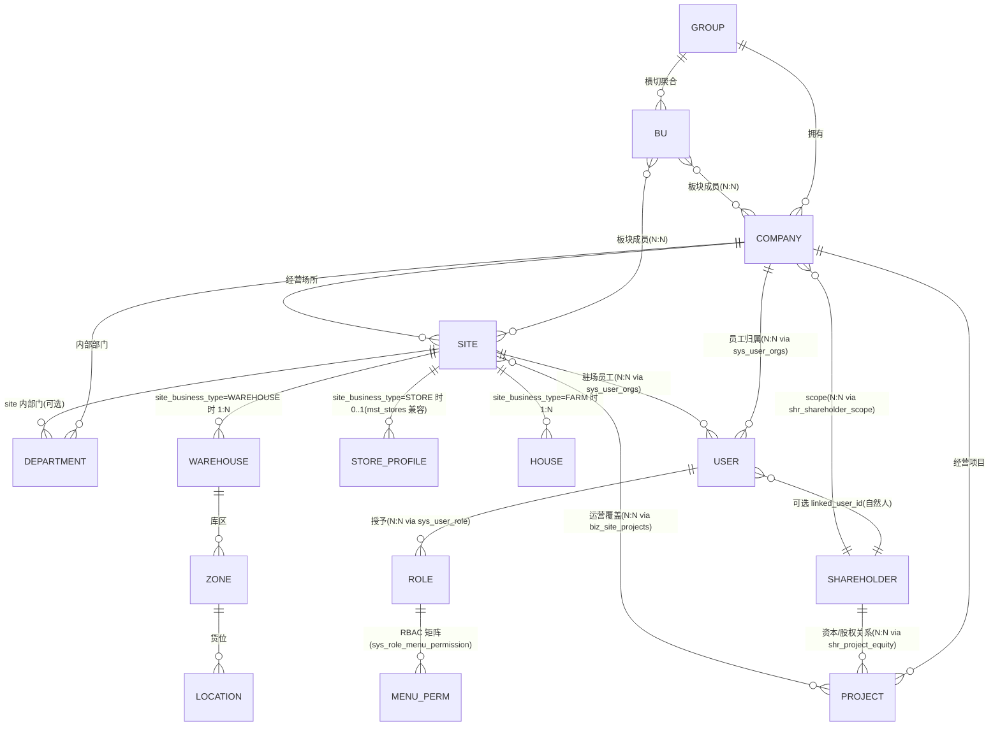
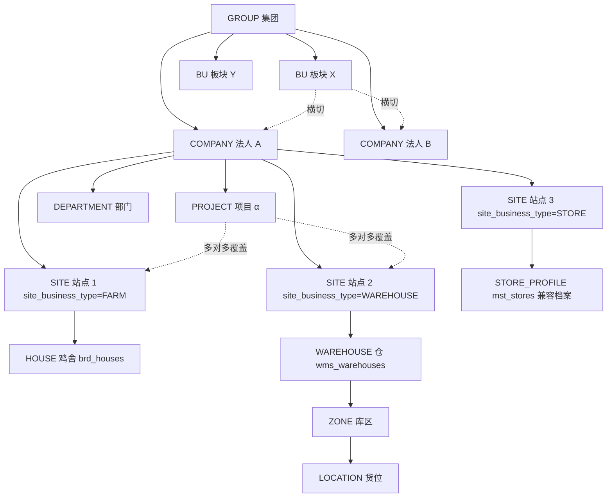
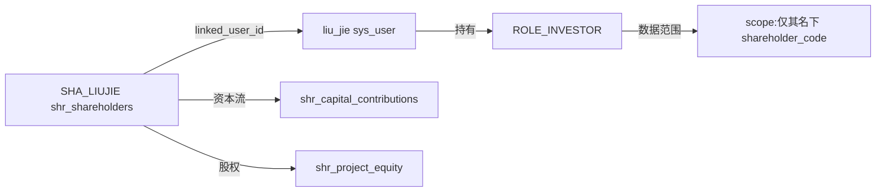
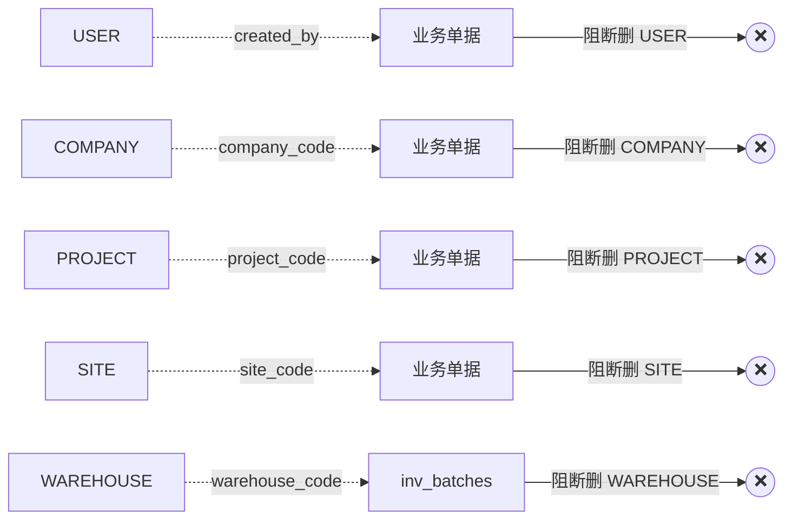
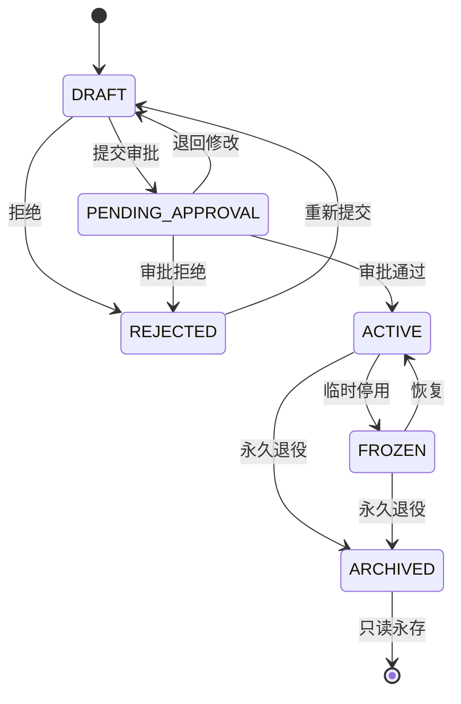

# M1 · 组织模型（架构冻结版）

> 编排人：Architect / MasterData Agent（feature/agent-architect-masterdata）
> 日期：2026-06-20
> 阶段：**Architecture Freeze**（架构冻结）
> 上游：
> - `docs/MASTER_DATA_PHASE2_DESIGN.md`（母规划）
> - `docs/MASTER_DATA_PHASE2_REVIEW.md`（Audit 评审）
> - `docs/MASTER_DATA_W4_EXECUTION_PLAN.md`（W4 落地）
> - `docs/MASTER_DATA_W4_REVIEW.md`（Audit W4 决议，§2.2 SITE 子类化冲突）
> - `docs/WAVE1_ACCEPTANCE_REVIEW.md`（W1 验收 / W5 准入）
>
> 本文件是**所有后续 wave 的强制参考基线**。一旦任何 service / migration /
> Selector / 前端表单与本文件冲突，**先回到本文件评审更新**，再做实施。
> 本阶段不写代码、不动 migration、不动业务流程。

---

## 0. 文档地位与冻结范围

### 0.1 架构冻结含义

| 类型 | 冻结 / 不冻结 |
|---|---|
| 10 类实体的**语义**（是什么 / 不是什么） | **冻结** |
| 10 类实体的**唯一编码规则** | **冻结** |
| 父子层级与 cardinality | **冻结** |
| 删除 / 归档状态机 | **冻结** |
| 未来 5 年扩展方向 | **冻结**（不允许在不进入"扩展评审"的情况下偷偷开新方向） |
| 物理表与列名 | **不冻结**（可在后续 wave 落迁移调整，但**语义对齐本文件**） |
| service / controller / 前端实现 | **不冻结**（按 wave 计划落地） |
| 现有 W4 seed 中 STORE/FACTORY/WAREHOUSE 三行的归属 | **本文件决议**（详 §5、§6、§7） |

### 0.2 与 W4 落地的关系

W4 已落 `sys_organization_type_rules` 表 + 9 条 seed。本文件**修正** Audit W4
评审 §2.2 的 SITE 子类化口径，并定下：
- `sys_organizations.org_type` 真值收敛到 **6 类**：GROUP / BU / COMPANY / SITE / DEPARTMENT / PROJECT
- STORE / FACTORY / WAREHOUSE 是 **`site_business_type` 子类**（不是 `org_type`）
- W4 seed 中的 STORE / FACTORY / WAREHOUSE 3 行 → M3 子文档给迁移路径（W5+ 合并到 SITE 行）
- W4 seed 中 DEPARTMENT 行的 `allowed_parent_types` 当前为 `['COMPANY', 'SITE']`，**缺 `'DEPARTMENT'` 自嵌套**；W6 type_rules service 接入前必须独立 TS 迁移 UPDATE → 含 `'DEPARTMENT'`（详 §8.2 C-1 决策）

### 0.2.1 C-1 ~ C-7 决策合入

本文件 v2 已合入 Audit M1 评审 §6.2 提出的 7 项条件决策（详
`docs/M1_ORGANIZATION_MODEL_DECISIONS.md`）：

| 决策编号 | 主题 | 合入章节 |
|---|---|---|
| C-1 | DEPT 嵌套环检测约束 | §8.2 末段 |
| C-2 | DataScope 5 步合并算法 | §11.5 末段 |
| C-3 | scope 严格只看显式绑定 | §9.7（新增） |
| C-4 | biz_projects.company_code 不可变（ACTIVE 后） | §4.1 末段 |
| C-5 | PROJECT 必属唯一 COMPANY | §3.2 / §4.1 / §5.5 |
| C-6 | mst_stores ↔ SITE status service 单点写 | §7.5 末段 |
| C-7 | sys_organizations PROJECT/WAREHOUSE 占位行保留 + 只读化 + UPDATE 白名单 | §4.2 / §6.2 |

变更明细见 `docs/M1_ORGANIZATION_MODEL_CHANGELOG.md`。

### 0.3 用户拍板 4 条的最终入模

| 拍板项 | 本文件落点 |
|---|---|
| #1 仓库 ≠ site；库存 / FIFO / 批次 / 库位用 `warehouse_code` | §6 仓库独立 canonical（`wms_warehouses`）；§5 SITE 子类 `WAREHOUSE` 仅作为"承载仓库的物理地点"，不是库存维度 |
| #2 门店 = `SITE-*-STORE`；`mst_stores` 是兼容台账 | §7 门店主身份在 SITE；`mst_stores` 退化为业务档案（M5 退役清单） |
| #3 鸡舍必属 site；`brd_houses.site_code` 加 FK | §5.2 SITE 子类 `FARM` 下挂 `brd_houses`，1 site : N houses，1 house : 1 site；`brd_houses.site_code` FK 约束 DDL 与回填脚本由 M3 子文档单独定稿 |
| #4 shareholder scope 不并入 sys_user_scopes | §11 股东 scope 独立 `shr_shareholder_scope`；DataScope 输出可统一暴露 `allowedShareholderCodes`，底层表不合 |

---

## 1. 总览：10 类实体的关系全景

### 1.1 实体关系图（Mermaid ER）



> 注：`STORE_PROFILE`、`HOUSE` 不是顶级实体，是 SITE 子类下属的运营档案 /
> 物理资产记录；在物理表上分别对应 `mst_stores`（兼容台账）与 `brd_houses`。

### 1.2 顶层层级图（Mermaid flowchart）



### 1.3 三层分离原则（核心心智模型）

| 层 | 主问题 | canonical code | 物理表 |
|---|---|---|---|
| 法人层 (Legal) | 签合同 / 开发票 / 报税 / 出资 | `company_code` | `sys_organizations(org_type=COMPANY)` |
| 经营层 (Operating) | 算项目利润 / 归集成本 / 出经营报表 | `project_code` | `biz_projects` |
| 物理层 (Physical) | 物在哪 / 谁在那干 / 鸡在哪养 / 货从哪发 | `site_code` + `warehouse_code` + `house_code` | `sys_organizations(org_type=SITE)` + `wms_warehouses` + `brd_houses` |
| 横切层 (Cross-cutting) | 板块汇总 / BI 切片 / SoD | `bu_code` | `biz_business_units` |
| 治理层 (Governance) | 谁能干什么 / 看到什么 | `user_id` + `role_code` + scope | `sys_user` + `sys_role` + `sys_user_orgs` + `sys_user_*_scopes` |
| 资本层 (Capital) | 谁出资 / 持有多少股权 / 分多少红 | `shareholder_code` | `shr_shareholders` |

判别口诀：**签合同看法人 → 算利润看项目 → 物在哪看 site/warehouse → 板块汇总看 BU → 谁能看什么看 user×role×scope → 谁出资看 shareholder**。

---

## 2. 集团组织模型 (GROUP)

### 2.1 性质

集团是组织树的**唯一根节点**。它**不是**法人，**不**签合同，仅作为：
- BI 报表合并最上层
- 顶层数据聚合（如"凤凰系总现金 / 总应收 / 总产蛋"）
- 多公司股权穿透起点

凤凰 ERP 现阶段集团节点 = "凤凰农业（集团）" 单根。未来可扩多根（详 §15.5）。

### 2.2 canonical 与父子

- 物理表：`sys_organizations`，`org_type='GROUP'`
- `parent_id` = NULL（树根）
- 子节点：`COMPANY`、`BU`（不允许直接挂 SITE / DEPARTMENT / PROJECT）

### 2.3 唯一编码规则

```
GROUP-{NAME_SHORT}
例:GROUP-FENGHUANG（凤凰系顶层）
```

- 前缀必须 `GROUP-`
- `GROUP-` 之后段 ≤ 32 字符，全大写 ASCII + 数字 + 短横
- 全集团**唯一**（即使将来引入跨国系列，按国家码区分：`GROUP-LAO-FENGHUANG`）

### 2.4 删除策略

❌ **永禁物理删除**。一旦建立即长存，最多 `status='ARCHIVED'`，不允许从层级树移除。

### 2.5 归档策略

🟡 **不归档**。GROUP 是 BI 维度根；归档会让历史报表的"集团合并"维度断裂。

---

## 3. 公司 (COMPANY) — 法人主体

### 3.1 性质

公司是**法律实体**，承担：
- 签合同（采购、销售、雇佣）
- 开 / 收发票（AP/AR）
- 出资 / 银行账户 / 税务申报
- 财务最高聚合维度

每一行 AP/AR/Cash/Bank/Payroll 必须**强制**关联一个 `company_code`。

### 3.2 canonical 与父子

- 物理表：`sys_organizations`，`org_type='COMPANY'`
- `parent_id` → GROUP
- 子节点允许：`SITE`、`DEPARTMENT`、`PROJECT`（树形挂载，但 PROJECT 还有 canonical `biz_projects`）
- 不允许子节点：`BU`、`COMPANY`、`GROUP`（多级子公司另立扩展机制，详 §15.2）

**与 PROJECT 的对偶约束（C-5 决策）**：每个 `biz_projects` 行**必属唯一 COMPANY**
（`biz_projects.company_code` 单一值，NOT NULL）。跨法人经营 = 多 project 并存 +
BU 横切汇总，**永禁**多法人合资 project 写入同一 project 行（详 §4.2）。

### 3.3 唯一编码规则

```
COMP-{COUNTRY_ISO}-{BUSINESS_FUNC}
例:
  COMP-LAO-AGRI       老挝凤凰农业发展有限公司
  COMP-LAO-FOOD       老挝凤凰食品集团有限公司
  COMP-LAO-XINGCHI    金三角星驰养鸡场
  COMP-CN-HQ          国内总部（如新建）
```

- 前缀必须 `COMP-`
- 国家段：CN / LAO / TH / VN / 其它 ISO-3166 alpha-3 简写
- 业务段：AGRI / FOOD / FEED / TRADING / SCM / HQ 等大类
- 历史旧编码（`LPH` / `CO-FHA` 等）走 `biz_site_aliases.alias_type='LEGACY_COMPANY_CODE'` 映射，**不允许**新建用旧形态

### 3.4 业务表必填关系

| 业务模块 | 是否必带 company_code |
|---|---|
| AP / AR / Cash / Bank / Payroll / 报销 | ✅ 必填 |
| 采购 PR / PO / 收货 / 付款 | ✅ 必填 |
| 销售 SO / 配送 / 退货 / 收款 | ✅ 必填 |
| 库存 inv_batches / wms_inbound / wms_outbound | ✅ 必填（W6 后 `owning_company_code`） |
| 工作流 wf_instance | ✅ 必填 |
| 主数据（customer / supplier / project / store / cash_account / bank_account） | ✅ 必填（隔离维度） |
| 主数据（material / product / sku / grade / spec） | ❌ 集团共享 |
| BI 分析表 | ✅ 必填 |

### 3.5 删除策略

❌ **永禁物理删除**。COMPANY 一旦发出即长存；即使法人注销也保留 ARCHIVED 行供历史报表查询。

### 3.6 归档策略

| 状态 | 含义 | 可建新单据 | 可读历史 |
|---|---|---|---|
| ACTIVE | 正常法人 | ✅ | ✅ |
| FROZEN | 暂停业务（如税务暂停） | ❌（前端 Selector 不显示） | ✅ |
| ARCHIVED | 永久退役（如清算注销） | ❌ | ✅ |

状态机：`ACTIVE ⇄ FROZEN`；`* → ARCHIVED`（不可逆，需双签）。

---

## 4. 项目 (PROJECT) — 经营主体

### 4.1 性质

项目是**经营核算单元**：
- 业务损益归集（"孟赛蛋鸡场项目本月利润"）
- 股东出资归集（"该项目股东实缴 XXX"）
- 跨 site 的成本归集（一个项目可能横跨"蛋鸡场 + 屠宰场 + 食品工厂"——但**法人维度仍单一**）
- 工作流 byProjectManager 审批人解析依据

⚠️ **唯一 canonical = `biz_projects`**。`shr_projects` 在 W6 退化为 `shr_project_attrs`（仅资本/股权附加字段，外键 biz_projects）；`prc2_projects` 在 W8 与 workflow.byProjectManager 同步切走。

**`biz_projects.company_code` 不可变（C-4 决策）**：

| 项目状态 | company_code 是否可改 |
|---|---|
| DRAFT | ✅ 可改（自由修正归属公司） |
| PENDING_APPROVAL | ✅ 可改（审批人退回 DRAFT 后） |
| ACTIVE | ❌ **永禁** |
| FROZEN | ❌ **永禁** |
| ARCHIVED | ❌ **永禁** |
| REJECTED | ✅ 可改（重新提交前） |

**业务重组标准做法**（如"孟赛蛋鸡场"从 COMP-LAO-AGRI 转 COMP-LAO-XINGCHI）：
1. 旧项目 `PRJ_MENGSAI_LAYER` → `status='ARCHIVED'`（历史 AP/AR/Cash 流水的 company_code 保持原值，永不可改）
2. 新建 `PRJ_MENGSAI_LAYER_V2`（或新命名）→ company_code = COMP-LAO-XINGCHI
3. 历史报表合并：BI 层通过"项目族"维度关联（远期 §14.6 数据湖）

W5 落 service update path 校验拒改 + W5 末 DB trigger 保险。

**PROJECT 必属唯一 COMPANY（C-5 决策）**：`biz_projects.company_code` 单一值，
**永禁**多法人合资 project。跨法人经营场景：
- **多 project 并存**：每法人各建独立 project，分别核算
- **BU 横切汇总**：通过 `biz_business_units` + `biz_bu_membership` 在 BU 层做合并报表

W5 起 biz_projects 扩列方案中不为"多公司项目"留 schema 扩展位；超出范围
需走扩展评审（§15.2）。

### 4.2 canonical 与父子

- 物理表（canonical）：`biz_projects`
- 物理表（org 树占位）：`sys_organizations`，`org_type='PROJECT'`（详 C-7 占位行决议见下）
- `biz_projects.company_code` NOT NULL **且单一**（C-5 决策，详 §4.1）
- 一个 project 可服务多个 SITE → via `biz_site_projects(site_code, project_code)` 桥表（W4-late / W5 新增）
- 一个 SITE 可服务多个 project（同上桥表）
- 但每个 project 自己仍只挂一个 company

**sys_organizations(org_type='PROJECT') 占位行（C-7 决策）—— 保留 + 只读化**：

| 项 | 决策 |
|---|---|
| 现存占位行 | **保留**（status='ACTIVE' / 'FROZEN' / 'ARCHIVED' 各自延续） |
| 新建占位行（W6+） | **永禁**（type_rules service 接入后硬阻；W5 软警告） |
| 占位行物理 DELETE | **永禁**（与 §12 删除策略一致） |
| 占位行 UPDATE 白名单 | 仅允许改以下字段：`status` / `org_name` 中文别名 / `org_name_cn` / `org_short_name` / `manager_user_id` / `manager_name` / `remark` / `sort_order` |
| 占位行 UPDATE 黑名单 | **禁改**：`org_code` / `parent_id` / `company_code` / `org_type` / `level` / `path`（这些一旦发布即不可变） |
| canonical 主权 | 永远在 `biz_projects`；占位行仅作 org 树展示与 manager_user_id 追溯 |

### 4.3 唯一编码规则

```
PRJ_{SITE_OR_BUSINESS_SHORT}_{SCOPE}
例:
  PRJ_MENGSAI_LAYER       孟赛蛋鸡场经营项目
  PRJ_DONGPENG_LAYER      东鹏蛋鸡场经营项目
  PRJ_VTE_FOOD_FACTORY    万象食品工厂项目
  PRJ_MENGSAI_ORGANIC     孟赛有机肥项目
```

- 前缀必须 `PRJ_`（下划线，不是短横；与 dictionary code 风格区分）
- 原则上 1 project ↔ 1 主 site，共享 site 走桥表
- 命名一旦发布**永不重命名**；废止改 `status='ARCHIVED'`

### 4.4 删除策略

❌ **永禁物理删除**。项目即使中止，财务流水 / 股东实缴 / 历史报表仍依赖。

### 4.5 归档策略

| 状态 | 含义 | 可建新单据（绑此项目） | 历史可读 |
|---|---|---|---|
| DRAFT | 立项中 | ❌ | ✅ |
| PENDING_APPROVAL | 待审批 | ❌ | ✅ |
| ACTIVE | 在建 / 运营 | ✅ | ✅ |
| FROZEN | 暂停（如资金链断、季节性停产） | ❌ | ✅ |
| ARCHIVED | 永久退役（清算 / 转让） | ❌ | ✅ |
| REJECTED | 立项被拒 | ❌ | ✅ |

`DRAFT → PENDING_APPROVAL → (ACTIVE | REJECTED)`；`ACTIVE ⇄ FROZEN`；`* → ARCHIVED`。

---

## 5. 站点 (SITE) — 物理地点

### 5.1 性质（架构冻结决议）

> **本节决议** Audit W4 评审 §2.2 文档级口径冲突。

SITE 是**所有物理运营发生地**的统一抽象，覆盖：
- 养殖场（蛋鸡 / 肉鸡 / 孵化）
- 工厂（饲料 / 屠宰 / 食品加工 / 有机肥）
- 仓库（承载 wms_warehouses 行）
- 门店（POS 销售点）
- 办公室

**口径冻结**：
- `sys_organizations.org_type='SITE'` —— 单一 org_type
- `sys_organizations.site_business_type` —— 子类区分（FARM / BROILER / HATCHERY / FACTORY / WAREHOUSE / STORE / OFFICE）
- W4 seed 中 `STORE / FACTORY / WAREHOUSE` 三行作为独立 org_type 是**过渡态**；M3 子文档将给"合并到 SITE 单行 + 加 sub-rules 表"的迁移路径

### 5.2 SITE 子类（site_business_type）冻结清单

| 子类 | 含义 | 与运营 canonical 的关系 |
|---|---|---|
| FARM | 蛋鸡养殖场 | 下挂 `brd_houses`（鸡舍）+ `brd_flocks`（鸡群）+ `brd_daily_logs`（日报） |
| BROILER | 肉鸡养殖场 | 同上 |
| HATCHERY | 孵化场 | 下挂 brd_houses + 孵化专用流程表 |
| FACTORY | 工厂（饲料 / 屠宰 / 食品 / 有机肥） | 下挂生产 / 加工记录表 |
| WAREHOUSE | 仓库性质 site | 1 site : N `wms_warehouses`（user 拍板 #1） |
| STORE | 门店性质 site | 1 site : 0..1 `mst_stores`（兼容档案，user 拍板 #2） |
| OFFICE | 办公室 | 无运营 canonical，仅作为人员驻地 / 报销发生地 |

> 子类列表本文件冻结；新增子类必须走"扩展评审"流程（§15.7）。

**`brd_houses.site_code` FK 收口（用户拍板 #3，2026-06-20）**：

- 一个鸡舍 **必属唯一一个** site_business_type ∈ {FARM, BROILER, HATCHERY} 的 SITE
- 一个 SITE 可下挂 0~N 个 `brd_houses`（1 : N）
- W5+ schema 改造：`brd_houses` 加 `site_code` 列（NOT NULL）+ FK → `sys_organizations(org_code)`（带"org_type=SITE AND site_business_type IN (FARM, BROILER, HATCHERY)"业务约束，service 层校验）
- 历史 `brd_houses` 行通过 `farm_code → biz_site_aliases (alias_type='FARM_CODE') → site_code` 桥接回填
- 鸡舍 `house_code` 不可随 SITE 改名而漂移（§5.4 编码规则中 SITE_SHORT 段允许与 SITE 当前名错位，但 house_code 一旦发布永不可重命名）
- FK 约束的 DDL 与回填脚本由 M3 子文档单独定稿，本 wave 不动 schema

C-1~C-7 决策书不直接覆盖拍板 #3，但本节明文承诺 W5+ M3 子文档完成 FK 落地。

### 5.3 canonical 与父子

- 物理表：`sys_organizations`，`org_type='SITE'`，`site_business_type ∈ §5.2`
- `parent_id` → COMPANY（必填）
- 子节点允许：`DEPARTMENT`（site 内部门）
- 不允许子节点：`SITE`（不嵌套）、`COMPANY`、`PROJECT`、`BU`、`GROUP`

### 5.4 唯一编码规则

```
SITE-{LOCATION_SHORT}-{TYPE_SUFFIX}
例:
  SITE-MENGSAI-LAYER      孟赛蛋鸡养殖场      site_business_type=FARM
  SITE-MENGSAI-HATCHERY   孟赛孵化场          site_business_type=HATCHERY
  SITE-MENGSAI-ORGANIC    孟赛有机肥厂        site_business_type=FACTORY
  SITE-DONGPENG-LAYER     东鹏蛋鸡养殖场      site_business_type=FARM
  SITE-VTE-FEED           万象饲料厂          site_business_type=FACTORY
  SITE-VTE-SLAUGHTER      万象屠宰加工厂      site_business_type=FACTORY
  SITE-VTE-WAREHOUSE      万象总仓所在地      site_business_type=WAREHOUSE
  SITE-VTE-STORE-01       万象 1 号门店       site_business_type=STORE
  SITE-VTE-OFFICE         万象办公室          site_business_type=OFFICE
```

- 前缀必须 `SITE-`
- 地点段：地名短码（MENGSAI / DONGPENG / VTE / LB / TH-BKK 等）
- 类型后缀：LAYER / BROILER / HATCHERY / FEED / SLAUGHTER / ORGANIC / FACTORY / WAREHOUSE / STORE / OFFICE
- **不允许**沿用 `LPH_*` / `FARM-*` 等历史 farm_code 风格做新建
- 历史 farm_code / store_code 走 `biz_site_aliases` 映射

### 5.5 与项目的关系

- 一个 SITE 可被多个 PROJECT 共用（如"孟赛蛋鸡场"同时挂"蛋鸡养殖项目"+"研发观察项目"）
- 一个 PROJECT 可覆盖多个 SITE（如"万象食品工厂项目"覆盖屠宰场 + 食品厂）
- 关系桥表：`biz_site_projects(site_code, project_code, weight_pct, is_primary)`
- 单 site 项目快捷字段：`biz_projects.site_code`（W5 新增 nullable，与桥表权威关系：**桥表 is_primary=true 那一行权威**，`biz_projects.site_code` 是冗余冷字段）

**与 C-5 决策一致**：`biz_site_projects` 桥表允许"多公司的 project 共用同一 site"
（例：万象总仓同时服务 PRJ_VTE_AGRI 与 PRJ_VTE_FOOD），但每个 project 仍只挂
一个 company。site × project 跨多公司是**允许的桥表组合**，project × company
跨多公司是**禁止的写入**。

### 5.6 删除策略

❌ **永禁物理删除**。site 关闭即 `status='ARCHIVED'`。

### 5.7 归档策略

| 状态 | 含义 | 可建新单据（绑此 site） | 历史可读 |
|---|---|---|---|
| ACTIVE | 运营中 | ✅ | ✅ |
| FROZEN | 暂停（如停产、节庆假期） | ❌ | ✅ |
| ARCHIVED | 永久退役（拆除 / 转让） | ❌ | ✅ |

SITE 子类（site_business_type）一旦发布**不可更改**——一个 FARM 不能改为 STORE。
如需"转产"，必须 ARCHIVE 旧 site + 新建另一个 site_code。

---

## 6. 仓库 (WAREHOUSE) — 独立 canonical

### 6.1 性质（user 拍板 #1）

**仓库 ≠ site**。site 是地点，仓库是 site 内的**库存仓**。

- 一个 SITE（site_business_type=WAREHOUSE）下可有 1 个或多个仓库
- 库存 / FIFO / 批次 / 库位维度 = `warehouse_code`（不是 site_code）
- warehouse_code 下细分 `zone_code`（库区）和 `location_code`（货位）

### 6.2 canonical 与父子

- 物理表：`wms_warehouses`（canonical）
- 物理表（org 树占位）：`sys_organizations`，`org_type='WAREHOUSE'`（详 C-7 占位行决议见下）
- 父：site（W5+ 新增 `wms_warehouses.mapped_site_code` FK → `sys_organizations(org_code WHERE org_type=SITE)`）
- 子：`wms_zones`（库区）→ `wms_locations`（货位）

**sys_organizations(org_type='WAREHOUSE') 占位行（C-7 决策）—— 保留 + 只读化**：

与 §4.2 PROJECT 占位行完全同口径：

| 项 | 决策 |
|---|---|
| 现存占位行 | **保留**（status 各自延续） |
| 新建占位行（W6+） | **永禁**（type_rules service 接入硬阻；W5 软警告）；新仓必须走 `wms_warehouses` canonical |
| 占位行物理 DELETE | **永禁** |
| 占位行 UPDATE 白名单 | 仅允许改：`status` / `org_name` / `org_name_cn` / `org_short_name` / `manager_user_id` / `manager_name` / `remark` / `sort_order` |
| 占位行 UPDATE 黑名单 | **禁改**：`org_code` / `parent_id` / `company_code` / `org_type` / `level` / `path` / `warehouse_code` 关联 |
| canonical 主权 | 永远在 `wms_warehouses`；库存 / FIFO / 批次 / 库位 100% 走 canonical（user 拍板 #1） |

### 6.3 唯一编码规则

```
单仓 site:  warehouse_code = site_code，例:SITE-VTE-WAREHOUSE
多仓 site:  warehouse_code = WH_{COMPANY_SHORT}_{LOCATION}_{SEQ}
例:
  WH_LAO_VTE_01        万象 1 号仓
  WH_LAO_VTE_02        万象 2 号仓
  WH_LAO_MENGSAI_01    孟赛饲料仓
```

- 前缀 `WH_` 或与 site_code 同形
- `wms_warehouses.mapped_site_code` 必填（指向承载它的 SITE 行）
- warehouse_code 全集团唯一

### 6.4 维度对照

| 维度 | 字段 | 业务用途 |
|---|---|---|
| 物理地点 | `site_code` | "在哪里"，BI 切片 |
| 库存仓 | `warehouse_code` | 库存 / FIFO / 入出库台账 |
| 库区 | `zone_code` | 仓内大区（冷藏区 / 常温区） |
| 货位 | `location_code` | 仓内具体位置 |
| 批次 | `batch_no` | 库存批号 |

### 6.5 删除策略

❌ **永禁物理删除**。仓库一旦使用过即永存；空仓也只 ARCHIVED。

### 6.6 归档策略

| 状态 | 含义 | 可入库 | 可出库 | 历史可读 |
|---|---|---|---|---|
| ACTIVE | 正常运营 | ✅ | ✅ | ✅ |
| FROZEN | 暂停入库（仍可出库清空） | ❌ | ✅ | ✅ |
| ARCHIVED | 永久退役（必须先清零库存） | ❌ | ❌ | ✅ |

ARCHIVED 强约束：`SELECT SUM(qty) FROM inv_batches WHERE warehouse_code=X` 必须 = 0。

---

## 7. 门店 (STORE) — SITE 子类

### 7.1 性质（user 拍板 #2）

**门店 = SITE-*-STORE**，即 site_business_type='STORE' 的 SITE 行。
`mst_stores` 退化为 "**门店业务档案**"：保留经营类型、店长、联系电话等运营字段，
但**主身份 / company_code 隔离维度**走 SITE。

### 7.2 canonical 与父子

| 表 | 角色 | 备注 |
|---|---|---|
| `sys_organizations` (org_type=SITE, site_business_type=STORE) | **主身份 canonical**（门店编码、name、company_code） | 唯一权威 |
| `mst_stores` | **运营档案 sidecar**（store_name 中文、operation_type、contact、phone、manager） | 1:1 挂在 SITE 上，主键约定与 SITE.org_code 对齐 |
| `biz_store_daily_close` | 门店日结业务表 | site_code 维度 |
| `sal_store_sales` | POS 销售单 | site_code 维度（W6 改名）|
| `sys_store` | V2 历史表 | M5 退役清单（`/api/master/stores` 同步退役） |

### 7.3 唯一编码规则

```
SITE-{LOCATION_SHORT}-STORE-{SEQ?}
例:
  SITE-VTE-STORE-01        万象 1 号门店
  SITE-VTE-STORE-02        万象 2 号门店
  SITE-MENGSAI-STORE       孟赛厂门口直营店
```

- 前缀必须 `SITE-`，类型后缀必须含 `-STORE`
- 多门店同地点用 `-{SEQ?}` 后缀
- 历史 `MS-STORE-*` 等编码进 `biz_site_aliases (alias_type='STORE_CODE')`
- ❌ 不允许新建以 `STR-` / `STORE-` 开头的非 SITE 风格 store_code

### 7.4 删除策略

❌ **永禁物理删除**。门店关闭即 ARCHIVED。

### 7.5 归档策略

| 状态 | 含义 | 可 POS 销售 | 历史可读 |
|---|---|---|---|
| ACTIVE | 营业中 | ✅ | ✅ |
| FROZEN | 装修 / 停业整顿 | ❌ | ✅ |
| ARCHIVED | 永久关门 | ❌ | ✅ |

`mst_stores` 行的 status 与 SITE.status **强制同步**。

**同步责任分配（C-6 决策）—— service 单点写**：

1. **主写入点**：`sys_organizations` 行（org_type=SITE, site_business_type=STORE）
2. **mst_stores 直写 status 禁止**：
   - 任何 status 变更（freeze / archive / restore）走 master-data-runtime 的
     SITE 路径；service 在同事务内级联更新 mst_stores.status
   - 任何 raw SQL / ORM API 直接 UPDATE `mst_stores.status` → PR review 阻拦
3. **mst_stores 的非 status 字段**（store_name / operation_type / contact /
   phone / manager）仍可独立 CRUD（运营档案语义），不触 SITE
4. **不用 DB trigger**：DB trigger 难审计且会与 W6 service 改造产生竞争；
   单点写在 service 层实现，配合 logger.info / sys_audit_log 落审计
5. **责任分配**：
   - 方案出稿：Architect（master-data-runtime/store 改造）
   - 落地：Architect 主，ERP 复审 POS / 日结路径不会绕过
   - 落地波次：W6（依赖 M3 子文档定稿）
6. **W5 期间**：扫描现存 `mst_stores.status` 与 SITE.status 差异行，由
   Architect / ERP 共同评估"以 SITE 为准回填"还是"以 mst_stores 为准升 SITE"

---

## 8. 部门 (DEPARTMENT)

### 8.1 性质

部门是**公司内 / site 内的组织划分**，用于：
- HR：员工编制
- 流程发起人 / 审批节点（"由财务部审批"）
- 报销 / 申购的成本归属
- 工作流 `byDepartmentRole`（远期能力，目前未实现）

部门**不是**财务隔离维度（财务隔离仍走 company_code），仅作组织管理 / 流程路由用。

### 8.2 canonical 与父子

- 物理表：`sys_organizations`，`org_type='DEPARTMENT'`
- `parent_id` → `COMPANY` 或 `SITE`（部门可以挂在公司层，也可挂在 site 内）
- 子节点允许：嵌套 `DEPARTMENT`（多层部门：财务部 → 应收应付组 → 应收主管）
- 不允许子节点：其他所有 org_type

**嵌套环检测约束（C-1 决策）—— 三层防护**：

1. **最大嵌套深度 = 5**（含根 COMPANY/SITE）。例：`COMPANY → 一级部门 → 二级
   组 → 三级主管 → 四级文员` 已是极限；第 6 层服务侧拒。
2. **应用层 ancestor 环检测**：service 在 `parent_id` 写入 / 更新前必须遍历
   祖先链路，若链路含 self.id 立即拒绝并返回明确错误（哪个 id 闭环）。
3. **DB 层自环 trigger**：BEFORE INSERT / UPDATE 拒绝 `parent_id = id`（最小
   防线，与 service 双保险）。
4. **service 接入波次**：W5 落 service ancestor 检测 + 自环 trigger；W6
   type_rules service 接入时把"深度 ≤ 5 + 允许 parent 类型集"软警告 → 硬校验。
5. **W4 seed 勘误**（C-1 落地前置）：`sys_organization_type_rules` 中
   DEPARTMENT 行当前 `allowed_parent_types = ['COMPANY', 'SITE']`，**缺
   `'DEPARTMENT'` 自嵌套**。W6 type_rules service 接入**之前**必须独立 TS
   迁移 UPDATE 该行 → `['COMPANY', 'SITE', 'DEPARTMENT']`，否则 service 启用
   时会拒绝深度 ≥ 2 的部门嵌套，与本约束矛盾。该 seed UPDATE 由 Architect
   在 W5 / W6 范围内单独提案。
6. **path 物化列 / 多列 CHECK CONSTRAINT** 等优化延 W6+ 评估，本决策不强制。

### 8.3 唯一编码规则

```
DEPT-{COMPANY_SHORT}-{FUNC}
例:
  DEPT-LAO-FIN          老挝公司财务部
  DEPT-LAO-PRC          老挝公司采购部
  DEPT-LAO-SAL          老挝公司销售部
  DEPT-LAO-HR           老挝公司人事部
  DEPT-LAO-MS-OPS       老挝公司孟赛场运营组（site 内部门可加 site 段）
```

- 前缀必须 `DEPT-`
- COMPANY_SHORT：法人简称（LAO / CN / TH 等）
- 嵌套部门用更长的 FUNC 段（`-AP-SUB` 等）

### 8.4 删除策略

🟡 **允许在 DRAFT 阶段物理删除**（建错重来）；ACTIVE 之后禁删，只能 ARCHIVE。

### 8.5 归档策略

| 状态 | 含义 | 可作为审批节点 / 报销归属 | 历史可读 |
|---|---|---|---|
| DRAFT | 试建 | ❌ | — |
| ACTIVE | 运营 | ✅ | ✅ |
| ARCHIVED | 撤销 | ❌（流程实例已绑定的仍可走完） | ✅ |

部门归档不级联归档员工——员工被解绑后**必须**重新绑定到其他部门，否则报销 / 流程发起失败。

---

## 9. 用户 (USER)

### 9.1 性质

用户是**自然人在系统的登录身份**。一个自然人 1 个 user 行；不允许双账号。

### 9.2 canonical 与父子

- 物理表：`sys_user`
- 不在 org 树里（user 是 org 的成员而不是 org 节点）
- 多对多关系：
  - `sys_user_orgs(user_id, org_id, data_scope_level, is_primary, is_manager, position_title)` 用户 ↔ org
  - `sys_user_role(user_id, role_code)` 用户 ↔ 角色
  - `sys_user_project_scopes(user_id, project_code)` 额外项目范围
  - `sys_user_farm_scopes(user_id, farm_code)` 额外农场范围（W7+ 合并到 sys_user_site_scopes 或 sys_user_scopes，详母规划 §5.7）
  - `sys_user_warehouse_scopes(user_id, warehouse_code)` 额外仓库范围

### 9.3 唯一编码规则

```
username:全集团唯一,小写 ASCII + 数字 + 下划线,≤ 32 字符
例:
  liu_jie          财务总监
  wang_ceo         CEO
  song_mg          石嘴山场长
```

- 不允许中文 username
- 一个自然人一个 username；如调岗，角色 / scope 重新绑定，**不**新建 username
- 系统管理员预留 username = `admin`（不可作为自然人使用）
- 用户 status 状态机：`ACTIVE / FROZEN（离职等待复盘）/ ARCHIVED（永久离职）`

### 9.4 与其它实体的关系

| 关系 | 物理表 | 说明 |
|---|---|---|
| user ↔ company | `sys_user_orgs` (org 是 COMPANY) | 员工归属 |
| user ↔ site | `sys_user_orgs` (org 是 SITE) | 驻场员工 |
| user ↔ department | `sys_user_orgs` (org 是 DEPARTMENT) | 部门成员 |
| user ↔ role | `sys_user_role` | RBAC |
| user ↔ shareholder | `shr_shareholders.linked_user_id` | 自然人股东登录账号 |
| user 创建 record | 业务表 `created_by` 列 | 审计追溯 |

### 9.5 删除策略

❌ **永禁物理删除**。离职走 `status='FROZEN'`（停用账号），90 天后审核归档为 ARCHIVED。审计、created_by 反查依赖永存。

### 9.6 归档策略

| 状态 | 含义 | 能否登录 | created_by 追溯 |
|---|---|---|---|
| ACTIVE | 在职 | ✅ | ✅ |
| FROZEN | 离职待审 / 停用 | ❌ | ✅ |
| ARCHIVED | 永久离职 | ❌ | ✅ |

ARCHIVED 后用户名**保留唯一占用**（不可被新员工复用），避免审计混淆。

### 9.7 scope 继承策略（C-3 决策 —— 严格只看显式绑定）

**核心规则**：用户的 scope 范围**只看 `sys_user_orgs` 表中显式绑定的行 +
`sys_user_*_scopes` 4 张显式追加表**，**不沿 `sys_organizations.parent_id`
向祖先方向隐式继承**。

| 场景 | 含义 |
|---|---|
| 用户绑 DEPT-LAO-FIN（挂在 COMP-LAO-AGRI 下）| **不自动**获得 COMP-LAO-AGRI 的 company scope |
| 用户绑 SITE-MENGSAI-LAYER（挂在 COMP-LAO-AGRI 下）| **不自动**获得 COMP-LAO-AGRI 的 company scope |
| 想拿 COMPANY scope | 必须在 `sys_user_orgs` 显式建对应 org_type=COMPANY 的行 |
| 唯一例外 | ROLE_ADMIN 持 perm `'*'`（C-2 Step 1 短路）|

**理由**：
- 合规审计：审计员问"用户 X 为什么能看到 COMP-LAO-AGRI 应付？" → 一表查
  sys_user_orgs 即可回答；隐式继承需多层 parent_id 追溯
- 最小授权：财务隔离 / 数据保护合规要求；隐式继承违背
- service 一致性：W4 Review §3.4 已指出"service 各自选一种实现 → 同一用户在
  不同模块看到不同范围"，统一选严格语义一锅煮死

**UI 引导（前端责任）**：用户管理页绑 DEPT 时 UI 自动 prompt "是否同时绑该
DEPT 所属 SITE / COMPANY？"，避免管理员漏配多绑。后端算法不感知 UI，严格只
看绑定。

**实施波次**：W5 落 service 严格语义检查 + 跑现存 sys_user_orgs 扫描出
"只绑 DEPT 漏绑 COMPANY"用户清单交业务方；W7 sys_user_scopes 合表方案不引入
任何祖先继承语义。

---

## 10. 角色 (ROLE)

### 10.1 性质

角色是 **RBAC 权限聚合**：
- 不是 org 节点，不在树里
- 不是 user 属性的子集，而是 **N:N** 关系
- 一个 user 可持多个 role（多角色组合 = SoD 风险，G119 治理面板做检测）
- 角色定义"能做什么菜单 / CRUD 操作"；具体看到什么数据（哪个公司 / 项目 / 站点）由 DataScope 决定

### 10.2 canonical 与父子

| 物理表 | 含义 |
|---|---|
| `sys_role` | 角色主表（role_code, role_name, status, description） |
| `sys_user_role` | 用户 ↔ 角色 N:N |
| `sys_role_menu_permission` | 角色 ↔ 菜单 ↔ 权限位（V/C/E/D/A/X/*） |
| `sys_permission_set` + `sys_permission_set_item` | 权限集（可复用的菜单×权限位包） |
| `sys_user_permission_set` | 用户直接绑权限集（绕过角色，给"临时授权"用） |
| `sys_data_scopes` | 角色 ↔ 模块 ↔ scope_type（SELF/PROJECT/COMPANY/REGION/GROUP）默认规则 |

### 10.3 唯一编码规则

```
ROLE_{FUNC_AREA}_{LEVEL?}
例:
  ROLE_ADMIN                   超管(全权 '*')
  ROLE_SYSOPS                  系统运维
  ROLE_CEO                     集团总裁
  ROLE_FIN_CFO                 财务 CFO
  ROLE_FACTORY_ACCOUNTANT      场长会计
  ROLE_PRC_BUYER               采购员
  ROLE_DRIVER                  司机
```

- 前缀必须 `ROLE_`
- 功能段：FIN / PRC / SAL / WMS / FARM / HR / SYS / IT 等
- 等级段：CFO / MGR / OFFICER / DRIVER 等
- 全集团唯一；删除受 G117 治理保护（status='ARCHIVED'，禁物理删）

### 10.4 删除策略

❌ **永禁物理删除**。角色一旦发出，sys_user_role / sys_role_menu_permission 都依赖此 role_code 反查历史。

### 10.5 归档策略

| 状态 | 含义 | 可绑给新用户 | 已持有用户能否登录 |
|---|---|---|---|
| ACTIVE | 在用 | ✅ | ✅ |
| ARCHIVED | 退役 | ❌ | 🟡 见 G117 治理：登录时角色被忽略，但用户其它角色仍生效 |

---

## 11. 股东 (SHAREHOLDER)

### 11.1 性质

股东是**资本流向 / 持股关系**的主体。可以是：
- 自然人股东（通过 `shr_shareholders.linked_user_id` 关联 sys_user 的实际登录账号）
- 法人股东（关联 sys_organizations.COMPANY 行）
- 信托 / 持股平台（暂不细分，归"其他"）

### 11.2 canonical 与父子

| 物理表 | 含义 |
|---|---|
| `shr_shareholders` | 股东主档（shareholder_code, shareholder_name, type, linked_user_id, status） |
| `shr_project_equity` | 股东 ↔ 项目 ↔ 股权（projectCode, shareholderCode, equity_pct）|
| `shr_capital_contributions` | 股东 ↔ 项目 ↔ 实缴流水（含 attachment_urls） |
| `shr_beneficial_equity` | 名义 ↔ 实际持有人映射（projectCode + nominee + beneficial） |
| `shr_shareholder_scope` | **股东视角的范围**：哪些 company / project 该股东可见（**与 sys_user_*_scopes 是不同维度的实体**，user 拍板 #4） |

### 11.3 唯一编码规则

```
SHA_{NAME_SHORT}
例:
  SHA_LIUJIE         刘杰
  SHA_WANGWH         王玮华
  SHA_FENGHUANG_GP   凤凰系持股平台
```

- 前缀 `SHA_`
- 自然人 + 法人 + 平台共享同一命名空间
- 全集团唯一

### 11.4 与用户的关系



⚠️ 一个 shareholder **可以** linked_user_id = NULL（"暂未开通登录的股东"，如老挝当地持股人）。
此时该股东的 capital / equity 由"代为操作的财务"录入。

### 11.5 与 DataScope 的关系（user 拍板 #4）

**底层表**：股东 scope 走 `shr_shareholder_scope`，与 `sys_user_*_scopes` **独立**。

**输出层**：DataScope.resolve() 可以**统一**输出 `allowedShareholderCodes`：
- 对**有 linked_user_id 的股东登录账号**：从 `shr_shareholder_scope` 计算
- 对**普通员工**：从 `sys_user_role` + 角色配置 + shr_shareholder_scope 派生
- 算法：service 层组装，物理表不动

业务 service 直读 CLS `dataScope.allowedShareholderCodes`（W7+ DataScopeService 改造后），不感知底层来源差异。

**DataScope 合并算法承诺（C-2 决策，W7 实施）**：

DataScopeService.resolve(user) 输出统一 CLS 结构：
```
dataScope {
  isGlobal: boolean,
  allowedCompanyCodes: string[],
  allowedProjectCodes: string[],
  allowedSiteCodes: string[],
  allowedWarehouseCodes: string[],
  allowedShareholderCodes: string[],
}
```

**5 步合并算法定型**（任何 service 私造算法 = PR 不予合入）：

```
Step 1. 短路: 若 user 持 perm '*' 或 username='admin'
        → isGlobal = true; 其它字段不 resolve(返回 [])
        → return 终止

Step 2. 默认 scope_type:
        遍历 user×role 找 sys_data_scopes(role_code, module_code)
        → 得到该用户每个 module 的 default scope_type
          (SELF / PROJECT / COMPANY / REGION / GROUP)
        → 缓存为 defaultScopeByModule

Step 3. user×org 展开:
        遍历 sys_user_orgs(user_id, org_id, data_scope_level)
        每行解出该 org 的 (company_code, project_code, site_code, warehouse_code)
        按 data_scope_level 展开:
          SELF       → 仅当前 org
          PROJECT    → 同 project 下所有 org
          COMPANY    → 同 company 下所有 org
          REGION/GROUP → 见母规划 §3.3
        若 data_scope_level 缺失 → 回退到 Step 2 defaultScopeByModule
        ★ 严格 sys_user_orgs 显式行,不沿 parent_id 隐式继承(C-3 决策)

Step 4. 显式追加(union):
        sys_user_project_scopes  → allowedProjectCodes 取并集
        sys_user_farm_scopes     → allowedSiteCodes 取并集(W7 合 sys_user_site_scopes)
        sys_user_warehouse_scopes → allowedWarehouseCodes 取并集

Step 5. shareholder 独立(user 拍板 #4):
        if user.linked_user_id 命中 shr_shareholders.linked_user_id
          → 该 shareholder + shr_shareholder_scope 关联的扩展
        else
          → 从 sys_user_role + 角色配置(若有)派生
        ★ 不与 Step 4 union;allowedShareholderCodes 完全独立计算
```

**实施波次**：W5 落文档（本节）；W7 sys_user_scopes 合表 wave 实施
DataScopeService 改造 + 兼容期保留旧字段名 ≥ 1 wave。

### 11.6 删除策略

❌ **永禁物理删除**。股东退出（转让 / 退股）走 `status='ARCHIVED'`；历史出资 / 分红流水必须永存。

### 11.7 归档策略

| 状态 | 含义 | 可建新出资单据 | 历史可读 |
|---|---|---|---|
| ACTIVE | 持股中 | ✅ | ✅ |
| FROZEN | 暂停（如有法律纠纷） | ❌ | ✅ |
| ARCHIVED | 永久退出 | ❌ | ✅ |

---

## 12. 完整删除策略（横向汇总）

### 12.1 决策矩阵

| 实体 | 物理删除 | FROZEN | ARCHIVED | 备注 |
|---|---|---|---|---|
| GROUP | ❌ 永禁 | ❌ | ❌（不归档） | 历史 BI 维度根 |
| COMPANY | ❌ 永禁 | ✅ | ✅ | 双签 |
| PROJECT | ❌ 永禁 | ✅ | ✅ | — |
| SITE | ❌ 永禁 | ✅ | ✅ | site_business_type 不可改 |
| WAREHOUSE | ❌ 永禁 | ✅（停入） | ✅（先清零库存） | 库存非零禁 ARCHIVE |
| STORE (SITE) | ❌ 永禁 | ✅ | ✅ | mst_stores 状态同步 |
| DEPARTMENT | 🟡 DRAFT 可删 | — | ✅ | 已绑流程不级联 |
| USER | ❌ 永禁 | ✅（离职） | ✅（90 天后） | username 唯一占用永存 |
| ROLE | ❌ 永禁 | — | ✅ | G117 治理保护 |
| SHAREHOLDER | ❌ 永禁 | ✅ | ✅ | 资本流水永存 |

### 12.2 物理删除的唯一例外（白名单）

仅以下场景允许在受控环境物理删除：
1. **DRAFT 状态的草稿单据**（如填错的项目 / 部门）— 仅 DRAFT 状态，建立 < 24h
2. **测试 / UAT 环境数据**（DEV / UAT 环境的脚本兜底；不允许进生产）
3. **GDPR / 数据主体删除请求**（未来跨境业务可能触发；走单独"被遗忘权"治理流程，本文件不展开）

任何物理删除均需：
- 操作人持 ROLE_ADMIN 或 ROLE_SYSOPS
- 二次确认 + sys_audit_log 强制落日志
- 业务表 FK 阻断（PostgreSQL FK 不要 ON DELETE CASCADE）

### 12.3 跨实体 FK 删除阻断



---

## 13. 完整归档策略（横向汇总）

### 13.1 状态机统一



- 不允许 `ARCHIVED → ACTIVE`（不可"复活"，需新建 + 复制属性）
- 不允许跨级：必须经 ACTIVE 才能 FROZEN 或 ARCHIVED

### 13.2 哪些实体允许跳过审批直建 ACTIVE

| 实体 | 走审批 | 说明 |
|---|---|---|
| GROUP / COMPANY / PROJECT / SITE / STORE / WAREHOUSE / DEPARTMENT | ✅ 必经审批 | 影响财务 / 经营核算 |
| USER | ✅（招聘流程） | HR 配置 |
| ROLE | ✅ | 权限矩阵敏感 |
| SHAREHOLDER | ✅ | 资本 / 股权敏感 |
| SKU / 物料 / 等级 / 规格 / 司机 / 车辆 | ❌ 直建 ACTIVE | 运营类，找不到可就地新建（G92 规则） |

### 13.3 ARCHIVED 后保留期

| 实体 | 最少保留期 |
|---|---|
| 财务相关（COMPANY / PROJECT / SITE / WAREHOUSE / SHAREHOLDER） | 永久（≥ 法定财务凭证保留期 30 年，含税务追溯期） |
| 运营 / 治理（DEPARTMENT / ROLE / USER） | 7 年（≥ 一般审计追溯期） |
| 主数据辅助（鸡舍 brd_houses / 库区 / 货位） | 5 年（业务追溯需要） |
| 字典 / 配置 | 永久 |

### 13.4 冷热数据分层（未来规划，详 §15.6）

ARCHIVED 行长期堆积会拖慢主查询。预留分层方案：
- ACTIVE / FROZEN → 主表（热数据）
- ARCHIVED ≤ 5 年 → 同表保留（温数据）
- ARCHIVED > 5 年 → 物理迁移到 `*_archive` 表 + 主表只留 stub（冷数据）

---

## 14. 未来五年扩展策略

### 14.1 时间轴

| 时间窗 | 主题 | 方向 |
|---|---|---|
| **2026 H2 (本年)** | 主数据治理收尾 | W4-W10 wave 走完；M2/M3/M5 子文档定稿；site canonical 化完成 |
| **2027** | 跨境扩张 + 数据湖准备 | 新国家公司接入；BU 横切矩阵成熟；数据湖 readiness（详 §14.6） |
| **2028** | 多租户 / SaaS 化探索 | tenant_id 引入；GROUP 多根支持；定制业务规则配置化 |
| **2029** | 智能化 / IoT 全量接入 | site 绑定 IoT 设备；鸡舍传感器；冷链温度链；自动单据生成 |
| **2030** | 数据主权 / 合规深化 | GDPR 类合规框架；被遗忘权；数据湖归档冷库；零信任审计 |

### 14.2 跨境扩张（2027）

新国家进入时：
- 新建 `COMP-{NEW_COUNTRY}-{BUSINESS}`（如 `COMP-TH-AGRI`）
- 在 GROUP 下挂；不嵌套 COMPANY → 仍单层
- BU 横切板块：`BU-AGRI-CROSS-BORDER` 等
- 货币 / 汇率 / 税务规则：扩 sys_dict + fin_exchange_rates 加 company_code 维度

**不允许**：在 GROUP 之上再加根（除非真出现"集团之集团"，那时走 §14.5）。

### 14.3 子公司多级化（2027-2028）

如出现 "凤凰农业 → 老挝凤凰农业 → 老挝孟赛子公司" 三层：
- **扩展 `sys_organization_type_rules`**：新增 `org_type='SUBSIDIARY'`
- `COMPANY` 允许子节点 `SUBSIDIARY`
- 法律实体仍是各自 company_code，但报表合并维度增加 `parent_company_code`
- 财务 AP/AR 仍按各 company_code 隔离；BI 报表新增"母子公司穿透"

### 14.4 BU 横切矩阵（2027）

现状：BU 是简单"板块成员"。未来：
- BU 内部多维（产品板块 × 区域板块 × 客户类别板块）→ `biz_bu_dimensions` 表
- BU 绩效 KPI 落到表（人均产蛋 / 板块毛利率）
- BU 经理（manager_user_id）权限：可看本 BU 下所有 company 的部分财务报表

### 14.5 多租户 / SaaS 化（2028）

如果 ERP 对外开放（如同行兄弟养鸡场用同一套系统）：
- 引入 `tenant_id` 列（顶层 GROUP 之上的"租户"维度）
- 所有 sys_organizations / biz_* / fin_* / wms_* / sal_* / prc2_* / shr_* / sys_dict 业务表全部加 `tenant_id` NOT NULL
- DataScope 输出新增 `tenantId`（默认 1 = 凤凰自己）
- RBAC：超管降级为"租户超管"
- 此为重大架构演进，必须经"扩展评审"流程（§15.7）

### 14.6 数据湖 / BI 现代化（2027 起）

随着 ARCHIVED 累积：
- 引入 `*_archive` 表对应每张主数据 / 业务表
- ARCHIVED > 5 年 trigger 自动迁移
- BI 仓库（如 ClickHouse / DuckDB）作为查询代理
- 主库只承载 OLTP，主数据 / 历史报表走 BI

### 14.7 智能化 / IoT（2029）

每个 SITE 可绑定 N 个 IoT 设备：
- 新建 `iot_devices(device_code, site_code, type, status)`
- site_business_type=FARM 的 site 自动有传感器 / 摄像头 / 自动喂料机
- IoT 上行数据自动生成 brd_daily_logs 草稿（人工审核 ACTIVE）
- 主数据本身不变，仅扩展 site 的下属资产维度

### 14.8 GDPR / 被遗忘权（2030）

如业务跨入欧盟 / 个人数据敏感市场：
- USER / SHAREHOLDER 类自然人主数据增加"被遗忘权"流程
- 物理删除 sys_user 行 → 但保留 `sys_user_deleted_stub(user_id, deleted_at, reason)` 满足审计
- 业务表 `created_by` 列改为 stub 引用（不再 FK，避免冲突）
- 此为本文件冻结的"删除策略"的唯一未来例外，需走扩展评审

---

## 15. 文档治理与扩展评审

### 15.1 本文件的修订

- 任何修订必须**先评审再合入**：Architect 草稿 → Audit / ERP / Finance 评审 → 用户拍板 → 合入。
- 修订必须保留版本历史（git log；不允许 force push）。
- 物理表 / 列名调整不需要修订本文件（仅在 wave 实施文档体现）；语义 / 编码 / 关系调整必须修订。

### 15.2 扩展评审流程

新增 org_type / site_business_type / 实体类型，或调整删除/归档策略，触发"扩展评审"：
1. 提案文档 `docs/M1-EXT-<topic>.md`
2. Audit + 至少 2 个业务 Agent（如新增涉及 ERP / Finance，二者必须签字）
3. 用户拍板
4. 合入本文件并打 tag `v3-m1-ext-<topic>-YYYYMMDD`

### 15.3 与现有上游文档的关系

| 文档 | 与本文件关系 |
|---|---|
| `MASTER_DATA_PHASE2_DESIGN.md` | 本文件是 §1（统一模型）的**冻结升级版**，覆盖更细 |
| `MASTER_DATA_PHASE2_REVIEW.md` | §1.2 自洽问题 / §3.3-a shareholder 语义问题在本文件 §11 解决 |
| `MASTER_DATA_W4_EXECUTION_PLAN.md` | W4 已落 seed；本文件决议 STORE/FACTORY/WAREHOUSE 在 W5+ 合并到 SITE |
| `MASTER_DATA_W4_REVIEW.md` | §2.2 SITE 子类化冲突在本文件 §5.1 决议 |
| `WAVE1_ACCEPTANCE_REVIEW.md` | §8.2 C-3 (M3 子文档) 待 M3 单独定稿；本文件给 M3 充分语义基础 |

### 15.4 后续 wave 引用承诺

| Wave / 子文档 | 必须引用本文件的章节 |
|---|---|
| M2 (project consolidation) | §4 PROJECT + §5 SITE × project 关系 + §11 SHAREHOLDER × project 关系 |
| M3 (inv_batches / SITE 子类化迁移) | §5 SITE 子类决议 + §6 WAREHOUSE 独立 canonical + §7 STORE 是 SITE 子类 |
| M5 (master 模块退役) | §7 STORE mst_stores 退化 + §15.3 关系图 |
| W5 biz_projects 扩列 | §4.2 / §5.5 / §11.2 |
| W6 inv_batches 改造 | §6.4 维度对照（保留 warehouse_code 不变） |
| W7 sys_user_scopes 合表 | §9.2 scope 表清单 + §11.5 shareholder scope **不参与**合表 |
| W8 workflow.byProjectManager 切表 | §4.1 biz_projects 是唯一 canonical |

---

## 16. 用户决策需求（用户拍板汇总）

本文件冻结的所有内容已基于过往**已拍板**项；不再有新的待拍板项。新提案
（如多租户化 §14.5）走扩展评审流程（§15.2）。

| 决策 | 来源 | 本文件落点 |
|---|---|---|
| 仓库 ≠ site，库存维度用 warehouse_code | user 2026-06-20 拍板 #1 | §6 全节 |
| 门店 = SITE-*-STORE，mst_stores 是兼容档案 | user 2026-06-20 拍板 #2 | §7 全节 |
| brd_houses 必属 site，FK 强约束 | user 2026-06-20 拍板 #3 | §5.2 FARM 子类下挂 brd_houses |
| shareholder scope 不并入 sys_user_scopes | user 2026-06-20 拍板 #4 | §11.5 |
| sys_organizations.org_type 收敛为 6 类（含 SITE 单一） | 本文件 §0.2 决议 | §1.3 / §5.1 |
| STORE/FACTORY/WAREHOUSE 是 site_business_type 子类 | 本文件 §5.1 决议（解 W4_REVIEW §2.2） | §5.2 全表 |
| biz_business_units 是横切式 BU canonical；sys_organizations.BU 在 W8 退役 | 母规划 §1.1 + 本文件 §1.1 | §1.1 / §15.4 W8 |

---

**架构冻结生效日期：2026-06-20。**
**后续任何子文档（M2 / M3 / M5）必须以本文件为强制参考基线。**
