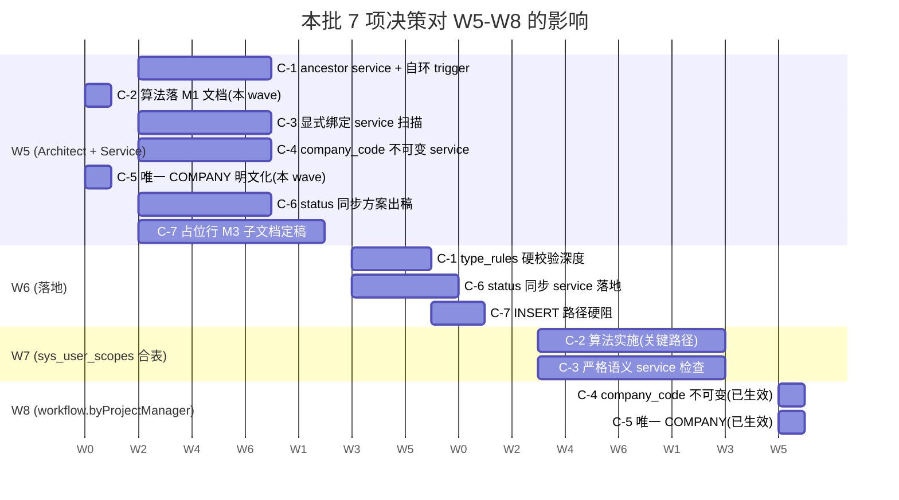

# M1 组织模型 · 决策拍板（C-1 ~ C-7）

> 编排人：Architect / MasterData Agent（feature/agent-architect-masterdata）
> 日期：2026-06-20
> 阶段：**Architecture Freeze 后续决策**
> 上游：
> - `docs/M1_ORGANIZATION_MODEL.md`（架构冻结版）
> - `docs/M1_ORGANIZATION_MODEL_REVIEW.md`（Audit §6.2 提出 C-1 ~ C-7）
> - `docs/MASTER_DATA_PHASE2_DESIGN.md`（母规划）
>
> 本文件**只做拍板建议**，不写代码、不动 migration、不动业务流程。
> 每一项必须在 W5 启动前合入 M1 主文件正文（由 Architect 单独 PR），本文件
> 作为决策依据保留。

---

## 0. 速读：7 项决策矩阵

| 编号 | 主题 | 推荐决策 | 立即执行项 | 冻结/延后项 |
|---|---|---|---|---|
| C-1 | DEPT 嵌套环检测 | **采纳 + 强化**：最大深度 ≤ 5；应用层 ancestor 环检测 + DB 层自环 trigger 双保险 | 本 wave 文档化；W5 落 service ancestor 检测 + 自环 trigger | path 物化列 / CHECK CONSTRAINT 延 W6+ |
| C-2 | DataScope 合并算法 | **完全采纳**：5 步算法（ADMIN '*' → sys_data_scopes 默认 → sys_user_orgs.data_scope_level 覆盖 → sys_user_*_scopes 并集 → shr_shareholder_scope 独立） | 本 wave 文档化进 M1；W7 实施合表时引用 | 全部冻结，不允许 service 私造算法 |
| C-3 | scope 继承策略 | **严格只看显式绑定**（Audit B 方案） + UI 绑 DEPT/SITE 时引导级联绑公司 | 本 wave 文档化；W5 service ancestor 检测时同步 | 隐式继承彻底禁止；ROLE_ADMIN '*' 唯一例外 |
| C-4 | biz_projects.company_code 不可变 | **采纳**：ACTIVE 之后不可改；业务重组走 ARCHIVE + 新建 | 本 wave 文档化；W5 service 改造（update path 禁 company_code）+ DB trigger 保险 | DRAFT/PENDING_APPROVAL 阶段允许改 |
| C-5 | PROJECT 必属唯一 COMPANY | **采纳**：biz_projects.company_code 单一；跨法人经营 = 多 project + BU 横切 | 本 wave 文档化；W5 biz_projects 扩列时不留扩展位 | 多法人 project 永禁；扩展需扩展评审 |
| C-6 | mst_stores ↔ SITE status 同步责任 | **service 单点写**：SITE 是主写入点；mst_stores 直写禁；不用 DB trigger | 本 wave 文档化；W5 service 改造（Architect 出方案 + ERP 协同落地） | trigger 方案彻底放弃 |
| C-7 | sys_organizations PROJECT/WAREHOUSE 占位行 | **保留 + 只读化**：占位行存在；canonical 主权在 biz_projects / wms_warehouses；占位行仅可改 status | 本 wave 文档化；M3 子文档定细则 | 物理删除占位行永禁；新建 sys_organizations.PROJECT/WAREHOUSE 行需走特批 |

---

## 1. C-1 — DEPT 嵌套环检测约束

### 1.1 推荐决策

**采纳并强化为三层防护**：

1. **最大深度 = 5**（含根节点 COMPANY/SITE 自身）。例如 `COMPANY/SITE → 一级部门 → 二级组 → 三级主管 → 四级文员` 已是极限。
2. **应用层 ancestor 环检测**：service 在 `sys_organizations.parent_id` 写入 / 更新前，必须遍历祖先链路，若链路含 self.id 立即拒绝。
3. **DB 层自环 trigger**：BEFORE INSERT/UPDATE 时拒绝 `parent_id = id`（最小防线，与 service 双保险）。

`path` 物化列（如 `"-1-25-37-"` 字符串）作为可选优化延后到 W6+ 评估，不在本决策范围。

### 1.2 原因

- Audit §2.2 已给出真实风险：`sys_organizations` 是 self-ref FK，DEPT 嵌套未保护即可成环，导致 service 递归遍历死循环 / 栈溢出。
- 5 层是业界通用上限（SAP / Oracle EBS / Workday 部门树几乎不超过 5 层），覆盖最复杂的"集团 → 公司 → 中心 → 部 → 室"组织。
- 自环（self-loop）是最常见的人为误操作（手填 parent_id = id），trigger 单条规则成本极低。
- ancestor 环检测在 service 层比 CHECK CONSTRAINT 更易携带错误信息（哪个 id 闭环），有利运维定位。

### 1.3 数据库影响

| 实体 | 影响 |
|---|---|
| `sys_organizations` | 加 BEFORE INSERT/UPDATE trigger 阻 `parent_id = id`；无新列、无新表 |
| `sys_organization_type_rules`（W4 已建） | seed 中 DEPARTMENT 行的 `allowed_parent_types` 已含 `['COMPANY', 'SITE']` + 自嵌套；本决策不改 seed，只在 service 接入 type_rules（W6+）时扩规则集 |
| 现存数据 | 必须在 W5 跑一次"现存 sys_organizations 已成环"扫描；若发现真实环（基于历史经验**不应有**，但需扫一遍），由人工修复 |

### 1.4 业务影响

| 场景 | 影响 |
|---|---|
| 创建嵌套部门 | service 在 5 层时报"已达最大嵌套深度"，UI 提示用户拆分组织 |
| 误填 parent_id = id | 立即被 trigger / service 拒，UI 提示 |
| 现有 ≤ 5 层数据 | ✅ 无影响 |
| 现有 > 5 层数据（极不可能） | 需要 Architect + 业务方共同评估是否拍扁 |

### 1.5 对后续 wave 的影响

| Wave | 影响 |
|---|---|
| **W5** | Architect 落 `service 层 ancestor 环检测` + `BEFORE INSERT/UPDATE trigger`；ERP / Finance 不动 |
| **W6** | type_rules service 接入时校验 DEPARTMENT 嵌套深度 ≤ 5（软警告 → 硬校验） |
| **W7** | sys_user_scopes 合表方案需引用本决策（多源 scope 解析时不递归祖先树） |
| **W8** | 无 |

### 1.6 立即执行 vs 冻结

**立即执行**（本 wave / W5）：
- 在 M1 §8.2 末段加约束文字（"DEPARTMENT 嵌套最大深度 5；service 必须做 ancestor 环检测；DB 自环 trigger 兜底"）
- W5 落 service ancestor 检测 + 自环 trigger（Architect 主，Audit 复审）

**继续冻结**（本 wave 不动，留 W6+ 评估）：
- `path` 物化列（性能优化，等真实出现"递归慢"问题再评估）
- 多列 CHECK CONSTRAINT 强约束（service + trigger 已够）

---

## 2. C-2 — DataScope 合并算法

### 2.1 推荐决策

**完全采纳 Audit §3.3 提出的 5 步算法**，写入 M1 §11.5（紧跟 shareholder scope 独立的承诺之后）。算法定型：

```
DataScopeService.resolve(user) → CLS dataScope {
  isGlobal: boolean,
  allowedCompanyCodes: string[],
  allowedProjectCodes: string[],
  allowedSiteCodes: string[],
  allowedWarehouseCodes: string[],
  allowedShareholderCodes: string[],
}

Step 1. 如果 user 持 perm '*' 或 username='admin'
        → isGlobal = true; 其它字段不 resolve(返回 [])
        → return 终止

Step 2. 由 user×role 找 sys_data_scopes(role_code, module_code)
        → 得到该用户每个 module 的 default scope_type
          (SELF / PROJECT / COMPANY / REGION / GROUP)
        → 缓存为 defaultScopeByModule

Step 3. 遍历 sys_user_orgs(user_id, org_id, data_scope_level)
        对每一行
          解出该 org 的 (company_code, project_code, site_code, warehouse_code)
          按 data_scope_level 展开:
            SELF       → 仅当前 org
            PROJECT    → 同 project 下所有 org
            COMPANY    → 同 company 下所有 org
            REGION/GROUP → 见母规划 §3.3 + Step 5
          产出 allowedCompanyCodes / allowedProjectCodes /
              allowedSiteCodes / allowedWarehouseCodes 的初步集合
        若 sys_user_orgs.data_scope_level 缺失 → 回退到 Step 2 defaultScopeByModule

Step 4. union sys_user_*_scopes 4 张表的"显式追加":
          sys_user_project_scopes  → allowedProjectCodes 取并集
          sys_user_farm_scopes     → allowedSiteCodes 取并集(W7+ 合 sys_user_site_scopes)
          sys_user_warehouse_scopes → allowedWarehouseCodes 取并集
          (sys_user_company_scopes 远期可加, 目前 sys_user_orgs 涵盖)

Step 5. allowedShareholderCodes 独立计算:
          if user.linked_user_id ∈ shr_shareholders.linked_user_id
            → 该 shareholder 自己 + 通过 shr_shareholder_scope 关联的扩展
          else
            → 从 sys_user_role + role × shareholder 配置(若有)派生
          (user 拍板 #4: 不与 Step 4 union)
```

### 2.2 原因

- W4 Review §3.3-b 已指出多源 scope 合并算法是 W7 合表的前置阻塞；不定义算法等于让每个 service 各自实现，已出现 finance-v2 `scopeAll/companyCodes` 错位（FINANCE_AUDIT §5.2）。
- 5 步顺序的核心是"默认 → 用户绑定 → 显式追加 → shareholder 独立"，与 G6 PBAC 模型 + 用户拍板 #4 一致。
- 取并集（不取窄）符合"用户预期能看到尽可能多"的业务直觉，又不破坏隔离（隔离边界由 module × company_code 必填 + Selector ACTIVE 过滤共同保证）。

### 2.3 数据库影响

| 实体 | 影响 |
|---|---|
| `sys_user_orgs` / `sys_user_*_scopes` / `sys_data_scopes` / `shr_shareholder_scope` | 算法不动 schema，仅规定读路径与合并方式 |
| `DataScopeService` 实现位置 | 仍在 `apps/api/src/modules/org/services/data-scope.service.ts`；W7 改造扩输出字段到 6 维 |

### 2.4 业务影响

| 场景 | 影响 |
|---|---|
| 现有用户登录 | ✅ 算法定型后输出与"old union"差异 ≤ 极少数边界用户（Audit §6.6 验收脚本可对比） |
| 新建用户 / 角色配置 | UI 暴露 5 步算法的输入：sys_user_orgs（含 data_scope_level） + 显式追加 scope 表 |
| 跨部门借调 | 借调用户在 sys_user_orgs 加新行（is_primary=false），默认拿到 SELF；想看更宽用 data_scope_level 调整 |
| ROLE_ADMIN 用户 | ✅ Step 1 短路，永远 isGlobal=true，无副作用 |

### 2.5 对后续 wave 的影响

| Wave | 影响 |
|---|---|
| **W5** | Architect 在 M1 §11.5 文档落算法；ERP/Finance 服务仍读现有 CLS（兼容期）|
| **W6** | 无直接影响 |
| **W7** | **关键**：sys_user_scopes 合表方案必须基于本算法；DataScopeService 改造输出 6 维 + 引用本算法 |
| **W8** | workflow.byProjectManager 切表后，audit DataScope 与 byProjectManager 双轨结果对账 |

### 2.6 立即执行 vs 冻结

**立即执行**（本 wave）：
- M1 §11.5 末尾新增"DataScope 合并算法（W7 实施承诺）"小节，整段贴 §2.1 算法伪代码

**冻结**：
- 任何 service 私造合并算法 = 与本决策冲突 = PR 不予合入
- W7 实施前不允许偷跑改 DataScopeService 输出字段

---

## 3. C-3 — scope 继承策略

### 3.1 推荐决策

**采纳 Audit B 方案：严格只看显式绑定**。

具体规则：
1. 用户绑 DEPT-X（挂在 SITE-Y 下） → **不**自动获得 SITE-Y 的 site scope
2. 用户绑 SITE-Y（挂在 COMP-Z 下） → **不**自动获得 COMP-Z 的 company scope
3. 想拿 SITE/COMPANY scope → 必须在 `sys_user_orgs` 显式建对应 org_type 的行
4. 唯一例外：ROLE_ADMIN 持 '*' → Step 1 短路（C-2 §2.1）
5. **UI 引导**：用户管理页绑 DEPT 时，UI 自动 prompt "是否同时绑该 DEPT 所属 SITE / COMPANY？"（前端 UX 责任，不影响后端算法）

### 3.2 原因

- 业务直觉的"隐式继承"（A 方案）在合规审计场景灾难性：审计员问"用户 X 为什么能看到 COMP-LAO-AGRI 的应付？"，A 方案需要追溯多层 parent_id 链路才能回答；B 方案直接看 sys_user_orgs 一张表即可。
- 财务隔离 / 数据保护合规要求"最小授权"原则——A 方案违背。
- W4 Review §3.4 已明确风险："service 各自选一种实现 → 同一用户在不同模块看到不同范围"。统一选 B = 一锅煮死。
- UI 引导补足业务效率（避免用户管理员漏配多绑）。

### 3.3 数据库影响

| 实体 | 影响 |
|---|---|
| `sys_user_orgs` | 无 schema 变更；只是写入端**鼓励多行**（每个 org_type 各一行） |
| `DataScopeService` | 实现按 §2.1 Step 3 仅展开"用户实际绑的 org"，不跨 org_type 隐式继承 |

### 3.4 业务影响

| 场景 | 影响 |
|---|---|
| 用户绑 DEPT 但漏绑 COMPANY | ❌ 该用户看不到 company 维度数据；UI 应在保存前给出明确警告 |
| 现有用户 sys_user_orgs 数据 | 需 W5 起一次扫描："有多少用户只绑 DEPT 没绑 COMPANY？"；如有，由 Audit 协同业务方补绑 |
| 新建用户流程 | UI 默认"绑公司 + 部门"双选；绑 DEPT 自动 prompt 是否同时绑所属 COMPANY/SITE |
| 工作流 byOrgManager / byDepartmentRole | 严格按显式绑定查找审批人，不沿祖先链 |

### 3.5 对后续 wave 的影响

| Wave | 影响 |
|---|---|
| **W5** | 配合 C-1 service ancestor 检测落地；输出"现存用户只绑 DEPT 漏绑 COMPANY"清单交业务方 |
| **W6** | 前端用户管理页加 UI 引导 prompt |
| **W7** | sys_user_scopes 合表方案不引入"祖先继承"语义 |
| **W8** | workflow.byProjectManager 直读 biz_projects.project_manager_user_id，与 scope 继承无关 |

### 3.6 立即执行 vs 冻结

**立即执行**（本 wave）：
- M1 §9 新加"scope 继承策略"小节，明确 B 方案
- W5 扫现存数据出报告

**继续冻结**：
- 隐式继承（A 方案）彻底禁止，无任何例外
- 任何 service 私加"沿 parent_id 继承"代码 = PR 不予合入

---

## 4. C-4 — biz_projects.company_code 不可变

### 4.1 推荐决策

**采纳并明确分段**：

| 项目状态 | company_code 是否可改 |
|---|---|
| DRAFT | ✅ 可改（自由修正） |
| PENDING_APPROVAL | ✅ 可改（审批人退回修改后） |
| ACTIVE | ❌ **永禁** |
| FROZEN | ❌ **永禁** |
| ARCHIVED | ❌ **永禁** |
| REJECTED | ✅ 可改（重新提交前调整） |

**业务重组标准做法**（如"孟赛蛋鸡场"从 COMP-LAO-AGRI 转 COMP-LAO-XINGCHI）：
1. 旧项目 `PRJ_MENGSAI_LAYER` → ARCHIVED（保留全部历史 AP/AR/Cash 流水，company_code 仍是 COMP-LAO-AGRI，永不可改）
2. 新建 `PRJ_MENGSAI_LAYER_V2`（或新命名）→ company_code = COMP-LAO-XINGCHI
3. 历史报表合并：BI 层通过"项目族"维度关联（远期 §14.6 数据湖）

### 4.2 原因

- ACTIVE 后改 company_code = 隐式跨法人 = 所有历史 AP/AR/Cash 流水的 company_code 与 project_code 关联关系断裂
- 财务凭证保留期可达 30 年（CLAUDE.md 财务合规），任何法人跳跃都是灾难
- DRAFT / PENDING_APPROVAL / REJECTED 阶段可改是合理过渡 —— 业务发起人需要修正错误归属
- 业务重组（罕见）走"ARCHIVE 旧 + 新建"是行业标准做法（SAP / Oracle 也强制）

### 4.3 数据库影响

| 实体 | 影响 |
|---|---|
| `biz_projects.company_code` | 不动 schema；W5 service 改造时加 update path 校验 |
| 可选 trigger | W5+ 加 BEFORE UPDATE trigger：当 OLD.status ∈ ('ACTIVE','FROZEN','ARCHIVED') 且 NEW.company_code <> OLD.company_code → RAISE EXCEPTION |
| `biz_projects.status` | 已有列；无新增 |

### 4.4 业务影响

| 场景 | 影响 |
|---|---|
| 业务方误填项目所属公司 | DRAFT 阶段可改；提交后审批人也可退回 DRAFT 重新改 |
| ACTIVE 项目业务重组 | 必须走"ARCHIVE 旧 + 新建" SOP；前端编辑表单的 company_code 字段在 ACTIVE 时灰显 + tooltip 提示 |
| 历史数据补救 | 若发现 ACTIVE 项目已有错误 company_code（罕见） → 由 Architect 走单独应急 PR + Audit + 业务方三方签字 |

### 4.5 对后续 wave 的影响

| Wave | 影响 |
|---|---|
| **W5** | biz_projects 扩列（M2 P2）时同步落 service update path 校验 + DB trigger 保险 |
| **W6** | 无 |
| **W7** | 无 |
| **W8** | workflow.byProjectManager 切表时确保 biz_projects.company_code 历史完整性 |

### 4.6 立即执行 vs 冻结

**立即执行**（本 wave / W5）：
- M1 §4 加"company_code 不可变（ACTIVE 之后）+ 业务重组 SOP"
- W5 落 service update path + DB trigger

**继续冻结**：
- ACTIVE 后改 company_code 的能力 = 永禁，无例外
- 跨 company_code 的"项目族关联"是 BI / 数据湖远期能力，不在 biz_projects schema 上加字段

---

## 5. C-5 — PROJECT 必属唯一 COMPANY

### 5.1 推荐决策

**采纳并扩展为完整边界声明**：

1. `biz_projects.company_code` 是项目"法人归属"，**单一**值
2. 一个 PROJECT 只能挂一个 COMPANY；不允许多法人合资 project
3. 跨法人经营场景的标准做法：
   - **多 project 并存**：每个法人各建一个独立 project（PRJ_MENGSAI_LAYER_AGRI / PRJ_MENGSAI_LAYER_XINGCHI），分别核算
   - **BU 横切汇总**：通过 `biz_business_units` + `biz_bu_membership` 在 BU 层做合并报表
4. 一个 SITE 仍可服务多个 project（biz_site_projects 桥表多对多），但每个 project 自己只挂一个 company

### 5.2 原因

- 财务隔离是 ERP 最高原则（CLAUDE.md §8 DataScope + Finance §4.1）
- 多法人共享 project 必然导致：AR/AP 归集到哪个法人？现金账户从哪走？汇率折算时按谁的本位币？— 没有可工程化的答案
- BU 横切是已有机制（biz_business_units），覆盖"合资项目报表合并"的合法需求
- SAP / Oracle ERP 业界都强制 "Project ↔ Company 1:1"

### 5.3 数据库影响

| 实体 | 影响 |
|---|---|
| `biz_projects.company_code` | NOT NULL（W4 已生效，prc2_projects 同步）；本决策再加"单一值约束"语义，service 层校验 |
| `biz_site_projects` 桥表 | 不动；site × project 桥不影响 project 的法人归属 |
| `biz_business_units` / `biz_bu_membership` | 不动；横切汇总走 BU 现有机制 |

### 5.4 业务影响

| 场景 | 影响 |
|---|---|
| 现有合资项目（如有） | W5 起扫描 biz_projects 是否有"理应跨法人但只挂一个法人"的项目；由业务方拍板拆分 |
| 跨境合资 project | 必须拆为各法人各一份 project；BI / BU 层做合并报表 |
| 项目创建 UI | CompanySelector 单选 + 必填；提交后 company_code 进入 §4 不可变规则 |
| Finance F2 项目过滤 | ✅ allowedProjectCodes 与 allowedCompanyCodes 笛卡尔积一致（不出现 "用户能看项目 P 但看不到 P 所在的公司"反例） |

### 5.5 对后续 wave 的影响

| Wave | 影响 |
|---|---|
| **W5** | biz_projects 扩列方案明文 "company_code 单一"；不在 schema 留多公司扩展位 |
| **W6** | 无 |
| **W7** | sys_user_scopes 合表算法 §2.1 Step 3 展开 "PROJECT scope" 时假设 1:1，无歧义 |
| **W8** | workflow.byProjectManager 依赖 biz_projects.project_manager_user_id；单一公司假设保证审批链清晰 |

### 5.6 立即执行 vs 冻结

**立即执行**（本 wave / W5）：
- M1 §4.2 + §5.5 明文"PROJECT 必属唯一 COMPANY"
- W5 service 改造时 biz_projects update path 拒绝 company_code 多值（DTO 强制单值）

**继续冻结**：
- 多法人合资 project 永禁
- 跨法人 project 需求必须走 BU 横切机制；否则进扩展评审

---

## 6. C-6 — mst_stores ↔ SITE status 同步责任

### 6.1 推荐决策

**采纳：service 单点写**，明确以下规则：

1. **主写入点**：`sys_organizations` 行（org_type=SITE, site_business_type=STORE）
2. **mst_stores 直写 status 禁止**：
   - master-data-runtime/store 的 status 变更（freeze/archive 等）→ service 拦截，先改 SITE 行的 status，再级联 mst_stores
   - 任何 raw SQL 或 ORM API 直更 mst_stores.status → 由 Audit 在 PR review 阻拦
3. **级联方式**：service 同事务内 UPDATE mst_stores.status；不用 DB trigger
4. **mst_stores 的非 status 字段**（store_name / operation_type / contact / phone / manager）→ 仍可独立 CRUD（运营档案语义）
5. **责任分配**：
   - **方案出**：Architect（本 Agent）
   - **落地**：Architect 主导 `master-data-runtime` 改造（store 类型，本身就在 master-data 责任域）
   - **关联 review**：ERP Agent 复审 POS / 日结路径不会绕过

### 6.2 原因

- DB trigger 难审计：trigger 在 PostgreSQL 中无法生成 audit log（除非额外建 audit 表），且业务侧很难定位"为什么改了 A 表 B 表也变了"
- service 单点写是显式控制流：可加 logger.info / audit log / changeRequest，运维可追踪
- mst_stores 已被 master-data-runtime 管理（runtime.service.ts TYPES.store），service 改造范围小（仅 lifecycle 端点扩 SITE 同步）
- 用 trigger 会让 W6 service 改造与 trigger 行为产生竞争（trigger 已改 → service 再改 → 双更）

### 6.3 数据库影响

| 实体 | 影响 |
|---|---|
| `mst_stores.status` | 不动 schema；不加 trigger |
| `sys_organizations`（SITE-*-STORE 行）| 不动 schema |
| `mst_stores.id` 与 `sys_organizations.org_code` 关联 | M3 子文档明确"mst_stores 主键 = sys_organizations.org_code"（即 store_code = site_code）；W6 service 改造时数据迁移 |

### 6.4 业务影响

| 场景 | 影响 |
|---|---|
| 门店冻结（FROZEN） | service 改 SITE.status → 级联 mst_stores.status；POS / 日结路径读 SITE.status 即可 |
| 门店归档（ARCHIVED） | 同上；POS 写入禁；历史可读 |
| 已有 mst_stores.status ≠ SITE.status 数据 | W5 扫描差异；由 Architect / ERP 共同评估"以 SITE 为准回填"还是"以 mst_stores 为准升 SITE" |
| 运营字段编辑（店长 / 联系电话） | 走 master-data-runtime/store 直 CRUD，不触 SITE |

### 6.5 对后续 wave 的影响

| Wave | 影响 |
|---|---|
| **W5** | Architect 出 service 改造方案（master-data-runtime/store lifecycle 端点扩 SITE 同步）；扫描差异数据 |
| **W6** | Architect 主导落地（master-data 责任域）；ERP 复审 POS 路径不破坏 |
| **W7** | 无 |
| **W8** | 无 |

### 6.6 立即执行 vs 冻结

**立即执行**（本 wave / W5）：
- M1 §7.5 末段明确"service 单点写；mst_stores 直更 status 禁止"
- W5 Architect 出方案

**继续冻结**：
- DB trigger 方案永久放弃
- mst_stores 不作为 status 主写入点（永远）

---

## 7. C-7 — sys_organizations.PROJECT / WAREHOUSE 占位行去留

### 7.1 推荐决策

**保留 + 只读化**：

| 项 | 决策 |
|---|---|
| 现存 sys_organizations(org_type='PROJECT') 行 | **保留**；状态以 status 字段决定（ACTIVE / FROZEN / ARCHIVED） |
| 现存 sys_organizations(org_type='WAREHOUSE') 行 | **保留** |
| 新建 sys_organizations(org_type='PROJECT' / 'WAREHOUSE') 行 | **禁止**（W6 service 接 type_rules 后硬阻；过渡期 W5 软警告） |
| 占位行的 UPDATE | **仅允许改 status** 与 `org_name` 中文别名；不允许改 parent_id / company_code / org_code |
| 占位行的物理 DELETE | **永禁**（与本文件 §12 一致） |
| canonical 主权 | 永远在 `biz_projects` / `wms_warehouses`；占位行**仅作 org 树展示** |

### 7.2 原因

- 强制清理占位行会破坏：
  - 历史 `sys_user_orgs` 绑定（如 user 绑 PROJECT 节点作为 manager）
  - 历史报表的"组织树视图"（清掉占位行后，树视图节点消失）
  - workflow.byOrgManager 的 manager_user_id 追溯
- 永久双轨不是问题：只要主权清晰（biz_projects / wms_warehouses 是唯一写权威）+ 占位行只读，无运行时歧义
- 与 user 拍板 #2 门店模式一致：`mst_stores` 也是退化为 sidecar 保留，不删
- 占位行的 INSERT 禁则需要 type_rules service 启用（W6+），所以 W5 期间是软警告即可

### 7.3 数据库影响

| 实体 | 影响 |
|---|---|
| `sys_organizations`（PROJECT / WAREHOUSE 占位行） | 不动 schema；不删数据 |
| `sys_organization_type_rules`（W4 已建） | PROJECT 行 + WAREHOUSE 行的 `notes` 字段已说明"org 树占位"；W5+ 扩 sub-rule "新建禁" |
| W4 service | 不动（未消费 type_rules） |
| W5+ service | 接入 type_rules 时 INSERT 路径加阻 |

### 7.4 业务影响

| 场景 | 影响 |
|---|---|
| 现有 org 树视图 | ✅ 视图无变化；项目 / 仓库节点依然展示 |
| 新建项目 | 必须走 biz_projects（master-data-runtime/project）；不再产生 sys_organizations 行 |
| 新建仓库 | 必须走 wms_warehouses（master-data-runtime/warehouse）；不再产生 sys_organizations 行 |
| 占位行的 manager 关联 | 仍可改 manager_user_id（W5+ 评估是否允许，目前保守允许） |
| 业务 service 查 project / warehouse | 一律读 canonical 表，不读占位行 |

### 7.5 对后续 wave 的影响

| Wave | 影响 |
|---|---|
| **W5** | M3 子文档定细则；Architect 不动占位行数据 |
| **W6** | type_rules service 接入；INSERT 占位行的 service 路径加硬阻；现存占位行不受影响 |
| **W7** | sys_user_scopes 合表方案：sys_user_orgs 的 PROJECT / WAREHOUSE 绑定不消费占位行的 parent_id，仅消费 org_code |
| **W8** | workflow.byOrgManager 仍可读占位行的 manager_user_id（兼容） |

### 7.6 立即执行 vs 冻结

**立即执行**（本 wave / W5）：
- M1 §4.2 + §6.2 加 "保留 + 只读化" 决议
- M3 子文档（待 Architect 单独定稿）落细则：INSERT 阻路径、UPDATE 白名单字段、迁移路径

**继续冻结**：
- 强制清理占位行的方案永远放弃
- 新建 sys_organizations(PROJECT/WAREHOUSE) 行在 W6+ 永禁（特批走扩展评审）

---

## 8. 跨决策一致性核验

### 8.1 与 M1 主文档 / 上游一致性

| 决策 | 涉及 M1 章节 | 涉及上游文档 | 一致性 |
|---|---|---|---|
| C-1 DEPT 嵌套 | §8.2 | M1 §0.2 type_rules 接入承诺 | ✅ |
| C-2 合并算法 | §11.5 末段（新增） | 母规划 §3.3 / Finance F1 / W4 Review §3.3-b | ✅ |
| C-3 scope 继承 | §9 末段（新增） | Audit §3.4 二选一拍板 | ✅ |
| C-4 company_code 不可变 | §4 末段（新增） | Audit §4.2 / 母规划 §5.3 W5 扩列 | ✅ |
| C-5 PROJECT 唯一 COMPANY | §3.2 / §4.2 / §5.5 明文化 | Audit §4.3 | ✅ |
| C-6 status 同步责任 | §7.5 末段细化 | Audit §1.1 / WAVE1_REVIEW §8.2 | ✅ |
| C-7 占位行保留 | §4.2 / §6.2 末段细化 | Audit §1.1 / M3 子文档前置 | ✅ |

### 8.2 与 user 已拍板 4 条的一致性

| user 拍板 | 与本批决策的关系 |
|---|---|
| #1 仓库 ≠ site | C-7 保留 sys_organizations(WAREHOUSE) 占位行不与本拍板冲突；canonical 仍是 wms_warehouses |
| #2 门店 = SITE-*-STORE | C-6 mst_stores ↔ SITE status 同步责任正好支撑此拍板 |
| #3 brd_houses 必属 site | 本批决策不涉及；W5+ M3 子文档继续推进 FK |
| #4 shareholder scope 不并入 sys_user_scopes | C-2 Step 5 明确 shareholder scope 独立计算，完全一致 |

### 8.3 对 W5 / W6 / W7 / W8 的总览影响



### 8.4 立即执行项汇总表（本 wave / W5 启动前）

| 编号 | 立即执行（M1 主文档修订） | 立即执行（service / DB 落地） |
|---|---|---|
| C-1 | §8.2 末段加约束 | W5: service ancestor 检测 + 自环 trigger |
| C-2 | §11.5 末段加完整算法 | — |
| C-3 | §9 加"scope 继承策略"小节 | W5: 现存 sys_user_orgs 扫描出报告 |
| C-4 | §4 加"company_code 不可变 + 业务重组 SOP" | W5: biz_projects 扩列时 service update 校验 |
| C-5 | §3.2 / §4.2 / §5.5 明文化 | — |
| C-6 | §7.5 末段细化责任分配 | W5: Architect 出 service 改造方案 |
| C-7 | §4.2 / §6.2 末段加"保留 + 只读化" | M3 子文档单独定稿（W5 内） |

### 8.5 继续冻结项汇总表

| 编号 | 冻结项 |
|---|---|
| C-1 | `path` 物化列、多列 CHECK CONSTRAINT 强约束（W6+ 评估） |
| C-2 | 任何 service 私造 scope 合并算法 |
| C-3 | 隐式继承 A 方案（永禁） |
| C-4 | ACTIVE 后改 company_code 的能力（永禁） |
| C-5 | 多法人合资 project 的 schema 扩展位（永禁） |
| C-6 | DB trigger 同步方案（永久放弃） |
| C-7 | 占位行物理删除、新建占位行（W6+ 永禁） |

---

## 9. 后续行动

### 9.1 本 wave 后续动作

1. **本文件合入**（git commit "docs: add organization model decisions"）—— 落决策依据；
2. **Architect 单独 PR**：将 7 项决策合入 M1 主文档（`docs/M1_ORGANIZATION_MODEL.md`），由 Audit 复审；
3. **M3 子文档启动**：含 C-7 占位行迁移路径 + C-6 mst_stores ↔ SITE service 改造方案 + W4 seed 中 STORE/FACTORY/WAREHOUSE 三行合并到 SITE 的迁移路径；
4. **W5 启动**：Audit 给 W5 准入评审（依赖本批决策合入 M1 主文档 + M2/M3 子文档定稿）。

### 9.2 后续 wave 引用承诺

| Wave / 子文档 | 必须引用本文件的章节 |
|---|---|
| M2 project consolidation | §4 (C-4) + §5 (C-5) |
| M3 SITE 子类化迁移 | §6 (C-6) + §7 (C-7) |
| W5 biz_projects 扩列 | §4 + §5 |
| W6 mst_stores ↔ SITE status 同步落地 | §6 |
| W6 占位行 INSERT 硬阻 | §7 |
| W7 sys_user_scopes 合表 | §2 (C-2) + §3 (C-3) |
| W8 workflow.byProjectManager 切表 | §4 + §5 |

---

**本决策生效日期：2026-06-20。**
**待 Architect 单独 PR 合入 M1 主文档后即作为强制基线。任何后续 wave 实施
与本决策冲突需先回到本文件评审更新。**
