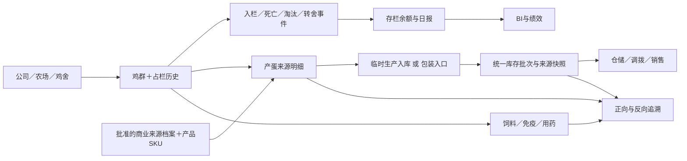

# 鸡舍、鸡群与鸡蛋产品闭环管理：最新版主分支复核及优化方案

审查日期：2026-11-17。状态：**代码修复已在独立分支验证；完整业务改造待审查选型，未上线。**

## 1. 结论与建议

建议选择**方案一：在现有产品、来源档案和库存体系上，增补鸡群生命周期单据与存栏事件账，第一期实行一舍一个在栏鸡群**。集团下两家公司、不同鸡舍饲养不同品种，并不必然要求同舍混群。现有商业产品管理可复用，真正需要补齐的是“入栏—生产—死亡/淘汰—出栏—清舍—换群”的可追溯业务链。

关键区分：**鸡舍是设施、鸡群是生物批次、鸡蛋品种是商品维度、SKU是销售/库存规格**。鸡舍不能永久固定为某种鸡或某种蛋；换群不能覆盖旧鸡群；存栏变化不能只改档案数字。

本次代码修复解决已确认的存栏计算、权限和移动端重复记录问题，尚未实现完整事件账、转舍单、盘点调整单、清舍验收或淘汰鸡销售。不能把本报告中的目标模型当成已经上线的功能。

## 2. 审查基线与范围

- 两次获取 `origin/main`，最后确认均为 `a7c0045b9f6d1a475b5a10710184e66d9c494aa0`，提交标题 `docs: add inv-opt next-steps handoff for ops and finance decisions`。
- 修复分支：`codex/flock-lifecycle-review-20261117`。
- 工作目录：`/home/jinhuit/PhenixCodebase/phoenix-erp-v3/.worktrees/flock-lifecycle-review-20261117`。原工作目录及其未提交改动未覆盖。
- 主协调代理实施修复，独立只读代理复核生命周期、权限、移动端兼容与下游调用。
- 已检查源码、冻结 SQL 基线及 TypeORM 迁移；使用自行创建的本机 PostgreSQL 18 测试库验证。**未连接生产数据库，不能据此断言生产已执行全部迁移或历史业务数据无异常。**
- 无生产迁移、部署、推送。本次不新增数据库结构。

## 3. 对此前分析的纠正

| 此前判断或容易产生的误解 | 最新代码事实 | 本次结论 |
|---|---|---|
| 普通蛋、粉壳蛋、红壳蛋缺少产品基础模型 | 已有 `md_product_varieties`、`shell_color`、品种关联、SKU组织适用范围及批次品种快照 | 不新建第二套蛋品品种表或库存台账 |
| 鸡群品种可以直接决定所有销售SKU | `md_egg_source_profiles` 按公司、鸡舍、日期确定商业来源；生物品种推导是独立能力 | 保留商业来源审批；鸡群品种用于生物追溯和一致性提示，不越权替代来源档案 |
| 普通蛋是与粉壳、红壳并列的第三种壳色 | 当前普通商品走 `STANDARD`、`variety_code=NULL`；特定品种走 `VARIANT` | “普通”是商业分类，不能臆造 `NORMAL` 壳色或强行改历史SKU |
| 日报生产入库没有防重复 | 已有事务锁、来源身份唯一约束、完全相同请求重放与数量冲突检查，且核对日报等级额度 | 保留并验证既有能力；缺口是来源精度和完整生命周期 |
| 只要补品种字段就能闭环 | 已有 `breed_code`、字典校验和部分来源保护，仍存在数量直接编辑、日报扣减与身份关联问题 | 核心是业务事件、状态联动、历史占栏及不可覆盖的来源快照 |
| 全部问题都应重做库存 | 最新主分支已有统一库存写入器、WMS及包装链 | 本次沿用统一写入器，下一期扩展来源引用，不旁路写库存 |

以上事实依据见第13节 E1—E4。此前笼统的“没有品种管理”“没有入库幂等”判断撤回。

## 4. 本次已修复的问题

| 问题与影响 | 修复后的行为 | 验证 |
|---|---|---|
| 日报按初始数减当天死亡量更新存栏，不能正确累计且漏掉淘汰 | 以现有余额为基线，按本次与原单的死亡、淘汰差额更新；取消按初始数重置 | 跨日、纯淘汰、重复提交、更正归零、已有手工余额测试 |
| 更新条件可能按鸡群或鸡舍同时命中多群 | 日报绑定唯一明确在栏群；精确更新该 `flock_no`；缺身份、错群、多群、未知状态/日期拒绝 | 真实PG原子回滚测试 |
| 修改历史日报后后续快照不一致 | 仅重放已证明连续且末值与当前余额相符的后续快照；不从初始数反推未知历史 | 连续历史更正、空快照拒绝、仅备注修改保留未知快照 |
| 同时报表提交或更正可能重复扣减 | 鸡舍事务锁、鸡群行锁、日报锁串行处理；新群占舍使用同一鸡舍锁 | 同日报并发、跨日并发、重复提交 |
| PUT 未传递组织范围，空范围可能放行 | PUT传递已解析养殖范围；非全局空范围拒绝；旧行身份与目标归属分别校验 | 跨公司拒绝、场区不扩权、空授权、真实HTTP读取与写入 |
| 通用CRUD可绕过日报逻辑 | 通用日报新增/修改/删除关闭，必须走专用接口 | controller/service双层测试 |
| 档案直接改存栏/初始数或删历史 | 鸡群编辑禁止直接改初始数、当前数及当前产蛋率；页面只读；鸡群/鸡舍禁止物理删除 | 权限及服务层测试；Web类型检查 |
| 在栏群可直接换舍、带存栏关闭、关闭后重新启用 | 档案直改鸡舍被阻止；归零才允许关闭；关闭后新建新批次；新群不得占用已有/不明确在栏舍 | 状态与数量保护测试 |
| 鸡舍编号、农场直接改动破坏追溯 | 禁止直接修改稳定编号及农场归属 | 服务端保护及独立复核 |
| 分级日报减少到已入库量以下 | 与生产入库共用公司/日期/鸡舍锁，核对同日各班次分级合计不小于已入库数量 | 降级数量与移除分级拒绝测试 |
| 移动死淘把鸡舍号当群号，复制蛋数到另一个ALL班次，且可能把HTTP失败当成功 | 单条已有日报只PUT死淘字段；无记录POST DAILY且不复制蛋数、不伪造群号；多班次要求逐班修改；检查HTTP结果并刷新 | 新增Web请求测试、独立复核 |
| 生产分析使用错误日报字段、缺范围、SQL错误吞成零值，重复按日报叠加初始存栏 | 使用实际字段与养殖范围，错误显式暴露；每群初始数只计一次；舍日产蛋率分母每日只取一次日末存栏 | 跨公司、字段、淘汰分母及多班次PG测试 |

存栏计算举例：当前10,000羽，第一天死亡30、淘汰20，第二天死亡10、淘汰5，余额为9,935。若第一天死亡更正为10，恢复20羽为9,955，不抹掉第二天死淘。同一日报重试不重复扣减。

本次保持旧版无分级日报的库存差额/冲销及缺批次通知路径，并补测重复、双班次、原始流水不足及其他日期流水不能代替的情况。它仍属于需要治理的遗留路径，不代表待补账已经完成。

## 5. 仍待业务改造或迁移的问题

这些项目必须进入实施清单，不能通过“直接编辑档案”继续绕行：

1. **缺正式事件账和业务单据。** 目前仍由日报更改存栏，没有完整的死亡处置、淘汰交接、转舍、盘点审批与冲销凭据。
2. **计划与实际退群日期混用。** UI的“计划/预计淘汰日期”写 `elimination_date`，生物品种推导却把它视为实际退群日。须拆 `planned_elimination_date` 与实际关闭/出栏事件；历史字段不能未经核实统一改名或回填。商业来源主链独立，但生物推导仍受此问题影响。
3. **日报粒度尚未统一。** 现有唯一约束是日期＋鸡舍＋班次；`ConsolidateBreedingDailyLogs` 迁移只检查当时是否重复，不持续保证一日一舍一行。建议规范“一个舍日汇总＋班次明细”，在来源额度和幂等身份同步设计后迁移，不直接删班次数据。
4. **退役群的历史修正受限。** 本次更正必须对应当前唯一在栏群，退役群或换群后的旧日报不能走普通编辑，需下一阶段受控历史更正/冲销流程。
5. **鸡舍停用与在栏群、容量未完整联动。** 下一期停用必须检查在栏、待办、设备映射和库存来源；满舍/超容量检查与入栏事务一起实现。当前不能把“停用舍”作为清舍完成。
6. **历史存栏可信度未认证。** 本次保留旧余额，不自动纠正过去手工改数；有差异的群须基线核对。历史快照断链会被拒绝继续更改死淘，不应绕过保护。
7. **历史无分级入账与待补账。** 旧路径按公司与蛋日寻找可用批次，来源不够细；曾跳过记账后再修改数量、后续补分级需专项对账，不能凭本次差额假定历史全额已入库。下一期逐步退出这条路径，统一受控产蛋入库。
8. **同舍同日换群/混群、转舍、分群并群尚不支持。** 现有 HOUSE-date 身份不能准确区分它们；本次选择拒绝歧义，不宣称已经支持。
9. **表单治理仍有旧债。** 鸡舍新编码仍可手填，鸡群状态等部分选项仍硬编码；下一期改自动编码和字典组件。当前旧状态、异常品种、缺开始日期的档案需先治理才能按新规则正常写日报。

## 6. 三个可行方案及排序

| 推荐顺序 | 方案 | 能解决什么 | 主要约束与代价 | 适合情况 |
|---|---|---|---|---|
| **1** | **现有体系增量闭环，一舍一在栏群** | 两公司、多场多舍不同品种；死亡、淘汰、整群出入栏、清舍换群、产品来源追溯及余额对账 | 一期不做同舍混群、拆群并群；需事件表、占栏历史、来源快照扩展和数据基线 | **当前已明确需求，收益与风险最平衡** |
| **2** | 分栏/子群完整生命周期 | 方案一全部能力，加同舍多群、多品种、部分转舍、拆分合并、复杂来源分配 | 日报、饲料、免疫、用药、包装、库存、BI全面增加子群/占栏维度；现场必须能分开计数和采蛋 | 真实经营已存在同舍混养、频繁部分转群，且能记录来源 |
| **3** | 仅补强现有日报与主档 | 快速阻止明显误扣、越权、直接覆盖和移动重复；配置好现有来源档案 | 仍缺入转出、盘点审批、处置、清舍和结算闭环；历史追溯和审计有限 | 仅作为短期过渡，本次修复接近该方案的基础防护 |

不建议为三类蛋各建一套鸡群/库存模块，也不建议上来重写全部ERP。方案一应为方案二预留占栏/来源标识，但不先交付现场用不到的复杂分群操作。

粗略工作量（用于比较，不是交付承诺）：方案一约25—40人日，方案二约50—80人日；含设计、开发、回归与试点支持，不含大量历史手工核对及业务等待。方案三的本次防护代码已完成，剩余上线前数据核查另计。正式排期应在确认单据范围、样本数据和验收口径后重估。

## 7. 推荐方案的目标模型

### 7.1 复用与新增边界

| 对象 | 处理方式 | 核心规则 |
|---|---|---|
| 集团/公司/农场/场区/鸡舍 | 复用现有组织及鸡舍主数据 | 公司来自权威归属，不信任前端传值；鸡舍是长期设施 |
| 鸡群档案 `brd_flocks` | 保留、加强稳定身份 | 品种、来源、入栏批次不可覆盖历史；`current_qty`为事件账投影，只读 |
| 生物品种 `BRD_BREED` | 复用并治理历史别名 | 品种码不等于商品SKU；未知不猜，尤其不能以白羽、俗称直接推断粉壳 |
| 商品品种、产品、SKU、组织适用范围 | 复用现有主数据 | 壳色、等级、包装规格分别管理；两公司可使用同一集团产品但各有适用授权 |
| 鸡蛋来源档案 `md_egg_source_profiles` | 保留为商业归类权威，版本化有效期 | 公司＋鸡舍＋业务日期唯一有效；STANDARD与VARIANT规则保持一致 |
| 鸡群业务单据（拟新增） | 入栏、死亡处置、淘汰/出栏、转舍、盘点调整、冲销 | 草稿/提交/审核/过账是单据状态；死亡/淘汰是事件类型，不能混成同一个状态字段 |
| 存栏事件表（拟新增） | 记录每次入、出、冲销 | 保存公司、群、占栏、发生/过账时间、数量、原因、原单、操作者、审核者、附件与冲销引用 |
| 占栏历史（拟新增） | 群在某舍的有效区间 | 一期一个舍同时一个有效占栏，使用时间区间；后续可扩展分栏/子群 |
| 舍日生产记录与明细 | 在现有日报基础上演进 | 汇总身份稳定，班次/群/等级为明细；拒绝日汇总与班次重复记账 |
| 库存批次与追溯桥接 | 扩展来源引用，沿用 `inv_batches` | 保留当时群号/占栏ID/来源档案版本；包装合批多来源用多对多明细，不能只放一个flock字段 |

拟新增表名可采用 `brd_flock_documents`、`brd_flock_events`、`brd_flock_occupancies`、`brd_flock_daily_balances`；最终以详细设计确定。本次没有创建这些表。

### 7.2 数量、并发与审计

存栏恒等式：**期末＝期初＋入栏＋转入－死亡－淘汰/出栏－转出±已审核盘点调整**。淘汰和销售不能对同一批鸡扣两次。

- 单据过账、事件写入、余额投影、占栏变更必须在同一事务；先锁相关鸡舍/群，多个对象按稳定顺序锁定。
- 每个来源单据行有唯一事件身份；重复同内容返回原结果，重复编号不同内容报冲突。唯一约束字段不得依赖NULL绕过。
- 已过账事实不直接改删；更正产生反向事件及新事件，保留原单。会计关账/养殖日结后的更正经授权另行处理。
- 使用 `version` 或等效条件更新防止两人用旧页面覆盖对方修改。现有事务锁解决重复扣数，但不等于完整的业务并发版本控制。
- 未来日期属于计划，不改变今天的存栏；系统区分业务发生时间、录入时间、过账时间。回溯操作检查后续库存、用药和结算是否已产生。
- 新入栏/增量有入栏单、供应商或内部来源、数量与日龄；盘点调整必须提供盘点依据和差异原因，不伪装成死亡。

### 7.3 业务流程

| 场景 | 建议流程与关闭条件 |
|---|---|
| 新群入栏 | 可用鸡舍→来源/品种/数量→容量和公司校验→审核过账→建立占栏→生成初始余额；创建主档与正式入栏关联 |
| 死亡 | 录入发生日、群、数量、原因→按规则审核→扣存栏→处置方式/附件/接收确认→关闭；不自动产生销售收入 |
| 淘汰 | 选择部分/整群、数量和原因→审核→实际移出过账；计划不扣数；整群归零后关闭占栏 |
| 淘汰后待售 | 若已移出产蛋群但仍在场，进入明确的待售鸡位置/余额，销售时仅核销待售鸡并记结算，不能再扣原群；若直接售出，则单据同一次过账产生出栏与销售引用 |
| 转舍 | 一期支持整群转入空舍；同公司双方数量守恒、占栏原子切换。部分转群/混群留方案二；真实存在运输间隔时用“发运—在途—接收”，不得同时计入两舍 |
| 跨公司调鸡 | 双方有授权、出入单、交接及内部结算引用；不能通过改 `company_code/farm_code` 实现。建议一期暂不开放，作为单独阶段验收 |
| 换群 | 旧群余额归零→检查未完单据→关闭旧占栏→清洗消毒及验收→鸡舍可用→新批次入栏；旧群记录永久保留 |
| 历史修正 | 核对原单、影响日期与后续链→审核冲销/重记→重建受影响余额快照→记录差异；不修改已售鸡蛋的历史生物来源 |

### 7.4 产品与换群的衔接

两公司可各有普通商品舍、粉壳商品舍、红壳商品舍；使用实际标准品种码及已批准的来源档案。不要根据鸡舍编号或名称猜品种。

例如甲公司H01原群F01产出的蛋已按红壳来源入库。F01出栏后换F02，商业来源批准改为粉壳：

1. 关闭F01及其占栏，保留F01所有历史日报、用药及旧批次。
2. 新建F02及新占栏；旧来源有效期结束，新来源生效，两者不重叠。
3. 生效之后的新产蛋走粉壳商品/SKU；旧红壳库存继续按原快照销售。
4. 当前来源档案只有日期精度时，**一期不允许同舍同日切换两种商业来源后混记**；确需当天切换则先升级时间/采集批次粒度。
5. 基因品种与批准商品分类不一致时提示复核。普通商品是否允许接收特定壳色蛋，应由集团商品标准决定，系统不能自行推断。

## 8. 下游调用与改造清单

“临时生产入库”和“包装入口”是按既有业务模式选择的路径，不能把同一批产蛋经过两路重复入账。

| 模块 | 现有依赖与风险 | 推荐调整 |
|---|---|---|
| 日报/生产入库 | 公司＋鸡舍＋日期，已有分级额度及幂等 | 引入稳定日报明细/占栏来源；沿用锁及额度校验，修正单不得让已入库量无来源 |
| 包装 | 结单调用包装库存集成，来源含鸡舍 | 传递来源明细ID和占栏/群快照；多来源合批保留分配数量，不猜单一群 |
| WMS | 调拨复制批次字段及品种/来源快照 | 新增来源字段必须在调拨、拆批、合批、报损、退货中保留；统一服务记账 |
| 销售 | 按可售库存/SKU FIFO消耗批次 | 继续按批次，不查询“现在鸡舍养什么鸡”改商品；退货回原来源且按质检状态处理 |
| 追溯 | 包装来源到鸡舍，再广泛查询群，存在LIMIT20 | 按真实来源ID查群和占栏，去掉用展示截断代替业务关系的做法；保留旧数据“不确定”标记 |
| 饲料 | 消耗多为鸡舍＋日期 | 用当日有效占栏分配到群；混群不能只按当前数量任意摊，规则需业务批准 |
| 免疫/用药 | 根据当前群舍归属及数量校验 | 记录当时占栏快照；关闭群禁止新操作；转舍后继承未完免疫计划/用药事实，并明确休药与蛋品隔离范围 |
| IoT | 设备映射鸡舍，观测按舍日 | 设施映射保留；观测按有效占栏归群；跨换群时段需确认，不能把传感器数据当死亡事件 |
| BI/BFF | 多处读取当前存栏，产蛋率按日报 | 改为统一余额查询；历史指标按当日余额，不用今天的存栏回算历史 |
| 财务/成本 | 产蛋库存、鸡只采购、淘汰销售各有不同业务事实 | 各单据保留同一来源引用；耗料/用药/养殖成本按群归集；科目、资本化与损失审批由财务确认；遵守现有ERP自有应收权威源约定 |

指标建议：死亡率、淘汰率、转出数分别展示；总产蛋量与商品蛋量分别展示。Hen-day产蛋率按选定的日均/日末有效母鸡数口径计算；Hen-housed累计产蛋数按原入舍母鸡数计算，名称和分母明确分开。料蛋比要求真实耗料与蛋重，缺蛋重时不能把“枚数比”冒充“公斤比”。本次BI修复仍属旧口径校正，并未实现完整行业绩效模型。

## 9. 页面与权限设计

- **鸡舍管理**：展示公司/场区、容量、当前群、遗传品种、批准商品类别、存栏、占用状态、下一步可操作动作；增加“在栏”“待清舍”“清舍中”“可入栏”业务状态，启停用另作设施状态。
- **鸡群档案**：基本资料＋生命周期时间线＋存栏明细账＋生产表现＋免疫用药＋出栏结算；当前存栏只读，操作入口为业务单据。
- **移动端**：当天鸡舍/群自动带出，死亡和淘汰分别录入；显示上次提交与重试结果，异常需原因/附件；新模型上线后日报读取死淘事件汇总，不能再与事件各扣一次。
- **产品来源配置**：展示生物品种与商业分类，变更带有效期及审批；模拟变更影响到哪些尚未入库的日报，禁止自动重标旧库存。
- **权限**：查看、新建、审核、过账、冲销、盘点调整、关闭鸡群分开；同时检验旧对象、目标舍与公司授权。大额/异常死淘与盘点调整审批阈值可配置，不写死未经确认的比例。
- **审计**：记录谁、何时、以何业务依据改变数量；附件统一上传组件；正式业务状态使用字典。自动任务也必须携带合法范围与业务来源。

## 10. 历史数据接续及上线顺序

### 数据核对

先在授权的脱敏/测试副本运行只读检查，形成每家公司、农场、鸡舍、鸡群的差异清单：

- 当前存栏与已有日报快照是否连续；初始数减累计死淘只是诊断项，不能作为自动修复真相。
- 一舍多在栏群、群舍农场不一致、非零退役群、缺入栏日期、未知品种、负数/小数数量。
- 同舍同日多班次、ALL/DAILY与早晚班并存、群号等于舍号等历史身份问题。
- 来源档案重叠/缺失、SKU组织适用范围、产品品种/壳色映射是否经业务确认。
- 日报分级、已入库、包装、销售、旧FARM_IN与待补账通知之间的数量差异。

为每个现存群确认**基线日、实际盘点数、责任人、证据、差异处理单**。新事件账从已批准基线衔接；不把初始数到今天的差额全部伪造成死亡，也不编造历史群号。旧数据保留原值及可信度标记。

### 实施阶段

| 阶段 | 交付与门槛 |
|---|---|
| P0 当前修复 | 审查本分支；在测试副本核查旧档案对严格校验的适配；核对历史阻断清单后再安排上线 |
| P1 业务模型与数据基线 | 明确一舍一群、日报粒度、计划/实际日期；设计单据/事件/占栏；确认两公司来源档案与实际品种 |
| P2 最小闭环 | 入栏、死亡、淘汰出栏、受控盘点、关闭、清舍、新群；完成数量投影、审计及移动端；切断日报与事件的双重扣减 |
| P3 产销追溯联动 | 日报来源到入库/包装/WMS/销售/追溯，免疫用药与饲料接有效占栏；BI口径统一 |
| P4 两公司试点及推广 | 每公司选有代表性的鸡舍，覆盖普通商品/粉壳/红壳样本；平行核对后逐步切换；保留明确回滚点 |

新结构仅走 `apps/api/src/database/migrations/` 的TypeORM TS迁移，包含down和约束验证；业务数据接续走经审查的治理脚本及回执，不把任意业务DML塞入结构迁移。回滚不能直接恢复旧代码后继续允许手改存栏；已产生新事件时需保持兼容读写或停写后受控回退。

### 发布执行顺序（正式只读核查后的更新）

当前生产配置基线F=`101916efbcd60956c9f8321d4859931049f966c3`，实际API/Web运行R=`cb42966edfa717b0984936951143d84973c1a263`，两者不同。最终正常合并的main记为T；main自动构建不是生产发布，不能将本次安排为一次full部署。

1. 完成最终源码的独立审查和CI，正常合并为精确T；重新正式inspect并绑定最新ledger摘要。已观察的GRADE_4/5各30枚超额必须依据真实业务凭据核对，审计HOLD不能绕过，也不能从库存反推日报应填数。
2. 审计GO后，在任何生产DDL前取得受控新鲜备份及完整性/可恢复性验证。当前pending-migration apply内的migration-evidence目录仅保存迁移日志，不是数据库备份，不能替代该前置。
3. 用现有受控迁移apply核验并执行实际待迁移集合（观察时既有3条＋本方案5条），保存实际应用回执；并发导致ledger或集合变化时重新inspect。
4. 对T显式API-only重锚定，保留F配置授权、R实际执行身份及T目标的精确关系。`mode=api`、`run_migrations=false`只表示schema已由上一步受控应用，不能跳过迁移回执。须核对实际API镜像、正式证据、后台SUCCESS及OPEN。
5. 只有API阶段完整成功后，才显式对同一T做Web-only发布；API失败保持阻断，不切Web。Web失败按既有恢复流程保留PREPARED，不自动清理或伪报成功。
6. 最终API/Web/floor均为T，备份、迁移、健康、真实页面/业务冒烟和正式完成证据齐全后，才给实际已部署的T打tag。没有真实旧群盘点及两公司签认仍保持未激活。

具体F/R/T、失败恢复及隔离验证范围见[发布前置设计](ops/flock-descendant-floor-reanchor-20261117.md)。合成Compose场景、owned Web health peer和证据适配器不能替代完整ERP发布或生产receipt；完整正式abort尚未执行，仅验证恢复授权。

## 11. 验收清单

1. 甲、乙公司同类产品可独立管理；场区用户不能读写同公司其他未授权农场，集团授权可汇总。
2. 同品种可分多个鸡舍批次；换群不改变已入库、已售出的旧蛋来源。
3. 死亡、淘汰累计正确；纯死淘无产蛋仍记账；重复提交不重复扣减；数量不能为负数、小数或超过余额。
4. 两人同时操作同群有一致结果；旧页面覆盖给出版本冲突；入栏不能并发占用同舍。
5. 更正、撤销、冲销和关账后修正各有受控路径；不能删历史；未知历史不自动补造。
6. 淘汰移出与销售只扣一次；待售鸡有去向和余额；整群关闭必须归零，清舍验收后才能换群。
7. 一舍一群的一期边界明确；同舍混群、当日商品类型切换等不支持场景必须明确拒绝。
8. 同一产蛋来源不能同时走两路入库；已入库/已售产蛋不能通过改日报消失；更正联动库存冲销。
9. 包装拆合批、WMS调拨、销售与退货后仍能反查群、舍、日期及来源档案版本。
10. 转舍后用药/免疫历史位置不漂移；未结束休药/待处理任务有明确承接。
11. 日报、存栏账、舍群看板、集团BI数字可对账，指标名称与分母一致。
12. 两家公司各完成实际场景试点，形成操作、异常处理与历史差异签认回执。

## 12. 本次验证记录与边界

运行基线：Node 20.20.2、现有依赖、本机自建 PostgreSQL 18；未读取生产连接配置。

| 检查 | 结果 |
|---|---|
| API `tsc --noEmit` | 通过，0错误 |
| Web `tsc --noEmit` | 通过，0错误 |
| farm / generic-crud / analytics 目录API回归 | 15套、160项通过；5套48项因专项PG环境变量缺失跳过，未算通过 |
| 指定真实PG/HTTP补跑 | 3套、37项通过（生命周期18、待补账通知4、权限/可见性/入库15）；与前述跳过项存在覆盖，不重复宣称全量通过 |
| Web定向测试 | 4套18项通过，含移动死淘请求、产蛋载荷、移动API及首页存栏 |
| Web changed lint | 门禁通过：修改文件未增加lint债务；仍报告既有11个error、4个warning，不称全仓零错误 |
| API修改业务文件lint | 0 error；保留类型等warning，未用屏蔽规则绕过 |
| 约束漂移静态门禁 | 0新增漂移；动态SQL不在解析器保证范围 |
| `git diff --check` | 通过 |
| 独立审阅 | 生命周期/权限/移动兼容第二轮未发现新增阻断问题；架构待办见第5节 |

**真实scope-audit已执行**：真实HTTP＋PG覆盖公司、场区、多授权、失效组织、空范围、伪造过滤、缓存失效及生产入库；另外服务测试覆盖PUT跨公司拒绝和通用CRUD旁路。前端实际检索了鸡舍/鸡群表单的`input`、`onChange`、`DictSelect`与下拉来源；发现并保留列入第5节的自动编码/硬编码旧债，没有凭空报告“全部主数据治理通过”。

原日报SQL形状mock测试随共享事务重构调整，关键场景改由真实PG验证，包括重复提交、分级不写旧流水、补分级冲销、双班次冲销、缺/不足/其他日期原始流水拒绝、缺批次通知与scope。它们不等于生产历史数据修复测试。

未执行：生产数据库结构/数据核验、生产迁移、完整`verify`构建、全仓Web零错误治理、浏览器端到端试运行、完整生命周期UAT。已有鸡群浏览器测试已改为验证存栏只读和编辑不携带数量，但本次未运行浏览器环境，不报端到端通过。

## 13. 关键代码证据索引

以下链接指向本次独立工作目录。E1—E4是最新主分支已有能力；E5—E8含本次修改。其余为下游现状，不表示本次全部改造。

- E1 [商业来源解析，STANDARD/VARIANT及有效期](</home/jinhuit/PhenixCodebase/phoenix-erp-v3/.worktrees/flock-lifecycle-review-20261117/apps/api/src/modules/product-master/services/sku-availability.service.ts:142>)；[独立生物品种推导及淘汰日期问题](</home/jinhuit/PhenixCodebase/phoenix-erp-v3/.worktrees/flock-lifecycle-review-20261117/apps/api/src/modules/product-master/services/sku-availability.service.ts:208>)。
- E2 [生产入库服务](</home/jinhuit/PhenixCodebase/phoenix-erp-v3/.worktrees/flock-lifecycle-review-20261117/apps/api/src/modules/sales-v2/services/production-inbound.service.ts:70>)；[生产来源身份唯一约束](</home/jinhuit/PhenixCodebase/phoenix-erp-v3/.worktrees/flock-lifecycle-review-20261117/apps/api/src/database/migrations/1792000000000-EnforceTempProductionSourceIdentity.ts:1>)。
- E3 [包装结单调用库存集成](</home/jinhuit/PhenixCodebase/phoenix-erp-v3/.worktrees/flock-lifecycle-review-20261117/apps/api/src/modules/terminal/packaging.service.ts:620>)；[包装生成库存来源](</home/jinhuit/PhenixCodebase/phoenix-erp-v3/.worktrees/flock-lifecycle-review-20261117/apps/api/src/modules/sales-v2/services/packaging-inventory-integration.service.ts:226>)。
- E4 [舍日历史重复迁移门禁，不是新唯一约束](</home/jinhuit/PhenixCodebase/phoenix-erp-v3/.worktrees/flock-lifecycle-review-20261117/apps/api/src/database/migrations/1790000000000-ConsolidateBreedingDailyLogs.ts:26>)。
- E5 [统一日报写入与更正](</home/jinhuit/PhenixCodebase/phoenix-erp-v3/.worktrees/flock-lifecycle-review-20261117/apps/api/src/modules/farm/farm.service.ts:372>)；[数量、锁与历史快照策略](</home/jinhuit/PhenixCodebase/phoenix-erp-v3/.worktrees/flock-lifecycle-review-20261117/apps/api/src/modules/farm/daily-stock-policy.ts:1>)。
- E6 [档案写入限制](</home/jinhuit/PhenixCodebase/phoenix-erp-v3/.worktrees/flock-lifecycle-review-20261117/apps/api/src/modules/generic-crud/flock-write-policy.ts:6>)；[旧行/目标范围校验](</home/jinhuit/PhenixCodebase/phoenix-erp-v3/.worktrees/flock-lifecycle-review-20261117/apps/api/src/modules/generic-crud/generic-crud.controller.ts:215>)。
- E7 [移动端死淘请求](</home/jinhuit/PhenixCodebase/phoenix-erp-v3/.worktrees/flock-lifecycle-review-20261117/apps/web/src/lib/mortality-payload.ts:4>)；[鸡群编辑存栏只读](</home/jinhuit/PhenixCodebase/phoenix-erp-v3/.worktrees/flock-lifecycle-review-20261117/apps/web/src/app/(admin)/breeding/flock/page.tsx:421>)。
- E8 [生产分析字段与范围](</home/jinhuit/PhenixCodebase/phoenix-erp-v3/.worktrees/flock-lifecycle-review-20261117/apps/api/src/modules/analytics/services/production-analytics.service.ts:11>)。
- E9 [WMS调拨批次字段](</home/jinhuit/PhenixCodebase/phoenix-erp-v3/.worktrees/flock-lifecycle-review-20261117/apps/api/src/modules/wms/wms.service.ts:2340>)；[销售FIFO](</home/jinhuit/PhenixCodebase/phoenix-erp-v3/.worktrees/flock-lifecycle-review-20261117/apps/api/src/modules/sales-v2/services/egg-inventory.service.ts:834>)。
- E10 [追溯按舍查群](</home/jinhuit/PhenixCodebase/phoenix-erp-v3/.worktrees/flock-lifecycle-review-20261117/apps/api/src/modules/traceability/traceability.service.ts:166>)；[TEMP来源精度说明](</home/jinhuit/PhenixCodebase/phoenix-erp-v3/.worktrees/flock-lifecycle-review-20261117/apps/api/src/modules/bff/packaging-history.service.ts:103>)。
- E11 [免疫群舍校验](</home/jinhuit/PhenixCodebase/phoenix-erp-v3/.worktrees/flock-lifecycle-review-20261117/apps/api/src/modules/farm/immune.service.ts:215>)；[用药群舍校验](</home/jinhuit/PhenixCodebase/phoenix-erp-v3/.worktrees/flock-lifecycle-review-20261117/apps/api/src/modules/farm/medication-record.service.ts:141>)。
- E12 [饲料鸡舍范围](</home/jinhuit/PhenixCodebase/phoenix-erp-v3/.worktrees/flock-lifecycle-review-20261117/apps/api/src/modules/farm/farm-feed.service.ts:129>)；[IoT设备鸡舍映射](</home/jinhuit/PhenixCodebase/phoenix-erp-v3/.worktrees/flock-lifecycle-review-20261117/apps/api/src/modules/iot/iot-sync.service.ts:140>)；[BFF存栏依赖](</home/jinhuit/PhenixCodebase/phoenix-erp-v3/.worktrees/flock-lifecycle-review-20261117/apps/api/src/modules/bff/bff.controller.ts:124>)。

## 14. 行业参考与待审定事项

行业资料支持“按鸡群持续记录生产、饲料、水、健康与环境，再进行跨批次比较”，以及将数字批次记录用于全链追溯。LOHMANN指南也把转入产蛋舍前的清舍与消毒准备单独列出。这些是流程参考，不是本项目表结构、审批权限或当地法规的现成答案。[LOHMANN管理指南：Monitoring & Profiling / Production House Transfer](https://lohmann-breeders.com/e-guide/alternative-housing/)、[Big Dutchman数字批次记录与价值链追溯](https://www.bigdutchman.com/en/news-stories/article/farmers-are-not-yet-sufficiently-aware-of-the-benefits-of-digitization-and-data-sharing/)。

供审查的建议默认值：

| 决策 | 建议 |
|---|---|
| 选择哪个方案 | 方案一；只有确认同舍混群及部分转群是当前刚需时选择方案二 |
| 一期在栏规则 | 一舍一个有效鸡群，整群转入空舍；不允许隐式混群 |
| 普通蛋分类 | 沿用已批准STANDARD来源，另与业务确认是否允许特定壳色降为普通商品 |
| 死亡/淘汰审批 | 分开记录；阈值由养殖负责人定，异常原因和处置凭据必需 |
| 盘点调整 | 单独受控单据，不开放档案改数；财务/养殖联合确认基线 |
| 换群日期 | 一期避免同舍同日多商品来源，实际出栏与计划日期分离 |
| 跨公司调鸡 | 暂不作为一期普通转舍开放，单独实施双边交接与结算 |
| 上线策略 | 两公司各选代表鸡舍试点；历史差异有回执，符合门槛后推广 |

审查通过上述业务范围后，再进入P1—P4详细开发。当前可单独审查本次修复补丁；完整闭环不能只靠发布这批补丁获得。
