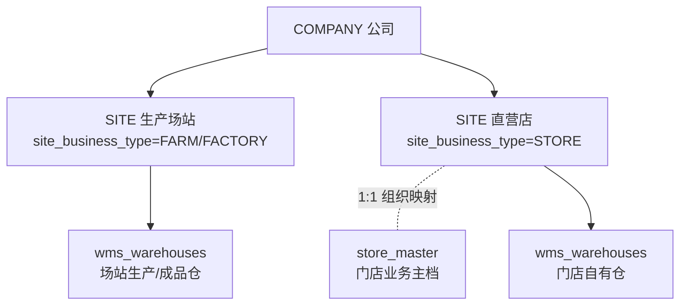
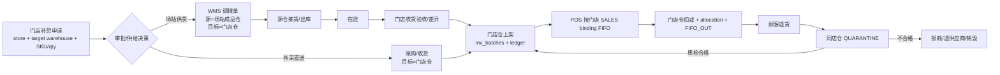

# 直营店组织归属与门店仓架构复查

> 日期：2026-08-27  
> 性质：架构复查 + 9 项裁定执行记录
> 最高业务裁定：①直营店直属公司，与生产场站平级，不属于任何场站；②直营店必须使用门店自有仓出货，不直接消费场站生产成品仓  
> 变更边界：本轮改代码与 schema；生产数据仅允许自动迁移中的 `SITE → STORE_SITE` 兼容转换，不建 SITE、不建仓、不回填 membership/binding

## 0. 结论

V1 的身份、membership、仓 binding、scope 门禁和 V1-2 原子 FIFO 底座大部分可以保留；错误集中在“如何回填组织映射和仓绑定”，不是要推翻已上线四表。

1. 用户裁定与 M1 冻结组织模型的树形关系一致：公司下的生产场站 SITE 与直营店 SITE 是兄弟节点，SITE 不允许嵌套。冲突来自 V1 附录 15.6 把“缺 SITE 映射”误写成“需要寻找场站归属”，而不是来自 `store_master.company_code`。
2. `store_master.company_code` 正确。10 店应直接归属其公司；同时应各有一个 `site_business_type=STORE` 的组织 SITE，用于物理地点/组织树，不得映射到 FARM/FACTORY SITE。
3. `store_aliases.alias_type='SITE'` 不应直接删除。它应被明确为“Store 业务主档 → 门店型组织 SITE”的 1:1 映射；当前约束过宽，只验证任意 ACTIVE SITE，后续最小调整应校验 `site_business_type='STORE'`、同公司、单店单 SITE，并宜把类型名澄清为 `ORG_SITE`/`STORE_SITE`。
4. 附录 15.6 的 58 条 `StoreWarehouseBinding` 候选整体作废。它们只是按同公司把 10 店与 11 个农场操作仓做笛卡尔积，不能转化为授权或库存归属。
5. 生产最近可证实的末态不是 17 仓，而是 21 仓：9 个好业财财务映射仓、11 个场站 OPERATIONAL 仓（孟赛 7、东鹏 4）、1 个测试仓；当前证据中没有门店自有仓。用户题干中的“17 仓”是 A 阶段扩仓前基线。
6. 现有场站仓→门店链路不闭环：补货申请与门店收货只是 Generic CRUD；仓间调拨能完成源扣减和目标入库，但没有补货单/签收编排；“销售出库到门店”只有源仓扣减，没有目标门店库存增加。门店仓与 POS 已具备仓范围 FIFO，但门店仓尚未创建/绑定。
7. 正确目标是：场站成品仓 → 补货申请/审批 → WMS 仓间调拨 → 门店仓收货上架 → POS 从门店 SALES 仓 FIFO 出库；退货进入同一门店仓的 QUARANTINE zone/status，质检后再转可售。

## 1. 证据口径与限制

### 1.1 证据等级

- A：当前源码、TypeORM 迁移、只读 SQL、当前运行门禁。
- B：已经成功执行并记录在仓库内的 production-environment 只读 workflow 输出。
- C：历史治理/设计文档与 Git 记录。
- 本报告以 A/B 事实判现状，以用户两条裁定判目标；历史设计与用户裁定冲突时，以用户裁定为准。

### 1.2 生产只读保护

既有 workflow 使用 GitHub production environment → SSH → 容器内 PostgreSQL，并同时设置连接级 `PGOPTIONS='-c default_transaction_read_only=on'` 与事务级 `BEGIN TRANSACTION READ ONLY`。相关入口：

- 组织/SITE：`.github/workflows/org-site-farm-readonly-audit.yml:13-157`，成功 run `32826936690`。
- 仓库：`.github/workflows/warehouse-domain-readonly-audit.yml:173-179` 及仓分域生产回归 run `32926337656`。
- Store V1：`scripts/store-v1-1-readonly-inventory.sql:1-56`，成功 run `33035061172`；V1-2 后只读 schema/候选复核 run `33036844321`。

本轮没有触发新 workflow。本地不能直接取得新的生产快照：SSH 主机别名无法解析，公网组织 API 返回 401。因此以下生产判断引用上述成功只读 run；不能由现有查询证明的事项明确标为“未证实”。

### 1.3 一个必须保留的证据边界

10 店 `mst_stores.mapped_site_code` 全为空，能证明“10 店尚未完成可识别的 SITE 映射”；不能逻辑上排除组织表中存在同名但未关联的孤立 SITE。正式回填前需重跑一次按公司、名称、地址和 `site_business_type` 的全量只读反查，防止重复建 SITE。

## 2. 既有组织模型核查

### 2.1 M1 冻结决议

`docs/M1_ORGANIZATION_MODEL.md` 的冻结语义是：

- `org_type` 收敛为 `GROUP/BU/COMPANY/SITE/DEPARTMENT/PROJECT`；STORE、FACTORY、WAREHOUSE 是 `site_business_type` 子类（`:34-41`）。
- COMPANY 直接拥有 SITE；SITE 的 `parent_id` 必须指向 COMPANY，且 SITE 不允许嵌套 SITE（`:82-90,394-400`）。
- 门店是 `org_type='SITE' AND site_business_type='STORE'`；`mst_stores` 是运营 sidecar（`:523-578`）。
- 仓库不是 SITE；库存/FIFO/批次/库位的 canonical 维度是 `wms_warehouses.warehouse_code`（`:452-519`）。

因此用户裁定的正确组织图与 M1 的父子模型一致：



“门店与场站平级”是组织树层级相同，不表示两者使用相同仓库，也不表示门店无需 SITE。门店 SITE 是门店自己的物理/组织节点，不是要挂靠的农场 SITE。

### 2.2 历史冲突来源

W4 曾把 STORE/FACTORY/WAREHOUSE seed 成独立 `org_type`；`docs/MASTER_DATA_W4_REVIEW.md:96-127` 已记录该冲突，M1 后续冻结为 SITE 子类。旧文档仍有 9 类 org_type 口径，不能覆盖 M1 冻结决议。

V1 提案后来采用“Store 为业务主档、SITE 为组织归属，显式映射”，这与 M1 的 canonical 主权表述存在措辞差异，但可以兼容：

- `store_master`：POS/营业日/membership 的业务身份权威。
- `sys_organizations SITE/STORE`：组织树、物理地点、公司直属关系的权威。
- 二者必须 1:1 映射、公司一致，禁止把某个 FARM SITE 当门店的 SITE alias。

这需要在后续架构冻结修订中统一“谁是门店编码/名称的最终主写点”；不影响本报告对父子层级和门店仓的裁定。

### 2.3 生产 SITE 实况

最近成功的组织只读 run 可证实 4 个 ACTIVE SITE：

| SITE | 名称 | 公司 | 已识别性质 |
|---|---|---|---|
| `SITE-DONGPENG-LAYER` | 东鹏蛋鸡养殖场 | `COMP-LAO-XINGCHI` | 生产场站；有 FARM 投影 |
| `SITE-MENGSAI-LAYER` | 孟赛蛋鸡养殖场 | `COMP-LAO-AGRI` | 生产场站；有 FARM 投影 |
| `SITE-VTE-BROILER` | 万象肉鸡养殖场 | `COMP-LAO-FOOD` | 生产场站；未映射 FARM |
| `SITE-VTE-SLAUGHTER` | 万象屠宰加工厂 | `COMP-LAO-FOOD` | 加工场站；未映射 FARM |

该 run 没有输出 `site_business_type`，故不能用它证明列的生产实值。Store 只读盘点的 10 店全部 `mapped_site_code=NULL`；当前没有证据证明这 10 店已作为门店型 SITE 完成组织树建模。

## 3. `mst_stores`、`store_master` 与 10 店归属

### 3.1 表关系现状

- 初始 `mst_stores` 没有 org/site FK：`apps/api/migrations/v3_schema_complete.sql:27-36`。
- 后续扩展增加 `company_code`、`mapped_site_code`，但没有主动回填：`migrations/mdm1_04_mst_stores_extend.sql:12-34`。
- 当前 V1 运行实体是 `store_master`，字段含 `store_code/store_name/company_code/status/timezone/business_day_cutoff`，没有 `site_code` 直接列：`apps/api/src/modules/store-pos/entities/store.entity.ts:3-15`。
- SITE 关系通过 `store_aliases` 表达；这不是数据库 FK 列，但 ACTIVE SITE alias 有 trigger 存在性校验。

### 3.2 10 店正确公司归属

生产只读候选及 G113 后续归属口径一致：

| 公司 | 直营店 |
|---|---|
| `COMP-LAO-AGRI` | `STORE-BKX-001` 波利坎赛省、`STORE-LPB-001` 琅勃拉邦、`STORE-MX-001` 孟赛、`STORE-PSL-001` 丰沙里省、`STORE-VTE-001` 万象、`STORE-VTE-WH-001` 万象仓储中心店 |
| `COMP-LAO-XINGCHI` | `STORE-DP-001` 东鹏、`STORE-HS-001` 会晒、`STORE-XB-001` 沙耶武里、`STORE-XC-001` 金三角特区 |

历史 G81 曾把 VTE/BKX 指向 `COMP-LAO-FOOD`，后被 G113 口径覆盖；正式回填前仍应以最新生产只读实值和业务负责人确认双重锁定。正确结构是“每店直接挂上述公司”，不是挂 `SITE-MENGSAI-LAYER` 或 `SITE-DONGPENG-LAYER`。

### 3.3 `store_master.company_code` 判定

判定：**兼容，直接复用**。

它准确表达门店直属法人/数据隔离维度。后续门店型 SITE 必须具有相同 `company_code`，并以 COMPANY 为 parent。应增加的是跨表一致性约束/服务校验，不是把 `store_master` 改挂生产 SITE。

## 4. 生产仓库与仓治理历史

### 4.1 生产末态纠偏：17 → 21

题干的 17 仓是初始基线：9 个 `CJ-WH-*`、7 个 `LPH_MS_*`、1 个 `WH-0001`。A 阶段随后新增 4 个东鹏正式操作仓，最近可证实末态为：

| domain | 数量 | 构成 | 门店仓判断 |
|---|---:|---|---|
| `FINANCE_MAPPING` | 9 | `CJ-WH-*` 好业财只读映射 | 不是操作仓 |
| `OPERATIONAL` | 11 | 孟赛 `LPH_MS_*` 7 + 东鹏 `LPH_DP_*` 4 | 全部按生产场站用途建立，非门店自有仓 |
| `TEST` | 1 | `WH-0001` 东鹏测试暂存仓 | 不是门店仓 |

证据见 `docs/ops/warehouse-type-and-permission-research-20260825.md:119-145,342-351,394-405`。现有 `type` 值中没有 STORE/RETAIL，仓表也没有 `store_code`；A 阶段首次 seed 正因假设该列存在而失败，修复后移除。

结论：在现有可审计证据中是**零门店自有仓**。严格说，旧仓 workflow 没有联查 binding；但 V1 回填明确未执行任何 binding DML，因此没有证据支持“已将某仓配置成门店仓”。

### 4.2 历史治理语义

- G4-D 建立 WarehouseScope 和 `allowedWarehouseCodes`，解决可见/可操作范围，不解决仓设施分类。
- G15 以“每个 SITE 一套子仓”建立 `EGG_FARM/EGG_SALES/MEDICINE/FEED/RAW_MATERIAL/PURCHASE_RECV/FINISHED`，这是用途维度，不是设施维度。
- 最近分域用 `domain=OPERATIONAL/FINANCE_MAPPING/TEST` 控制能否发生 ERP 库存写入。
- `facility_class=FACTORY/DISTRIBUTION/STORE/TRANSIT/GENERAL` 是已讨论/批准方向，尚未落 schema；`QUARANTINE` 当前是 zone/status 语义，不应硬塞进旧仓 `type`。

门店仓设计必须正交表达：

```text
domain = OPERATIONAL                 # 是否可发生库存动作
facility_class = STORE               # 设施归属，待双维度治理落地
usage_type = EGG_SALES/GENERAL       # 业务用途，沿用/规范现有 type
zone_type = SALES / QUARANTINE       # 仓内区域
store ownership = store_master + binding（过渡）/明确 owner_store_id（终态待拍板）
```

## 5. V1-1 schema 完善性复查

### 5.1 已上线资产

`apps/api/src/database/migrations/1787875200000-CreateStoreWorkstationIdentity.ts:7-61` 已上线：

- `store_master`
- `store_aliases`
- `store_memberships`
- `store_warehouse_bindings`
- SITE alias trigger
- ACTIVE + OPERATIONAL warehouse binding trigger

V1-2 又已上线支付幂等、销售/班次/批次锁、allocation、库存不足强阻断和精确退货。二者均无业务回填，故生产仍 fail-closed。

### 5.2 `store_aliases.SITE`

当前语义：`store_id → alias_type='SITE' + alias_code`；trigger 只要求目标是任意 ACTIVE SITE（迁移 `:17-25,52-56`）。

判定：**概念保留、约束需收紧**。

它不应表示“店属于某场站”，而应表示“同一家店的业务身份和门店型组织 SITE 是同一实体的两个投影”。问题有四个：

1. 未要求 `site_business_type='STORE'`，理论上可误连 FARM/FACTORY SITE。
2. 未校验 `store_master.company_code = SITE.company_code`。
3. 未保证一个 store 只有一个 ACTIVE SITE 映射。
4. `SITE` 名称容易被误读为场站挂靠。

最小调整方案（后续实施，不在本轮）：

- 先在设计/接口文档把类型语义改称 `STORE_SITE` 或 `ORG_SITE`；兼容期可保留数据库旧值 `SITE`。
- 收紧 trigger/service：目标必须 ACTIVE、`org_type='SITE'`、`site_business_type='STORE'`、同 company。
- 增加每 store 单一 ACTIVE 组织 SITE 的 partial unique 约束；目标 SITE 也只能映射一个 ACTIVE store。
- 不允许把生产场站 SITE 写入该 alias；历史码继续用 `LEGACY_STORE_CODE`。

若最终决定以 `store_master.site_code` 明确 FK 取代 alias，也应先双写/核对再退役 SITE alias，不应直接删除已上线结构。

### 5.3 `StoreWarehouseBinding`

当前模型字段为 `store_id, warehouse_code, purpose, priority, status, effective period`；purpose 仅 `SALES/RETURNS`，ACTIVE 绑定目标必须 ACTIVE + OPERATIONAL。运行时按 priority 排序，并计算 binding 与 WarehouseScope 的交集：`apps/api/src/modules/store-pos/services/store-scope-policy.service.ts:52-73`。

判定：**模型继续适用，绑定对象和回填规则必须重置**。

- `SALES`：POS 可售库存仓。
- `RETURNS`：退货回库路径；可以与 SALES 同一物理仓，但必须落入 QUARANTINE zone/location。
- priority：多仓兜底/配送店场景仍有用；真实一店一仓时通常单条 priority=100。它是排序，不是 ownership。
- binding 不应把任意同公司操作仓变成门店仓；门店仓必须先创建、验收 ownership/zone/scope，再绑定。

后续可补的约束：priority 非负；同 purpose 生效期重叠治理；RETURNS 的隔离区能力校验；双维度落地后要求 `facility_class=STORE`。这些不影响现有表可复用。

### 5.4 58 条候选为何整体作废

只读 SQL `scripts/store-v1-1-readonly-inventory.sql:34-41` 仅按 `store.company_code = warehouse.company_code` 联接所有 ACTIVE + OPERATIONAL 仓：

- AGRI 6 店 × 孟赛 7 个生产用途仓 = 42。
- XINGCHI 4 店 × 东鹏 4 个生产用途仓 = 16。

这不是匹配算法，只是公司池枚举。它违反“门店自有仓”裁定，并可能让 POS 直接消耗饲料、药品、原料、生产成品等场站库存。处理结论：

- 58 条全部标记为 **VOID_BY_STORE_WAREHOUSE_DECISION**，不得回填、不得逐条人工挑选。
- 后续盘点脚本不再生成 company-pool binding 候选。
- 新候选只来自“已批准的门店仓创建清单 → 已创建并验收的 warehouse_code → 对应 store 的 SALES/RETURNS binding”。

## 6. 门店仓目标设计

### 6.1 一店一仓基线

每个真实持有现场库存的直营店至少一个自有 OPERATIONAL 仓。建议编码：

```text
ST_<COMPANY_SHORT>_<STORE_SHORT>_SALES

示例：
ST_LAO_AGRI_BKX_001_SALES
ST_LAO_AGRI_LPB_001_SALES
ST_LAO_AGRI_MX_001_SALES
ST_LAO_AGRI_PSL_001_SALES
ST_LAO_AGRI_VTE_001_SALES
ST_LAO_AGRI_VTE_WH_001_SALES
ST_LAO_XINGCHI_DP_001_SALES
ST_LAO_XINGCHI_HS_001_SALES
ST_LAO_XINGCHI_XB_001_SALES
ST_LAO_XINGCHI_XC_001_SALES
```

规范建议：

- `ST_` 明确门店设施，不复用 `LPH_MS_`/`LPH_DP_` 农场前缀。
- 编码全局唯一、发布后不改名；`STORE_SHORT` 从 `store_code` 机械规范化产生并登记映射。
- `company_code` 等于门店公司。
- `domain='OPERATIONAL'`。
- 过渡期旧 `type` 使用已批准的用途值（优先 `EGG_SALES`，一般商品店可 `GENERAL`），不得写 `STORE` 破坏用途维度。
- 双维度治理落地后增加 `facility_class='STORE'`；仓能力再表达 `RETAIL_FULFILLMENT/RETURNS_QUARANTINE`。
- 组织/地点关联指向该店自己的 SITE-STORE，不指向生产场站 SITE。
- ownership 终态优先显式 `owner_store_id/store_id`；在字段未落地前，以唯一有效 binding + 门店 SITE + 运维清单三者共同证明归属。

### 6.2 库区与货位

最小配置：

| zone | 用途 | 可售状态 |
|---|---|---|
| `SALES` | 门店正常可售库存/后场库存 | `AVAILABLE` |
| `QUARANTINE` | 顾客退货、破损待判、召回隔离 | `QUARANTINE`，禁止 POS 分配 |

可选增加 `RECEIVING/STAGING` 用于调拨到货待验收。退货不必建第二个物理仓；`RETURNS` binding 可指向同仓，V1-2 已要求找到 ACTIVE QUARANTINE location 才允许回库。只有独立退货中心场景才配置不同 RETURNS 仓。

### 6.3 “万象仓储中心店”例外

`STORE-VTE-WH-001` 名称含“仓储中心”不自动等于配送中心，也不自动允许共享农场仓。需用户确认它是：

- 有零售/POS 的直营店：照常建立门店自有仓；或
- 展示/接单点、无现场库存：可绑定经批准的配送仓，但必须明确 ownership、配送责任和不在店现货语义；或
- 实际配送中心：应分别建配送设施仓和门店业务身份，不能靠名称混用。

## 7. 库存流与现有链路冲突

### 7.1 正确单据流



关键原则：源场站仓和目标门店仓是两个库存节点。库存所有权/在途状态只能通过正式单据转移，不能把门店 POS 直接指向源场站成品仓。

### 7.2 当前已有能力

- `POST /api/inventory/transfer/confirm` 可在一个事务中创建 `wms_transfer`、源 `inv_batches` 扣减、源/目标 ledger、目标批次入库：`apps/api/src/modules/wms/wms.service.ts:1362-1508`。
- V1-2 POS 已按 `sale.warehouseCodes`、AVAILABLE、有效期和 FIFO 锁定/扣减批次，并写 allocation/ledger。
- 退货已按原 allocation 进入 RETURNS binding 的 QUARANTINE location。

这些是可复用引擎，但现有 transfer 是“立即完成式仓间调拨”，没有补货审批、在途、门店签收和差异状态机。

### 7.3 当前空白/旁路

- `/store/replenish` 只是 `store_replenish_req` Generic CRUD，无专用 API/审批/调拨生成。
- `/store/receiving` 只是 `store_receiving` Generic CRUD，不消费 WMS 调拨，不增加门店仓库存。
- `/warehouse/outbound` 的 STORE 去向只扣源仓，写 `destination_store_code`，没有目标门店入库。
- `store_inventory` 是可编辑快照，POS 不读取它；POS 权威库存是 `inv_batches`。
- `store_transfers` 虽有表定义，但未发现业务 service/API/page 消费。

所以现状不是“已有链路待接一个页面”，而是**编排层空白、库存引擎局部可复用**。

### 7.4 补货页收口建议

后续不扩展 Generic CRUD 状态字段，而是建立专用 replenishment application service：

1. 申请锁定 canonical store 和 target SALES warehouse，SKU/qty/需求日期/原因不可仅文本。
2. 供给决策选择源 OPERATIONAL 成品仓；权限校验源、目标双仓。
3. 审批后生成 WMS transfer；保存 `replenishment_id ↔ transfer_id`。
4. 门店收货按 transfer 行验数量/批次/差异；完成后目标门店仓库存成为 POS 可售来源。
5. 原 `store_replenish_req/store_receiving` 转只读 adapter 或迁移历史，不再是库存权威写入口。

## 8. DataScope 与角色设计

### 8.1 当前门禁

V1 scope 已形成：

```text
系统 RBAC（能做什么）
  ∩ StoreMembership（属于哪家店）
  ∩ StoreWarehouseBinding（该店业务使用哪些仓）
  ∩ DataScope.allowedWarehouseCodes（用户获授权哪些仓）
```

`StoreScopePolicy.resolve()` 对非 global 用户执行 binding 与 WarehouseScope 交集，空集 403；global 用户仍受 binding 和 OPERATIONAL 限制。这个模型与新门店仓完全兼容。

### 8.2 收银员与店长

- Cashier：有效 membership + 该店 SALES 仓显式授权；只看/扣本店仓。
- Store Manager：本店 membership + 本店 SALES/RETURNS 仓显式授权；可看本店库存、收货、退货隔离和日结。
- membership 不替代系统角色；`CASHIER/STORE_MANAGER` 表达店内身份，`ROLE_CASHIER/ROLE_STORE_MGR` 与菜单位表达操作能力。

当前 DataScope 对 SITE 用户采用“所属 SITE 的 OPERATIONAL 仓 ∩ 显式 WarehouseScope”；这要求新门店仓的 site 关联必须指向门店自己的 SITE，否则收银/店长授权会被错误地与生产场站捆绑。

### 8.3 补货跨仓

补货需要同时看源场站仓和目标门店仓，但不应为了方便给店长整个公司仓的写权限。推荐分责：

| 角色 | 源场站仓 | 门店仓 | 动作 |
|---|---|---|---|
| 店长 | 只读可供量（可脱敏/聚合） | 本店读写申请、收货 | 发起补货、确认收货，不直接扣源仓 |
| 场站/WMS 仓管 | 源仓出库写 | 目标仓单据可见/在途 | 拣货、发运、完成源端动作 |
| 补货协调/供应链 | 经显式授权的源+目标仓 | 经显式授权 | 审批、选源、异常协调；不得因公司角色自动全仓 |
| Cashier | 不可见 | 本店 SALES 仓由 POS 间接扣减 | 无补货/调拨权限 |

实现时宜把“源仓库存查询”“源仓库存写”“目标仓收货”拆权限位，避免店长通过调拨接口绕过职责分离。

## 9. 兼容性与冲突矩阵

| V1 资产/设计 | 判定 | 所需调整 | 改动量 |
|---|---|---|---|
| `store_master.company_code` | 兼容 | 保留；与门店 SITE 公司一致 | 小（校验） |
| StoreMembership | 兼容 | 7 条候选仍需职责/生效期确认；角色显式映射 | 数据回填，不改模型 |
| `store_aliases.LEGACY_STORE_CODE` | 兼容 | 继续承接旧码 | 无/小 |
| `store_aliases.SITE` | 方向兼容、约束不足 | 澄清为门店型组织 SITE；同公司、STORE subtype、1:1 | 小到中 |
| StoreWarehouseBinding schema | 兼容 | 只绑定新建门店仓；双维度后增强校验 | 小 |
| 58 条 company-pool 候选 | 冲突 | 整体作废，重制候选生成规则 | 文档/脚本中；业务数据尚未写 |
| binding `SALES/RETURNS` | 兼容 | RETURNS 要求 QUARANTINE；ownership 不由 purpose 代替 | 小 |
| priority | 兼容 | 单仓默认；多仓仅明确业务场景启用 | 无/小 |
| ACTIVE+OPERATIONAL trigger | 兼容但不充分 | 双维度后追加 STORE facility/capability | 小 |
| binding ∩ WarehouseScope | 完全兼容 | 为 cashier/manager 显式授门店仓 | 配置 |
| V1-2 原子支付/FIFO/allocation | 完全兼容 | 输入仓改为门店自有仓；无须改核心原子性 | 小/回归 |
| V1-2 QUARANTINE 退货 | 完全兼容 | 每个门店仓建隔离 zone/location | 配置 |
| `/store/replenish` Generic CRUD | 不兼容目标闭环 | 改专用领域流并生成 WMS transfer | 大 |
| `/store/receiving` Generic CRUD | 不兼容目标闭环 | 与 transfer/目标仓上架关联 | 中到大 |
| `store_inventory` 可编辑快照 | 冲突库存唯一台账 | 转只读/退役，展示门店仓 `inv_batches` | 中 |
| `wms_transfer` 原子仓间引擎 | 可复用但编排不足 | 增申请/审批/在途/签收/差异 | 中 |
| Sales V2 公司级 FIFO | 与多仓并存有风险 | 普通销售订单需明确 warehouse scope；POS 已按仓 | 独立中型治理 |

整体判断：身份与 POS 原子底座保留率高；门店仓主数据是新增配置/治理；补货链是主要工程缺口。

## 10. 修订后的 V1 分阶段路径

### V1-1R：身份与组织映射修订（插入 V1-1 收尾）

- 撤销附录 15.6 “门店找场站归属”和 58 条 binding 候选。
- 10 店全部按公司直属，先做门店型 SITE 去重盘点，再生成 1:1 Store↔SITE 候选。
- SITE alias 语义/约束修订方案定稿；membership 7 条候选保持待确认。
- 不回填任何仓 binding，状态统一为 `WAITING_FOR_STORE_WAREHOUSE`。

### V1-2W：门店仓基础（作为 V1-2 与 V1-3 之间的硬 Gate）

- 冻结门店仓编码、owner、facility/usage 过渡口径。
- 为批准试点店先建 OPERATIONAL 门店仓、SALES/QUARANTINE zone/location。
- 配置 SALES/RETURNS binding 和 cashier/manager WarehouseScope。
- 用 V1-2 原子性测试验证只能扣门店仓，农场仓即使同公司也不可进入候选。

不建议一次性为 10 店全建仓；L0 生产量级下先由运营确认真实持货/开售店，试点通过后按店复制。

### V1-2R：补货领域合同（与 V1-2W 并行设计）

- 定义 replenishment、source selection、transfer、in-transit、receipt、discrepancy 状态机和幂等键。
- 复用 WMS transfer 库存动作，但不直接暴露“立即完成式 confirm”给店长。
- 冻结门店仓收货后何时从 RECEIVING/QUARANTINE 转 AVAILABLE。

### V1-3：Terminal 单店试点

- 硬前置加入“试点店门店型 SITE、门店仓、zone、binding、WarehouseScope、补货首批入库均完成”。
- UAT 从“开班→销售”扩为“补货→调拨→门店收货→POS→退货隔离→盘点”。
- 禁止将场站仓直接绑定给试点店以绕过门店仓 Gate。

### V1-4：Tender/日结/财务

- 保持原方案；增加在途/门店收货差异的财务责任边界。
- 不把调拨当销售，不在场站出库时形成门店销售收入；收入在 POS 成交确认。

### V1-5：旁路收口

- `/store/replenish`、`/store/receiving` 切到新领域 API。
- `store_inventory` 与旧 store transfer/receiving 表只读归档。
- 门店库存页面只展示 WMS 门店仓事实与在途。

### V1-6：legacy 退役准备

- 保持原方案；SITE/legacy alias 双读差异也必须清零后再讨论旧列退役。

## 11. 回填清单重制

### 11.1 Store/SITE

10 店全部：

1. `store_master.company_code` 取第 3.2 节公司归属。
2. 查询/确认同公司下是否已有该店的 `SITE + site_business_type=STORE`。
3. 无则生成新的门店 SITE 候选，parent=COMPANY；有则核验公司、地址、状态后复用。
4. 建 1:1 Store↔门店 SITE 映射；绝不指向 `SITE-MENGSAI-LAYER`、`SITE-DONGPENG-LAYER` 等生产场站。

### 11.2 Membership

原 7 条候选不因本次组织/仓裁定而失效：

- `amei`：会晒 CASHIER、STORE_MANAGER 两角色是否同时保留待确认。
- `cashier`：万象 CASHIER。
- `chenling`：孟赛 STORE_MANAGER。
- `alue`：万象 STORE_MANAGER。
- `bouavanh`：波利坎赛 STORE_MANAGER。
- `xiaolan`：沙耶武里 STORE_MANAGER。

回填时把系统角色 `ROLE_CASHIER/ROLE_STORE_MGR` 显式映射为 membership `CASHIER/STORE_MANAGER`，确认生效期；不从 legacy 字符串自动授权。

### 11.3 Warehouse binding

原 58 条全部删除出回填计划，替换为：

```text
每店：WAITING_FOR_STORE_WAREHOUSE
  → 门店仓创建并验收
  → SALES binding（门店仓）
  → RETURNS binding（同仓，要求 QUARANTINE）
  → cashier/manager WarehouseScope 显式授权
  → binding ∩ scope smoke
```

在门店仓创建前，保持无 binding/fail-closed 是正确安全状态，不得临时绑定农场仓开售。

## 12. 用户裁定（2026-08-27，9 项全部采用 Codex 建议）

1. Store 为业务身份权威，SITE 为组织/地点投影，二者 1:1；此裁定覆盖 M1 的旧主权措辞，但不改写 M1 历史原文。
2. alias 正式采用 `STORE_SITE`，部署迁移将存量 `SITE` 兼容转换。
3. `wms_warehouses.owner_store_id` 表达设施所有权；binding 只表达 `SALES/RETURNS` 用途。
4. 门店仓编码固定为 `ST_<COMPANY_SHORT>_<STORE_SHORT>_SALES`。
5. 10 店逐店确认，本轮只出裁定清单，不建仓。
6. 首期退货进入同一门店仓的 QUARANTINE zone/location。
7. 不新设角色：现有 WMS 仓管负责源仓发运，店长负责申请与签收/差异确认。
8. 完整调拨采用 `PENDING → IN_TRANSIT → RECEIVED → COMPLETED`；旧一步确认兼容映射为直接完成。
9. Sales V2 普通订单 FIFO 收紧 warehouse scope 同步登记为独立治理项，本轮不实施。

## 13. 最终裁定摘要

- 组织：公司 → 生产场站 SITE / 直营店 SITE，二者平级；10 店不属于任何生产场站。
- 门店：`store_master.company_code` 保留；每店需自己的 STORE SITE 映射。
- 仓库：每个真实持货门店使用自有 OPERATIONAL 仓；农场仓不能当门店仓。
- alias：SITE 映射概念保留但改为“门店型组织 SITE”，收紧 subtype/company/1:1。
- binding：schema/purpose/priority 可复用；58 条候选整体作废，待门店仓创建后重建。
- 库存：场站仓→正式调拨/补货→门店仓→POS FIFO；退货→门店仓 QUARANTINE。
- scope：membership → binding → WarehouseScope 交集继续作为唯一放行路径；跨仓补货按职责拆权。
- 实施状态：9 项裁定已进入代码/schema；业务数据、SITE、仓、membership、binding 均未创建或回填。

## 14. 修订执行记录

### 14.1 身份主权与 alias 收紧

- 冻结口径：`store_master` 是 POS、membership、营业日等门店业务身份权威；`sys_organizations(org_type='SITE', site_business_type='STORE')` 是该门店的组织/地点投影，必须 1:1、同公司。
- 此口径是对 `docs/M1_ORGANIZATION_MODEL.md` §7.1–7.2 旧“SITE 为门店主身份 canonical”措辞的附录覆盖声明；M1 原文作为历史事实不改写。
- 迁移 `1787961600000-TightenStoreSiteAndWarehouseOwnership.ts` 将 `alias_type='SITE'` 兼容转换为 `STORE_SITE`，收紧 CHECK，并建立 store 方向与 SITE 方向两个 ACTIVE partial unique。
- trigger 与 `StoreIdentityGovernanceService` 双层校验 ACTIVE、SITE、STORE subtype、同公司；store company 变更可在 service 层拒绝与既有 ACTIVE STORE_SITE 不一致的写入。

### 14.2 门店仓 schema 基线与逐店裁定清单

`wms_warehouses.owner_store_id` 为可空 FK：普通/生产仓必须为空，只有门店自有仓非空。数据库 trigger 与两条仓写入口共同校验 owner store 为 ACTIVE 且同公司；服务端要求公司限定仓码。

| 门店 | 公司 | 建议仓码 | 本轮建议 | 状态 |
|---|---|---|---|---|
| STORE-BKX-001 | COMP-LAO-AGRI | ST_LAO_AGRI_BKX_001_SALES | 自有仓候选 | 待业务逐店确认 |
| STORE-LPB-001 | COMP-LAO-AGRI | ST_LAO_AGRI_LPB_001_SALES | 自有仓候选 | 待业务逐店确认 |
| STORE-MX-001 | COMP-LAO-AGRI | ST_LAO_AGRI_MX_001_SALES | 自有仓候选 | 待业务逐店确认 |
| STORE-PSL-001 | COMP-LAO-AGRI | ST_LAO_AGRI_PSL_001_SALES | 自有仓候选 | 待业务逐店确认 |
| STORE-VTE-001 | COMP-LAO-AGRI | ST_LAO_AGRI_VTE_001_SALES | 自有仓候选 | 待业务逐店确认 |
| STORE-VTE-WH-001 | COMP-LAO-AGRI | ST_LAO_AGRI_VTE_WH_001_SALES | 配送中心候选（若兼具零售则拆分设施/业务身份） | 待业务逐店确认 |
| STORE-DP-001 | COMP-LAO-XINGCHI | ST_LAO_XINGCHI_DP_001_SALES | 自有仓候选 | 待业务逐店确认 |
| STORE-HS-001 | COMP-LAO-XINGCHI | ST_LAO_XINGCHI_HS_001_SALES | 自有仓候选 | 待业务逐店确认 |
| STORE-XB-001 | COMP-LAO-XINGCHI | ST_LAO_XINGCHI_XB_001_SALES | 自有仓候选 | 待业务逐店确认 |
| STORE-XC-001 | COMP-LAO-XINGCHI | ST_LAO_XINGCHI_XC_001_SALES | 自有仓候选 | 待业务逐店确认 |

本轮不建上述任何仓，不改 `type/domain` 语义。退货首期固定使用同仓 QUARANTINE zone/location。

### 14.3 调拨状态机与在途所有权

- 新专用接口：创建 `PENDING`、发运 `IN_TRANSIT`、签收 `RECEIVED`、差异关联后 `COMPLETED`；权限仍为 `MENU_INV_BATCH:E` + 原 DataScopeGuard。
- 在途方案是“源仓发运时扣减 + `TRANSFER_OUT` ledger + `wms_transfer_items.source_snapshot/in_transit_qty` 挂账在途；目标仓仅在签收时按实收量建立批次并写 `TRANSFER_IN`”。它不制造可售的虚拟在途批次，且可用单据、明细、双 ledger 完整审计。
- 短少/破损写入 `wms_transfer_discrepancies`；存在差异时停在 RECEIVED，必须关联 `LOSS` 报损单或 `ADJUSTMENT` 调整单的 `resolution_ref` 才可完成。
- 旧 `/api/inventory/transfer/confirm` 保留一步完成兼容；历史 COMPLETED 不改写。Generic CRUD 禁止直接改调拨 status，前端扫码改走专用 receive。

### 14.4 回填清单重制（只读、零回填）

- 10 店公司归属仍为 AGRI 6 店、XINGCHI 4 店，来源不依赖 SITE。
- 门店型 SITE 建议编码为 `SITE-<原 STORE_CODE 去前缀>-STORE`，名称为“原门店名（组织地点）”，公司见上表；10 条全部待授权创建，正式创建前须按公司/名称/地址反查孤立 SITE。
- membership 7 条保持原候选：amei 2 条、cashier/chenling/alue/bouavanh/xiaolan 各 1 条，仍需职责与生效期确认。
- 原 58 条同公司仓池候选全部声明 `VOID_BY_STORE_WAREHOUSE_DECISION`。修正版 SQL 只允许 `owner_store_id` 明确且同公司、ACTIVE、OPERATIONAL 的仓成为 binding 候选；本轮不建仓，因此预期 0 条。
- 本轮没有执行 Store/SITE、仓、membership、binding 的回填 DML。

### 14.5 补货职责与后续立项

- 店长：补货申请、目标门店仓签收、差异确认；不直接扣源仓。
- 现有 WMS 仓管：源仓拣货、发运；不新设“补货协调”角色。
- 完整补货单编排 UI 留在 V1-3，不在本轮扩范围。
- Sales V2 普通订单从公司库存池收紧至显式 warehouse scope 已登记为独立治理项；本轮不修改 Sales V2 FIFO。

### 14.6 验证、合入与生产证据

- 本地：API/Web `tsc --noEmit` 通过；API Jest 71 suites / 621 tests、Web Vitest 82 files / 447 tests 全绿。新增定向回归覆盖 alias subtype/company、owner_store 同公司/仓码、PENDING 无库存写、IN_TRANSIT 源扣减挂账、RECEIVED 差异、差异处理链接。
- 治理门禁：TS migration down、migration no-business-DML（alias enum 兼容转换有显式豁免）、nullable-in-unique、constraint drift、entity drift、WMS DataScope write gate 全部通过；调拨 4 个写端点均保持 `MENU_INV_BATCH:E + DataScopeGuard`。
- 生产只读预检 run `33039619568` 成功，`READONLY_GUARD=on` 并最终 `ROLLBACK`。生产 checkout `3deab5ac...`；现有 `wms_transfer` 只有 `COMPLETED=3`，可直接通过新 CHECK，`store_aliases` 为空，无 alias 转换冲突。
- 同一 run 重证：10 条 STORE SITE 全部 `STORE_SITE_REVIEW_REQUIRED`；7 条 membership 与预期完全一致；10 条逐店建仓清单为 9 个自有仓候选 + 万象仓储中心店配送中心候选；修正版 binding 候选 0；窗口 `sys_error_logs` 0 行。未执行任何业务 DML。
- PR：`#111`。待 main CI、full 部署完成后补录合入 SHA、部署 run、迁移日志、三方 revision、runtime smoke 与部署后错误窗口。
