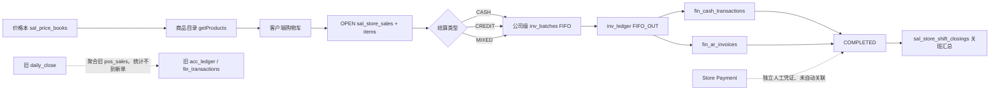
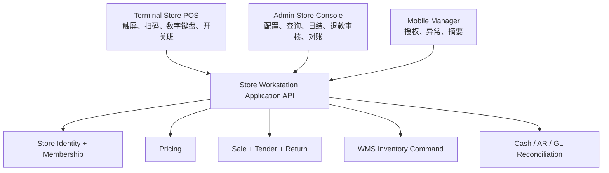
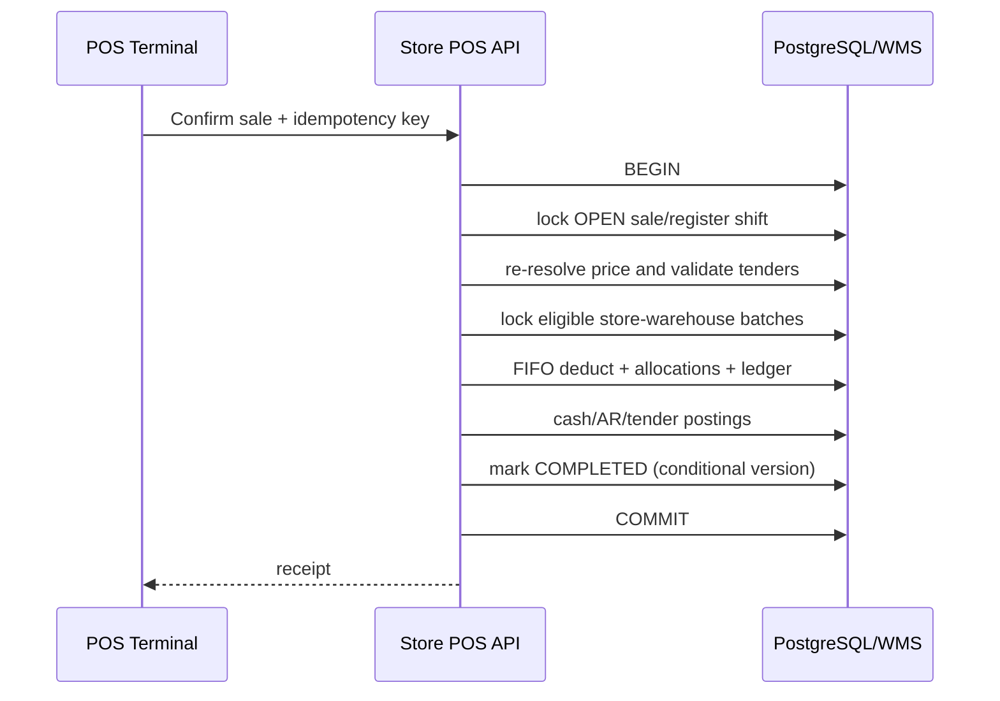
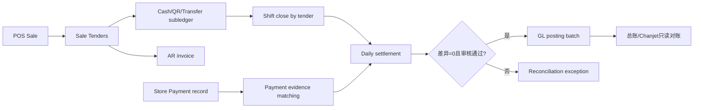
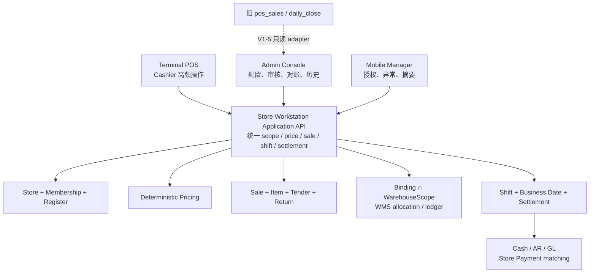

# 直营店收银 / 门店工作台历史设计考古、现状分析与 V1 提案

> 日期：2026-08-27
>
> 性质：纯调研、零实施
>
> 取证范围：前端三端路由、后端 Store / Store POS / Store Payment / WMS、迁移与 DDL、`docs/`、Git 历史
>
> 生产边界：本轮未连接生产、未执行生产命令、未写生产；生产运营量仅给出只读取证口径，不伪造实况

## 0. 结论先行

项目历史上可以区分出 **4 种设计方案/形态**，不是 4 个都完整上线的产品版本：

1. **旧门店管理工作台 + V2 POS/日结**（2026-05-15 起）：`/store/*` 是 Generic CRUD 工作台，旧 POS 写 `pos_sales`，旧日结聚合 `pos_sales` 并写 `daily_close / acc_ledger / fin_transactions`。当前门店 CRUD 壳仍在，旧 POS 已从模块注销，旧日结代码仍注册，是半废弃兼容链。
2. **Sales V2 直营店 POS**（2026-05-29 起）：`/store-pos` + `/api/v2/store-sales`，使用 `sal_store_sales` 表族，支持价格本、开关班、现金/赊销/混合支付、FIFO、AR、整单退货。它是**当前采用的主收银方案和唯一活跃 POS 入口**。
3. **统一公司收款码 / Store Payment MVP**（2026-06-21 起）：独立 `/store-payment` 域，解决个人收款码、付款截图、人工确认和审计；并非 POS 支付腿，也不自动入财务账。代码已落地，但裁定始终是受控试点 `GO WITH CONDITIONS`，生产 readiness 为 HOLD。
4. **门店分账库存设置**：`/settings/store-stock` 宣称 Retail/Wholesale 双库存池，但仅有前端设置壳，未发现正式 Boolean schema、库存路由或扣减实现；属于**提出/展示过但未形成运行方案**。

当前没有一个“更完善且已存在、可直接启用的 V1”。最接近的底座是 Sales V2 POS，但它还不是合格的多门店生产 V1：权限、门店仓、库存原子性、价格权威、多支付、日结与总账对账均未收口。因此本文提出的“门店工作台 V1”是基于既有资产的**增量目标方案**，不是伪称历史上已有的版本。

推荐形态：**独立 Terminal 触屏收银体验 + Admin 管理/审核后台 + Mobile 只做店长审批和异常提醒**；共用一套 Store POS Application API，不复制业务规则。

---

## 1. 取证方法与证据等级

- A 级：当前源码、当前迁移/DDL、当前路由与权限种子。
- B 级：专项架构/治理报告及已记录的生产只读证据。
- C 级：Git commit 的引入时间、diff 和提交说明。
- “当前采用”以 A 级为准；早期文档的 HOLD/未 wiring 若已被后续源码和 commit 覆盖，不作为当前状态。
- `docs/ops/runs/` 中大量 Store Payment Agent 编排产物属于同一 REQ 的过程记录，不按独立业务方案重复计数。

## 2. 前端入口与角色 / 菜单考古

### 2.1 Admin 端

| 路由 | 菜单 / 角色入口 | 当前功能 | 判断 |
|---|---|---|---|
| `/store-pos` | `MENU_STORE_POS`；登录后 `ROLE_CASHIER` 跳此；Cashier 通常 V/C/E，Store Manager 另有 D/A | 商品、购物车、建单、现金/赊销/混合收款、开关班、当日汇总、历史、作废、整单退货 | 当前主 POS，但页面仍固定试点公司/门店常量 |
| `/store` | `MENU_STORE_MGR`；`ROLE_STORE_MGR` 登录后跳此 | 今日销售/单量/待收货/近效期 KPI 与五个快捷入口 | 工作台导航壳，KPI/子页未形成统一应用层 |
| `/store/receiving` | `MENU_STORE_MGR` | `store_receiving` CRUD：补货收货验收 | Generic CRUD 单表操作，不是 WMS 收货流程 |
| `/store/replenish` | `MENU_STORE_MGR` | `store_replenish_req` CRUD | 状态字段存在，但无专用领域状态机证据 |
| `/store/losses` | `MENU_STORE_MGR` | `store_losses` CRUD | 原因硬编码，未走字典/统一 WMS 损耗动作 |
| `/store/inventory` | `MENU_STORE_MGR` | `store_inventory` 快照 CRUD | 可人工改库存快照，不是唯一库存台账 |
| `/store/daily` | `MENU_STORE_MGR` | `daily_close` CRUD | 与新 POS 的班次日结不是同一链 |
| `/store-payment` | `MENU_STORE_PAYMENT*` 五个细分菜单 | 收款账户、付款登记、凭证、确认/驳回/作废；导出禁用 | 独立人工收款确认域，不是 POS 支付编排 |
| `/settings/store-stock` | 设置菜单体系 | `mst_stores.split_stock_enabled` 开关，UI 宣称零售/批发分池 | UI 壳，未落地库存模型 |
| `/master-data/stores`、`/master/stores` | 主数据菜单体系 | 门店运行时/兼容 `mst_stores` 档案 | 门店身份目前仍双轨 |

关键证据：

- 路由与快捷入口：[store/page.tsx](<../../apps/web/src/app/(admin)/store/page.tsx>)、[store-pos/page.tsx](<../../apps/web/src/app/(admin)/store-pos/page.tsx>)、[store-payment/page.tsx](<../../apps/web/src/app/(admin)/store-payment/page.tsx>)。
- Sidebar 映射：[Sidebar.tsx](../../apps/web/src/components/layout/Sidebar.tsx) 154–172 行。
- 登录角色跳转：[login/page.tsx](../../apps/web/src/app/login/page.tsx) 188–201 行。
- Generic CRUD 对 `store_*` 的菜单映射与 `store_code` 注入：[generic-crud.controller.ts](../../apps/api/src/modules/generic-crud/generic-crud.controller.ts) 291–296、396–495 行。

### 2.2 Terminal 端

Terminal 已有适合触屏作业的基建：全屏 kiosk、无 Admin Sidebar、权限瓦片、数字键盘、班次/上下文、本地草稿；当前覆盖包装和 WMS，配送瓦片标为未就绪。**没有门店 POS / Cashier 路由或门店角色首页**。

现有可复用资产：

- 全屏与登录保护：[terminal/layout.tsx](<../../apps/web/src/app/(terminal)/layout.tsx>)。
- 权限瓦片：[terminal/home/page.tsx](<../../apps/web/src/app/(terminal)/terminal/home/page.tsx>)。
- 终端上下文与 localStorage：[useTerminalContext.ts](../../apps/web/src/hooks/useTerminalContext.ts)。
- 包装的开班→作业→异常→关班流程证明该端适合固定工位，而非证明门店 POS 已实现。

### 2.3 Mobile 端

Mobile 有登录、角色导航、审批、通知、农场销售、配送等能力，且有断网提示；**没有门店 POS、Cashier 收银、门店开关班或门店库存工作台**。`/mobile/sales` 是农场直销，不应误计为直营门店 POS。

建议 Mobile V1 只承担店长授权改价、退货/日结审批、异常提醒和只读摘要；不把连续扫码、购物车和收款主流程塞进手机页。

## 3. 后端域与数据模型考古

### 3.1 当前主 POS：StorePosModule

统一前缀 `/api/v2/store-sales`，Controller 挂 `MenuGuard + DataScopeGuard`：

| 能力 | API | 权限 |
|---|---|---|
| 商品目录 | `GET /products` | `MENU_STORE_POS:V` |
| 当日摘要 | `GET /daily-summary` | V |
| 当前班次/历史 | `GET /shift`, `GET /shift/history` | V |
| 开班/关班 | `POST /shift/open`, `POST /shift/close` | C |
| 销售列表/详情 | `GET /`, `GET /:id` | V |
| 建单 | `POST /` | C |
| 现金/赊销/混合 | `POST /:id/pay-*` | E |
| 作废/整单退货 | `POST /:id/void`, `POST /:id/return` | D |

证据：[store-pos.controller.ts](../../apps/api/src/modules/store-pos/controllers/store-pos.controller.ts) 36–210 行。

表族：

- `sal_store_sales`：销售主单、金额、币种、支付状态、现金账户/AR/班次引用、退货字段。
- `sal_store_sale_items`：商品/SKU、等级、规格、数量、单价、金额、首批次号。
- `sal_store_shift_closings`：开关班、系统现金、实盘现金、差异、销售汇总。
- 初始 DDL 在 [27_store_pos_tables.sql](../../apps/api/ddl/27_store_pos_tables.sql)，后续 SKU、币种、退货字段由其他迁移追加，因此该 DDL 不是最终 schema 单一真源。

### 3.2 旧 Store 域

旧 `/api/v3/pos` 已在 [store.module.ts](../../apps/api/src/modules/store/store.module.ts) 注销，注释明确唯一活跃 POS 是 StorePosModule。StoreService 仍保留三条日结形态：

1. ORM `biz_store_daily_close`；
2. V2 fidelity `daily_close`；
3. V2 日结聚合旧 `pos_sales / pos_sale_items`，写 `acc_ledger` 和旧 `fin_transactions`。

这条日结不会统计新 POS 的 `sal_store_sales`。证据：[store.service.ts](../../apps/api/src/modules/store/store.service.ts) 14–53、56–253 行。

### 3.3 Store Payment 域

数据模型：

- `store_payment_accounts`：公司、门店、账户码、支付方式、币种、QR 附件、可选 `fin_cash_account_id`、状态。
- `store_payment_records`：付款号、门店/公司、账户、金额、币种、方式、付款时间、凭证、可选订单/销售单号、PENDING/CONFIRMED/REJECTED/VOIDED、审计字段。

当前链路是“店员登记 → PENDING → 店长/财务确认/驳回 → 可作废 → 审计”。它没有调用 POS、现金流水、AR、总账或 Chanjet；`fin_cash_account_id` 只是弱映射线索。证据：[store-payment.service.ts](../../apps/api/src/modules/store-payment/store-payment.service.ts)、[CreateStorePaymentTables](../../apps/api/src/database/migrations/1782041418112-CreateStorePaymentTables.ts)。

### 3.4 门店库存 / Store Stock

现状有三种互不等价的“库存”表达：

1. POS/Sales V2 走 `inv_batches / inv_ledger`；POS FIFO 只按 `company_code + SKU/product/grade`，不按门店或仓库筛选。
2. WMS 原子库存走 `wms_stock_balance / wms_stock_ledger`，维度含仓、库位、规格、批次和 `store_code`，与 POS FIFO 不是同一服务。
3. `/store/inventory` 直接 CRUD `store_inventory` 快照，`/settings/store-stock` 只写一个未形成正式 schema/逻辑的开关。

因此当前门店不是“每店一个正式虚拟仓”，也不是独立 Store Stock 领域；实际 POS 消耗的是**公司级 `inv_batches` 池**。`store_code` 在销售单上表示归属门店，在 ledger 上是跟随写入的机构标签，但不决定取货批次。

## 4. 历史方案清单与 Git 时间线

| 方案 | 时期 / 关键提交 | 单据流 / 库存 / 收银 / 权限 | 当时裁定 | 当前状态与证据链 |
|---|---|---|---|---|
| A. 旧门店工作台 + V2 POS/日结 | 2026-05-15，`991035ae` initial | `/store/*` CRUD；旧 `pos_sales`；旧 POS 扣 `inv_batches`；`daily_close` 写旧财务表；legacy `store_code` 隔离 | 初始业务基线；后续审计称 POS 接近 Runtime | **半废弃**：CRUD 与 StoreService 仍在，旧 POS Controller 注销；新 POS 不被旧日结统计 |
| B. Sales V2 Store POS | 2026-05-29，`3a176558`；`2d342f30` 引擎解耦；6 月 27–28 日补币种、改价、退货、并发现金 | `sal_store_sales`；价格本；CASH/CREDIT/MIXED；公司级 FIFO；现金/AR；班次 | Pilot Run 1 核心范围；R6 代码层 ready、运营待跑 | **当前在用主方案**：唯一活跃 POS 模块；但固定试点门店及多项 P0 债务未收口 |
| C. Store Payment 统一公司收款码 | 2026-06-21 `69cb7fdb` schema；`13676d2c` API；6 月 23–24 Web/ACL | 独立付款凭证；人工确认；门店/本人范围；不扣库存、不自动财务入账 | REQ 明确 MVP-1 排除自动对账/财务/库存/POS 强绑定；后续 `GO WITH CONDITIONS` | **代码落地、试点未闭环**：生产 readiness HOLD；导出禁用；不是 POS 支付腿 |
| D. Retail/Wholesale 分账库存 | 页面随设置体系出现；未发现对应领域 commit | UI 开关宣称 POS 只扣 Retail、B2B 只扣 Wholesale | 未发现正式 schema gate / 领域裁定 | **展示壳/未落地**：无后端读取、无池维度、无迁移；Generic CRUD 甚至可能动态补 TEXT 列 |

### 4.1 重要历史文档逐项裁定

- [sales-v2-architecture-audit.md](../sales-v2-architecture-audit.md)（2026-05-26）：当时销售域碎片化，旧 `store/pos` 被判为最接近 Runtime；不是对当前新 StorePosModule 的最终验收。
- [sales-v2-architecture.md](../sales-v2-architecture.md)（2026-05-27）：规定 `sal_*`、库存和 Finance V2 边界，为新 POS 抽离提供架构基线。
- [pilot-run-1-execution-plan.md](../pilot-run-1-execution-plan.md)、[launch report](../pilot-run-1-launch-report.md)（2026-05-30）：将直营店 POS、FIFO 与日结列入试运行核心范围，状态 RUNNING；这是试运行裁定，不等同当前生产实况证明。
- [v3-final-readiness-audit.md](../v3-final-readiness-audit.md)：指出旧门店日结仍写 `fin_transactions`，Pilot 可启动但全量上线需清旁路。
- [R6 go-live preparation](../production-runtime-rebuild-phase-r6-go-live-preparation.md)：POS→库存场景代码 ready，但 HTTP 全链和真实运营未跑，不能据此声称生产成熟。
- [REQ_STORE_PAYMENT_UNIFIED_CODE_001_SPEC.md](REQ_STORE_PAYMENT_UNIFIED_CODE_001_SPEC.md)：冻结 MVP-1 为人工收款凭证，明确排除自动到账、自动对账、库存、Chanjet、POS 强绑定和生产部署。
- [Store Payment data model](REQ_STORE_PAYMENT_UNIFIED_CODE_001_DATA_MODEL_DRAFT.md)、[API draft](REQ_STORE_PAYMENT_UNIFIED_CODE_001_API_DRAFT.md)、[permission matrix](REQ_STORE_PAYMENT_UNIFIED_CODE_001_PERMISSION_MATRIX.md)、[state machine](REQ_STORE_PAYMENT_UNIFIED_CODE_001_STATE_MACHINE.md)：分别定义独立账户/记录、细粒度菜单、门店派生范围和四态；早期均为 draft，不应误写成当时已批准实施。
- [Store Payment controlled pilot decision](STORE_PAYMENT_CONTROLLED_PILOT_RELEASE_DECISION.md)、[A7 QA Gate](A7_STORE_PAYMENT_FINAL_QA_GATE_REPORT.md)：后续代码和本地/受控试点准备已推进，但 production 始终 HOLD。
- [warehouse type and permission research](warehouse-type-and-permission-research-20260825.md)：提出 `facility_class × usage_type × capabilities` 双维度，`STORE` 是设施类别草案；当前仍冻结，不能直接复用旧 `type` 硬塞门店。
- [procurement role / xiejiling research](procurement-role-and-xiejiling-conflict-research-20260826.md)：X-B 明确要求 POS 专用门店模型、双读和消费点清零后才退役 `sys_user.store_code`。
- [SKU status mismatch fix](sku-status-mismatch-fix-20260826.md)：明确将 POS `getProducts()` 漏 `sal_price_items.status='ACTIVE'` 留作销售定价专项债务。

## 5. 当前采用方案：完整链路剖析

### 5.1 收银链路



1. **选货/价格**：`getProducts(storeCode, companyCode)` 查询 ACTIVE 且生效中的价格本、正价明细，并返回 floor/ceiling；但 `storeCode` 未参与 SQL，`pi.status='ACTIVE'` 漏滤，且无确定排序便做内存去重，所以“最新价”不可靠。
2. **建单**：客户端提交商品名、商品码和单价；服务重算金额、只校验低于 floor 的店长授权，没有按权威价格结果复验 SKU/价格，客户端仍可伪造高价/商品描述。
3. **收款**：只有 CASH/CREDIT/MIXED 三种业务分支；`paymentMethod` 是单值标签，不是多支付 tender 明细。现金写 `fin_cash_transactions`，赊销写 `fin_ar_invoices`，混合仅是一条现金腿 + 一条 AR 腿。
4. **库存**：同一 DB 事务内调用 FIFO，但 FIFO 以公司为池，不选门店仓；库存不足只 warn，异常 catch 后也继续，随后仍可完成销售。因此“事务包裹”不等于“库存与成交原子成功”。
5. **日结**：新链关班按 `sal_store_sales` 从 `opened_at` 聚合并写 `sal_store_shift_closings`。`MIXED` 的 `paid_amount` 被全部计入 `cash_sales`，即使 payment method 是 QR/转账。
6. **财务**：单笔 POS 已分别写 Cash/AR；关班仅保存运营汇总，不生成可对账的日结凭证。Store Payment 也未自动匹配 POS 或总账。旧 V2 日结虽然写旧财务表，却读旧 `pos_sales`，不能充当新链闭环。

### 5.2 门店库存模型结论

- 门店当前是销售归属/组织兼容身份，不是已建模的正式 WMS 仓。
- 项目长期原则已经明确“仓库 ≠ SITE，FIFO/批次/库位用 `warehouse_code`”；因此不建议另建平行 `store_stock` 作为权威库存。
- `inv_batches` 虽存在 `warehouse_code/location_code/store_code`，当前 POS FIFO 没用仓库条件；`store_code` 也不应继续兼任组织 SITE、门店、数据隔离和库存池。
- `/store/inventory` 可编辑快照与“库存台账唯一性”铁律冲突，应在 V1 中降为只读视图或退役，而非继续扩展。

### 5.3 权限与多店

- `ROLE_CASHIER` 通常持 `MENU_STORE_POS:V/C/E`，`ROLE_STORE_MGR` 持 V/C/E/D/A；登录页只做目的地分流，真正门禁是菜单权限。
- `DataScopeGuard` 只把范围写 CLS，不自动过滤。StorePosService/ShiftService 信任 query/body 的 `storeCode/companyCode`，未读取 allowed store scope；具菜单权限的人可构造跨店请求。
- `sys_user.store_code` 注释允许逗号多店，但 POS 没有授权门店列表或 selector；Generic CRUD 又按整个字符串做等值查询。因此“一 cashier 多店”只是字段兼容设想，不是可用能力。
- Store Payment 已有逗号拆分、别名展开和部分门店范围逻辑，但不应复制到 POS；V1 应统一为显式授权模型。

### 5.4 与近期治理的耦合

1. **仓库分域后**：`wms_warehouses.domain` 已区分 OPERATIONAL / FINANCE_MAPPING / TEST；门店仓必须是 OPERATIONAL。`facility_class=STORE`、`usage_type`、capabilities 仍是草案，V1 需等该 schema 决策或以兼容映射过渡，不修改现有 `type` 语义。
2. **仓权限 A 阶段**：门店 POS 库存仓应采用“所属门店授权 ∩ 显式 WarehouseScope”，零授权 fail-closed，且 FINANCE_MAPPING/TEST 不可进入销售扣减。
3. **X-B store_code 退役**：先引入正式 Store 身份与 Store Membership，POS 双读影子比对；之后停止 JWT legacy 消费，最后才讨论删列。不能在 POS 仍依赖时直接 DROP。

## 6. 已知缺陷与债务清单

### P0：V1 上线前必须清偿

1. **跨店/跨公司范围绕过**：StorePosService 未应用 DataScope，所有门店/公司参数由客户端提供。
2. **支付并发竞态**：支付前事务外读 OPEN，事务内无销售单 `FOR UPDATE` 或条件状态更新，可能重复扣库存、重复写 Cash/AR。
3. **FIFO 失败仍成交**：库存不足仅 warning；任一 FIFO 异常被 catch 吞掉；退货却按整单数量入 QUARANTINE，可能凭空增加库存。
4. **公司级库存池**：POS 未指定门店运营仓，无法证明哪家店出了哪批货。
5. **价格权威缺口**：漏 `sal_price_items.status='ACTIVE'`；storeCode 未用；价格本优先级不确定；建单未复验商品和权威售价。
6. **日结双轨断裂**：新班次读 `sal_store_sales`，旧日结读 `pos_sales`；Admin `/store/daily` 还可直接 CRUD。
7. **支付明细缺失**：无 tender 行表，无法表达现金+QR、双币种、找零、二维码账户、退款分摊。
8. **门店显式授权缺失**：legacy 单值/逗号字符串不是授权模型。

### P1：首轮稳定后清偿

9. 多批次分配只把首批号写回 sale item，缺完整 `sale_item ↔ batch allocation` 追溯。
10. 开班 SELECT 后 INSERT，无“每店唯一 OPEN 班次”约束。
11. 现金超收只在 sale 记录 paidAmount，Cash transaction 仍写 total，找零/实收口径不一致。
12. CREDIT 的客户校验会被默认“散客”绕过；MIXED 也可形成无权威客户的 AR。
13. 关班把 CASH/MIXED 的 `paid_amount` 当现金，支付方式口径错误。
14. Store Payment 与 POS/总账无自动匹配，`fin_cash_account_id` 无强 FK，确认不等于入账。
15. Store Payment 固定单店试点，导出禁用，附件 ACL/metadata 条件下可能不可预览。
16. `/store/*` 多个 CRUD 表是旁路库存/损耗/日结模型，易制造第二真相。
17. 初始 DDL、后续迁移、schema snapshot 对币种/退货等字段末态不一致，需在实施阶段做约束三对齐。

## 7. 门店工作台 V1 目标方案

> **复核修正 v1.1（2026-08-27，定稿）**：12 项建议均已采纳。本节以下内容已按 R1–R8 攻击面补齐；凡与前文“建议/待批准”措辞冲突，以本节、§8、§11–§14 的定稿口径为准。本轮仅修订方案与执行生产只读聚合，没有实施任何 V1 业务代码、DDL 或部署。

### 7.0 批判性复核结论

| 攻击面 | 结论 | 依据与修正 |
|---|---|---|
| R1 两入口 scope | **方案有洞，已修正** | `DataScopeGuard` 明确只写 CLS、始终放行；Controller 又把客户端 `storeCode/companyCode/id` 原样交给 service（[data-scope.guard.ts](../../apps/api/src/modules/org/guards/data-scope.guard.ts) 1–5、22–51 行；[store-pos.controller.ts](../../apps/api/src/modules/store-pos/controllers/store-pos.controller.ts) 102–210 行）。`getSale(id)` 只按 ID，列表也只使用可选客户端过滤（[store-pos.service.ts](../../apps/api/src/modules/store-pos/services/store-pos.service.ts) 207–223、560–603 行）。修正为：`/store-pos` 与 Terminal **只能调用同一组 scoped Application API**；所有读、写、详情、支付、退货、班次、商品目录均在 service/application 层解析 membership，入口/路由不得各写一套授权。兼容入口未迁移完成前不得开放 Terminal 试点。 |
| R2 支付/FIFO/退货原子性 | **需补充，已修正** | 当前支付在事务外读 OPEN，事务内无 sale 行锁/条件更新；FIFO 虽锁批次，但库存不足和异常会继续成交（[store-pos.service.ts](../../apps/api/src/modules/store-pos/services/store-pos.service.ts) 307–341、687–793 行）。退货虽锁 sale，却按整行数量新建 QUARANTINE 批（同文件 480–539、912–939 行）。修正为同一 transaction manager/QueryRunner 内依次锁 sale、shift/register、候选批次；幂等唯一键 + `status='OPEN'` 条件终态更新双保险；任何库存、现金、AR、tender 异常抛出并回滚。原单是否已关班/日结不改变原 allocation：库存仍精确反向，财务生成当前营业日的 reversal/adjustment，并引用原 settlement；已 POSTED settlement 不回开、不改写。 |
| R3 门店仓与仓权限 | **需补充，已修正** | 当前只落地 `domain`，`facility_class/usage_type/capability` 仍未落地（[AddWarehouseDomain.ts](../../apps/api/src/database/migrations/1787724000000-AddWarehouseDomain.ts) 3–18 行；[warehouse research](warehouse-type-and-permission-research-20260825.md) 188–209 行）。过渡期只要求绑定 ACTIVE、`domain=OPERATIONAL` 的已核验仓，并以 binding purpose 标记 SALES/RETURNS；不得把旧 `type` 临时写成 STORE。有效仓严格为 `StoreMembership→StoreWarehouseBinding ∩ dataScope.allowedWarehouseCodes`，不是并集，空集 fail-closed。现有仓权限集合来源见 [data-scope.service.ts](../../apps/api/src/modules/org/services/data-scope.service.ts) 184–196、267–327 行。 |
| R4 价格权威 | **方案有洞，已修正** | 当前价格本没有 store scope/version，POS 目录没用 `storeCode`、漏 `pi.status='ACTIVE'`，且无确定排序（[sales baseline](../../apps/api/migrations/20260527_sales_v2_phase0_baseline.sql) 106–163 行；[store-pos.service.ts](../../apps/api/src/modules/store-pos/services/store-pos.service.ts) 633–666 行）。落定优先级：**门店本 > 客户本 > 渠道本 > 公司默认本**；同层依次按 item specificity、`priority ASC`、`effective_from DESC`、`publish_version DESC`、`id DESC` 形成全序。相同 company/scope/item/currency/priority 且生效期或数量区间重叠时禁止发布；不同 priority 可重叠但必须预览遮蔽。目录与结算复用同一解析器，结算事务内重算并保存 price item 与快照。 |
| R5 settlement | **方案有洞，已修正** | 旧日结仍聚合 `pos_sales` 并写旧财务链，新班次聚合 `sal_store_sales`（[store.service.ts](../../apps/api/src/modules/store/store.service.ts) 110–239 行；[store-pos-shift.service.ts](../../apps/api/src/modules/store-pos/services/store-pos-shift.service.ts) 84–146 行）。Store Payment 只有自由文本 sale/order no，无匹配状态（[CreateStorePaymentTables.ts](../../apps/api/src/database/migrations/1782041418112-CreateStorePaymentTables.ts) 38–70 行）。修正为：V1-1 即冻结旧链新增消费者；V1-5 在新链 UAT/观察通过时关闭旧写入口。新增门店时区、日切时刻与不可变 `business_date`；夜班按**开班时确定的营业日**归属，关班不因跨零点拆班。自动匹配失败进入 EXCEPTION，财务/店长按 scope 人工选候选单或暂不匹配，必须填写原因/凭证/审计；未匹配不得过账。 |
| R6 阶段依赖 | **需补充，已修正** | 仓 A 已完成，但双维度仓类型尚未排期；原 V1-2 暗含依赖。修正为 V1-1 可先绑定 OPERATIONAL 仓，不依赖 `facility_class` schema；V1-2 的库存成交只依赖可信绑定与 WMS command。`facility_class=STORE` 作为已批准的并行仓治理项，在落地后替换过渡校验，不阻塞 P0。Tender 契约提前在 V1-2 冻结，避免 Terminal 按单值支付返工。 |
| R7 生产量级 | **原方案仅有口径，已执行补齐** | workflow 在 `default_transaction_read_only=on` + `BEGIN TRANSACTION READ ONLY` 下完成五类聚合，见 §10。91 天销售/退货/支付均为 0，仅 4 次关闭班次，因此不以全量推广为当前最高优先；但跨店、重复支付、库存失败仍成交属于任何重新启用前的硬门。量级规则见 §10.2。 |
| R8 自找风险 | **方案有洞，已修正** | Terminal context 使用未按用户/门店/register 隔离的全局 localStorage key（[useTerminalContext.ts](../../apps/web/src/hooks/useTerminalContext.ts) 12–22、71–124 行）；旧 `/store/daily` 仍可 CRUD，现代班次又缺 OPEN 唯一约束（[daily/page.tsx](<../../apps/web/src/app/(admin)/store/daily/page.tsx>) 21–64 行；[store-pos-shift.service.ts](../../apps/api/src/modules/store-pos/services/store-pos-shift.service.ts) 42–69 行）。修正为草稿 key 必须包含 user/store/register/schemaVersion，登录/切店/关班清理并校验服务端身份；单浏览器多操作员不得共享 register session；新旧 POS 不允许同店同营业日双写；Cashier 培训/UAT 签收是试点运营 Gate，虽不做运行时权限替代。 |

### 7.1 架构选择



**建议：Terminal 主收银，Admin 管理，Mobile 辅助。**

- Terminal 已有 kiosk、触屏、权限瓦片、数字键盘、班次和 localStorage 草稿基建，最适合连续扫描和高频结账。
- Admin 保留商品/价格、账户、班次历史、日结审核、退货审核、对账和门店库存只读视图。
- Mobile 不复制完整 POS，只做需要离开柜台的店长动作。
- 现有 `/store-pos` 可先作为兼容入口，逐步把页面逻辑抽到共享 Store POS UI/domain hooks；不要求首阶段改路由。
- **复核修正 v1.1**：兼容仅限 UI/路由，不能兼容旧的信任边界。Admin `/store-pos` 与 Terminal 从 V1-1 起必须共用同一个 `StoreContextResolver + StoreScopePolicy` 和 scoped API；任何入口若仍可直接提交并信任 `storeCode/companyCode`，则两入口均不得进入试点。

### 7.2 正式门店与门店仓模型

目标实体关系：

```text
Store (正式门店身份，canonical store_id/store_code)
  ├─ StoreMembership (user_id, store_id, role, effective period, status)
  ├─ StoreWarehouseBinding (store_id, warehouse_code, purpose, priority, status)
  ├─ StoreRegister (收银机/终端)
  └─ StoreShift (register_id + cashier + opened/closed)

wms_warehouses
  domain = OPERATIONAL
  facility_class = STORE          # 已批准进入后续仓治理，当前尚未落地
  usage_type = EGG_SALES/GENERAL  # 按业务用途
  capability 可包含 RETAIL_FULFILLMENT / RETURNS_QUARANTINE
```

选择 **WMS 门店仓**，不建设平行权威 `store_stock`：

- 每家直营店至少绑定一个销售可用 OPERATIONAL 仓；退货可进同仓 QUARANTINE zone，必要时绑定独立退货仓。
- **复核修正 v1.1（过渡合同）**：双维度字段落地前，binding 只接受 ACTIVE + OPERATIONAL 仓，`purpose=SALES/RETURNS`；QUARANTINE 是绑定仓内的 zone/status 能力要求，不把旧 `wms_warehouses.type` 改写成 STORE。双维度治理落地后再追加 `facility_class=STORE`/capability 校验。
- **复核修正 v1.1（集合语义）**：`effectiveWarehouseCodes = binding(store_id,purpose) ∩ allowedWarehouseCodes`。StoreWarehouseBinding 只做业务上下文裁剪，绝不扩张 DataScope；Admin/GROUP 的 global scope 也仍须受 binding 和 OPERATIONAL 限制。
- `store_code` 只表达门店业务归属；库存定位始终由 `warehouse_code + zone/location + batch` 表达。
- POS 不直接改余额表，调用统一 WMS inventory command，在同一数据库事务中锁销售单、锁批次、扣减、写 allocation 和 ledger。
- FIFO 顺序维持到期日优先、创建时间次之；库存不足或库存服务异常必须回滚成交，若业务要“先卖后补”必须另建明确 Backorder 单据，不能 warn 后静默完成。

### 7.3 单据与原子性

最小新增/演进模型：

- `store_sales`：沿用 `sal_store_sales`，补 `store_id / warehouse_code / register_id / shift_id / idempotency_key / version`。
- `store_sale_items`：沿用现表；价格来源留 `price_item_id / price_snapshot`。
- `store_sale_tenders`：一单多行，类型 CASH/QR/TRANSFER/CARD/CREDIT，金额、币种、汇率、账户、外部参考、状态。
- `store_sale_allocations`：每个 sale item 对应多个 batch/qty，替代只存首批号。
- `store_returns + items + tender_reversals`：V1 可先整单退货，但数据模型不锁死为整单；库存只按原 allocation 可退数量反向。
- `store_shift_closings`：沿用并补按 tender 的 expected/actual/difference；唯一 OPEN 班次约束需按 register 或 store 的业务裁定。
- `store_daily_settlements`：班次可多次，日结按门店+营业日汇总，生成 immutable settlement 和对账状态。

成交事务：



任何库存、tender 或财务子账失败都回滚；重试依赖 idempotency key 返回同一结果。

**复核修正 v1.1（PostgreSQL 18 / 当前 TypeORM 合同）**：支付方法不得在进入事务前调用普通 `getSale()` 作为权威判断；必须使用同一个 transaction manager 完成 `SELECT sale ... FOR UPDATE`、事务内重读 items/status、锁定 OPEN register/shift、按有效门店仓锁批次、写 allocation/ledger/tender/现金或 AR，最后用 `WHERE id=? AND status='OPEN'`（或 version）条件更新。`idempotency_key` 建数据库唯一约束，重复请求读取既有结果。advisory lock 可作为同仓 SKU 的串行优化，不能替代 sale/batch 行锁与数据库唯一约束。

退货无论原班次 OPEN/CLOSED、原 settlement REVIEWED/POSTED，都按原 allocation 的“已售 - 已退”余额反向至 RETURNS/QUARANTINE；已日结只追加当前营业日的 tender reversal、库存 reversal 与 settlement adjustment，引用原 sale/allocation/tender/settlement。禁止重开或改写历史 settlement，也禁止因缺 allocation 猜测回库；历史无 allocation 的旧单走人工异常单。

### 7.4 价格体系

- 继续使用 `sal_price_books / sal_price_items`，但建立确定的适用规则：company 必选，可选 store/channel/customer group；ACTIVE + 生效期 + currency + priority + version。
- 商品目录与提交结算均由服务端重新解析 price item；销售行保存 `price_item_id` 和不可变价格快照。
- 明确处理同一 SKU 多个有效价格：priority、scope specificity、effective_from、version/id 形成全序；冲突配置在发布价格本时阻断。
- **复核修正 v1.1（权威全序）**：先过滤 company/currency/ACTIVE/生效期/数量区间；再按 SKU 精确优先于 product+grade+spec，scope 固定为 `store > customer > channel > company-default`，随后 `priority ASC > effective_from DESC（NULL 最早）> publish_version DESC > id DESC`。最后的 id 只作稳定兜底。
- **复核修正 v1.1（冲突 Gate）**：同 company、同 scope key、同 item identity、同 currency、同 priority 的明细，只要日期区间或数量区间相交即拒绝发布；不同 priority 可重叠但发布预览必须显示被遮蔽规则。生效期与数量区间均按闭区间判断。
- 改价必须记录原价、改后价、原因和授权人；floor/ceiling 都由策略决定，不让客户端凭菜单码自报授权。
- 首个修复即补 `pi.status='ACTIVE'`，但应和完整价格解析一起验收，避免只补一行后仍随机取价。

### 7.5 多支付、挂单、退货与离线

- **多支付**：tender 行金额按结算币种校验合计；现金支持 tendered/change；QR/转账必须绑定 Store Payment Account 或财务现金账户映射；CREDIT 必须有 ACTIVE 客户和额度/账期检查。
- **挂单**：OPEN 单可保存/恢复，绑定 register/cashier/store，过期自动标记 ABANDONED；恢复时重新校验价格和库存，不预占或明确用 reservation。
- **退货**：按原单、原行、原 allocation 和原 tender 反向；退回 QUARANTINE，质检后才能转 AVAILABLE；退款分现金/QR/AR 红冲，不再用整单数量盲目回库。
- **离线评估**：V1 不建议真正离线成交。可离线缓存商品/价格只读和 OPEN 草稿，但支付确认、库存扣减、票号生成必须在线。若老挝网络实测要求离线销售，应单独立项：设备证书、签名事件、离线额度/库存配额、单调序列、冲突仲裁和补传审计，风险高于 V1。

### 7.6 权限模型与 store_code 退役

引入显式 `StoreMembership`，语义对齐仓权限 A 阶段：

- Cashier：按有效 membership 选择门店；可开班/建单/收款，只能操作自己的 register/shift。
- Store Manager：本店改价授权、退货、关班/日结审核；多店店长由多条 membership 表达。
- Finance：按公司/授权门店看 settlement 和 Store Payment 对账，不自动获得 POS 操作权。
- Admin：配置门店、仓、register、支付账户和授权；高权限仍留审计。
- 服务端从认证上下文解析 allowedStoreIds，body 的 `store_id` 必须是其子集；再取 StoreWarehouseBinding 与 allowedWarehouseCodes 交集，空集合 fail-closed。

X-B 路线：

1. 建 Store/StoreMembership/绑定映射并回填；legacy `store_code` 只读兼容。
2. POS 双读（membership 权威、legacy 影子比较）并记录差异，不改变结果。
3. 切换 POS、Store Payment、Generic CRUD 门店页到新范围；保留 feature flag 回旧读。
4. 停止用户 API 写 legacy，token 保留兼容版本；观察无消费者后移除 JWT 字段。
5. schema 删除最后单独决策，绝不与 V1 首发绑在一起。

### 7.7 财务闭环



- Store Payment 不再是孤岛：QR/转账 tender 可引用 account；付款凭证与 POS sale/tender 进行一对一/多对一匹配。
- CONFIRMED 仅表示业务凭证确认，不直接等于 GL posted；日结结算审核后生成幂等 posting batch。
- 对账至少三方：POS tender 合计、收款账户/Store Payment 证据、Cash/AR/GL；差异进入异常队列，不靠修改已确认记录抹平。
- 延续“好业财只读单向”铁律；不得把门店聚合或 Store Payment 塞进 `fin_ar_invoices`。赊销发票仍由 ERP 业务流生成，支付结算走现金/收款/总账链。
- **复核修正 v1.1（营业日）**：Store 配置 IANA timezone 与 `business_day_cutoff`；开班时计算并固化 `business_date`，销售继承 shift 的营业日。跨零点夜班不拆分，摘要、匹配、settlement 一律按 `business_date`，不得再用 `CURRENT_DATE` 或字符串截取 `created_at`。
- **复核修正 v1.1（人工兜底）**：Store Payment 自动匹配须同时满足 company/store/currency/amount/reference/business_date；失败则为 `EXCEPTION`。有授权的店长/财务可在 scope 内选择候选 sale/tender、部分匹配或暂不匹配，必须记录 reason、evidence、operator/time 和解除匹配审计。`CONFIRMED` 只代表凭证审核，未匹配或有差异不得进入 GL posting。
- **复核修正 v1.1（双轨收敛）**：V1-1 冻结旧 POS/日结新功能和新消费者；V1-3 试点店按“门店 + business_date”选择唯一写引擎，禁止新旧双写；V1-5 在新链 UAT、对账与回滚演练通过后关闭 `pos_*`、`daily-close-v2`、`/store/daily`、`store_inventory` 写入口，历史仅通过只读 adapter 查询。

## 8. 增量迁移路径

> **复核修正 v1.1**：V1-0 已于本轮完成生产聚合，结论见 §10；正式交付仍按 **6 个实施阶段 V1-1…V1-6**。仓 A 已闭环，`facility_class=STORE` 的双维度治理可并行，不再作为 V1-1/V1-2 的隐性阻塞。

| 阶段 | 目标与主要产物 | 硬前置 / 可并行 | 退出标准 |
|---|---|---|---|
| V1-1 身份、scope 与过渡门店仓 | canonical Store/映射、StoreMembership、StoreWarehouseBinding；统一 `StoreContextResolver/StoreScopePolicy`；Admin/Terminal API 全链强制 scope；移除固定常量 | 本轮聚合完成；门店与人事授权确认；仓 A 已具备。双维度仓治理、X-B 消费矩阵可并行 | 两入口所有读写共享一套 scope；跨店/跨公司/猜 ID 均 403；有效仓=binding∩allowedWarehouseCodes；空集 fail-closed；legacy 仅影子比较 |
| V1-2 价格与成交安全 | 确定性 price resolver/发布冲突 Gate/价格快照；sale+shift+batch 锁、idempotency、allocation、失败回滚；冻结 tender/营业日接口契约 | V1-1 的可信 store/warehouse context；价格冲突清单；WMS command 边界。价格与库存子流可并行开发、共同验收 | 双击/重试仅一个结果；不足/库存或财务异常零成交；每批可追溯；目录/结算同价；同级重叠价格不能发布 |
| V1-3 Terminal 与单店试点 | Terminal POS、扫码/键盘/挂单/班次；版本化且按 user/store/register 隔离草稿；Admin 兼容入口保留 | V1-1/2 API 稳定；终端网络/硬件基线；试点店 Cashier 培训签收；同店旧写引擎关闭 | 单店 UAT 完成开班→销售→支付→退货→关班；网络重试不重复；两入口结果和权限一致；同营业日无双 POS 写入 |
| V1-4 Tender、营业日日结与财务 | tender 行；Store Payment 自动/人工匹配；business_date；settlement/异常/审核/幂等 posting | V1-2 已冻结 tender/营业日契约；账户/科目/审批职责确认 | POS/tender/凭证/Cash/AR/GL 可勾稽；EXCEPTION 可人工闭环；POSTED settlement 不可改；跨午夜口径一致 |
| V1-5 旁路收口 | 旧 `pos_*`、`daily-close-v2`、`/store/daily`、`store_inventory` 写入口关闭；历史只读 adapter | V1-3/4 UAT 与稳定观察通过；历史映射和回滚演练 | 新写入口唯一；旧写入连续观察为 0；旧数据可查；新 settlement 不读旧表；无双写/双日切 |
| V1-6 `store_code` 退役准备 | 停写 legacy；双读差异清零；移除 JWT/runtime 消费；DROP 另案 | V1-5；X-B 静态消费矩阵、runtime 告警和 JWT 兼容观察均清零 | 观察窗无读取/写入/漂移后才提交独立 schema 删除决策；V1 不直接 DROP |

该顺序不推倒重来：保留 `sal_store_sales`、现有页面和 Store Payment 表，优先补权威身份、原子性和对账；旧表先只读，不删除。

## 9. V1 对既有债务的清偿关系

| 债务 | V1 处理 | 是否顺带清偿 |
|---|---|---|
| POS 漏 price item ACTIVE | V1-2 统一价格解析，目录与结算双校验 | 是，且不止补单一过滤 |
| `store_code` 双轨 | V1-1 引入 membership；V1-5/6 双读→停写→移除消费 | 是，但 DROP 不属于 V1 首发 |
| 门店库存不分仓 | StoreWarehouseBinding + OPERATIONAL STORE 仓 + WMS command | 是 |
| Store Stock UI 壳 | 不扩平行池；改为仓库存只读/配置视图 | 是 |
| 新旧日结双轨 | settlement 统一读新 sale/tender；旧链只读归档 | 是 |
| Store Payment 孤岛 | tender/account/settlement 匹配，确认与过账分层 | 是 |
| 多批次追溯缺失 | allocation 表 | 是 |
| 真实离线能力缺失 | V1 明确只离线草稿；全离线另立高风险项目 | 否，主动限界 |
| 两入口 scope 旁路 | 共用 StoreContextResolver/StoreScopePolicy；所有 ID 详情与动作复核 scope | 是，V1-1 P0 |
| 跨午夜口径漂移 | store timezone/cutoff + shift/sale/settlement 固化 business_date | 是 |
| OPEN 班次并发 | register 维度 partial unique + 行锁/条件状态更新 | 是 |
| Terminal 草稿串身份 | localStorage key 按 user/store/register/schemaVersion 分区并做服务端恢复校验 | 是 |
| 老 cashier 培训缺口 | 试点前培训/UAT 签收 Gate；不把培训记录冒充 RBAC | 运营清偿 |

## 10. 生产只读取证（复核修正 v1.1：本轮已执行）

### 10.1 Workflow 与实值

在 [.github/workflows/flock-refresh-readonly-audit.yml](../../.github/workflows/flock-refresh-readonly-audit.yml) 增加 `store-pos-v1` 目标，经 GitHub production environment → SSH → `PGOPTIONS='-c default_transaction_read_only=on'` → `BEGIN TRANSACTION READ ONLY` 执行。审计窗口为 **2026-05-29 00:00:00Z（新 POS 引入日）至 2026-08-28 00:00:00Z**，只输出门店级聚合，不输出人员明细。

证据：首次运行 `33030598823` 在只读状态确认后因生产 `created_at` 为 text、与 timestamp 比较失败而安全终止；适配显式 cast 后运行 `33030653177` 成功，production checkout `132cde1b`，事务内 `transaction_read_only=on`，最终 COMMIT（只读事务）。

| 五类聚合 | 91 天生产实值 | 判断 |
|---|---|---|
| 门店单据量 | 新 `sal_store_sales` 0；旧 `pos_sales` 0 | 当前无可证明的真实 POS 交易量，两轨不得相加且均为零 |
| 活跃 cashier | 交易活跃 0；在册 `ROLE_CASHIER` 2：`STORE-HS-001` 1、`STORE-VTE-001` 1 | 有配置、无交易；不能按在册人数推断使用率 |
| 班次频率 | `STORE-BKX-001` 1 次 CLOSED（均长约 0.01h）；`STORE-DP-001` 2 次（均长约 16.01h）；`STORE-MX-001` 1 次（均长约 0.02h）；合计 4 次、OPEN 0 | 只有极低频演练/试班信号；东鹏班次形态最接近真实长班，但没有销售，不能直接定为业务量试点 |
| 退货率 | settled sale 0、return 0；分母为 0，不报 0% | 无法据此评估退货流程，必须用 UAT 注入场景验证 |
| 支付方式分布 | 新 POS completed 0；Store Payment confirmed 0 | 无真实渠道偏好证据；首发渠道按已采纳范围配置，不按空数据删减设计 |

### 10.2 “量级 → 试点店 → 推广优先级”规则

以最近连续 90 天、按 canonical store 的 COMPLETED/RETURNED 销售为准，旧新表分列：

| 量级 | 判定 | 策略与试点 |
|---|---|---|
| **L0：0 单** | 无真实成交；本次生产属于 L0 | 只做 V1-1/P0 安全与可观测性，不启动全量 Terminal/财务推广。试点店由运营确认“未来 30 天会真实开售”且完成仓/账户/人员映射后选择；若尚无承诺店，先用隔离 UAT 店。东鹏仅作为班次核查第一候选，不因 2 次班次自动当选 |
| **L1：1–99 单/90 天** | 低频 | 选 1 店受控试点；先验证全链与人工 settlement，不做多店并发扩张 |
| **L2：100–999 单/90 天** | 中频 | 选交易量最高且退款/差异可控的 1 店，加 1 个不同支付结构的备选店；V1-2/3/4 提升为近期交付 |
| **L3：≥1000 单/90 天或 ≥20 单/营业日** | 高频 | P0 立即阻断推广，V1-1/2 最高优先；完成 7–14 个营业日试点、对账率达标后分批推广 |

所有量级下，静态 P0（跨店、重复支付、库存失败仍成交）都是重新启用/新增推广前硬门；低量级只降低产品推广优先级，不降低安全修复级别。

## 11. 12 项决策落定状态（用户已全部采纳）

1. **已落定**：Terminal 主收银 + Admin 管理 + Mobile 审批/摘要；`/store-pos` 仅作共享 API 下的过渡 UI。
2. **已落定**：Store 为业务主档，SITE 为组织归属，显式映射；StoreMembership 为授权权威。
3. **已落定**：真实有店存则一店一 OPERATIONAL 销售仓 + QUARANTINE zone；展示店可共享配送仓但须 binding/ownership。
4. **已落定**：批准 `facility_class=STORE` 与 capability 进入下一阶段仓治理；落地前使用 §7.2 过渡合同，不改旧 `type`。
5. **已落定**：库存不足强制阻断；Backorder 若需要另立正式单据。
6. **已落定**：数据模型首发多 tender；现金、QR/转账、赊销按真实账户配置开放，银行卡/双币种/找零以门店配置和 UAT 为 Gate。
7. **已落定**：每 register 班次 + 每门店 business_date 日结。
8. **已落定**：首期店长关班、财务审核 settlement 后过账；稳定后再评估零差异自动过账。
9. **已落定**：首发整单退货、模型支持部分退货；必须按原 allocation/tender 反向，已日结走 adjustment。
10. **已落定**：V1 只允许离线草稿，不允许离线成交。
11. **已落定**：新链稳定后旧 `/store/daily`、`store_inventory`、旧 POS 写入口转只读/退役，禁止双写。
12. **已执行**：生产只读五类聚合已完成，结果与优先级规则见 §10。

## 12. 最终回答用户三个问题

- **历史上有几种设计？** 按业务设计/运行形态去重为 4 种：旧门店工作台/V2 POS，新 Sales V2 POS，独立 Store Payment，未落地的分账库存设置。若只数“可独立成交的 POS 引擎”，则是 2 代（旧 `pos_sales` 与新 `sal_store_sales`）。
- **当前采用哪种？** Sales V2 Store POS 是唯一活跃收银入口；旧 `/store/*` 与日结残留仍在；Store Payment 是并行人工收款凭证，不是当前 POS 支付引擎。
- **是否存在更完善 V1？** 仓库里不存在已完成的更完善 V1；存在足够基建可以增量形成。本文 V1 方案以现有 StorePosModule 为底座，正式引入门店身份/门店仓、多 tender、原子库存、统一 settlement 与三方对账，并给出不推倒重来的迁移路线。

## 13. V1 最终形态一页纸（定稿 v1.1）



核心实体：canonical `Store`（以正式门店主档承载，SITE 仅映射）、`StoreMembership`、`StoreWarehouseBinding`、`StoreRegister`、`StoreShift`；沿用并演进 `sal_store_sales/items`，新增 `store_sale_tenders`、`store_sale_allocations`、`store_returns/items/tender_reversals`、`store_daily_settlements`、Store Payment match/audit。库存权威仍是 WMS；价格权威仍是 `sal_price_books/items` 的统一解析器；历史 settlement immutable。

| 6 阶段 | 最终边界 | 状态 |
|---|---|---|
| V1-1 | 身份、membership、仓 binding、两入口全链 scope | **下轮起步；本轮未实施** |
| V1-2 | 确定性价格、sale/shift/batch 原子性、idempotency、allocation，提前冻结 tender/business-date 契约 | 待 V1-1 |
| V1-3 | Terminal、隔离草稿、单店 UAT；Admin 过渡入口共用 API | 待 V1-2 |
| V1-4 | 多 tender、营业日日结、Store Payment 匹配、财务审核/过账 | 待 V1-3（接口契约在 V1-2） |
| V1-5 | 旧 POS/日结/库存 CRUD 写入口收口，历史只读 | 待稳定观察 |
| V1-6 | legacy `store_code` 停写、移除消费；DROP 另案 | 待消费矩阵清零 |

12 项决策状态：**12/12 已采纳**；其中 #12 已执行并取得 L0 量级证据，其余 11 项已冻结为上述工程合同，不再作为实施阶段的开放选择题。当前推广裁定：**不做多店全面 V1；先完成 V1-1/P0，再由运营确认未来 30 天真实开售店。东鹏仅为班次核查第一候选，若无开售承诺则使用隔离 UAT 店。**

## 14. V1-1 起步任务精确范围（供下轮直接执行）

### 14.1 目标与必须交付

1. **canonical Store**：以正式门店主档作为 `store_id/store_code/company_code/status/timezone/business_day_cutoff` 权威，建立 SITE/legacy alias 映射；本阶段不删除或停写 `sys_user.store_code`，只影子比对并记录差异。
2. **StoreMembership**：`user_id + store_id + role + effective_from/effective_to + status`；同一用户可多店。有效 membership 是 `allowedStoreIds` 唯一业务来源，legacy 仅 shadow，不参与放行。
3. **StoreWarehouseBinding**：`store_id + warehouse_code + purpose(SALES/RETURNS) + priority + status + effective period`；只绑定 ACTIVE/OPERATIONAL 仓。运行时有效仓严格等于 binding 与 `allowedWarehouseCodes` 的交集，空集拒绝。
4. **统一应用层门禁**：新增 `StoreContextResolver/StoreScopePolicy`（名称可按现有模块风格调整），由 StorePos sale/详情/list/products/daily-summary/pay/void/return 与 Shift open/current/close/history 全部调用。按 ID 的动作必须先 scoped lookup，不能先无范围 `getSale(id)`。
5. **两入口一致**：Admin `/store-pos` 移除固定试点常量，门店 selector 只展示 membership 门店；Terminal V1-1 只补入口壳/导航和共享 scoped client，**不实现购物车、支付、库存或正式 Terminal POS 页面**。若 Terminal 页面留到 V1-3，则必须至少用契约测试证明未来入口无法绕开 API scope。
6. **过渡与可观测性**：feature flag 只允许“membership 权威 + legacy shadow”或 fail-closed，不允许 legacy 回退放行；记录不含敏感明细的 mismatch 指标/审计。冻结旧 POS/日结新增消费者，但本阶段不关闭历史入口。

### 14.2 数据与迁移边界

- schema 变更只允许 TypeORM TS migration，含 `down()`；entity 字段与迁移末态三对齐。唯一约束中的 effective nullable 字段不得直接进入普通 UNIQUE；使用合适的 partial/exclusion 约束或非空占位，并遵守 nullable-in-unique 铁律。
- migration `up()` 不做业务用户/门店/仓绑定 seed；历史映射与 membership/binding 回填生成独立只读盘点 + 经确认的运维脚本。本阶段不得在生产运行 DDL/DML，除非下一轮另获执行授权。
- 不新增 `facility_class/usage_type/capability` 字段，不修改旧 `wms_warehouses.type`；只消费现有 `domain=OPERATIONAL`。仓双维度治理独立并行。

### 14.3 明确不在 V1-1

- 不修/重写 FIFO，不建 allocation/tender/settlement，不实现 payment idempotency、价格全序或退货 reversal（这些属于 V1-2/V1-4）。
- 不实现完整 Terminal 收银 UI，不做离线成交，不改财务过账，不部署、不迁生产数据。
- 不关闭旧 `/store/daily`、`store_inventory` 或 `pos_*` 写入口；只加冻结声明/监控，真正收口在 V1-5。
- 不删除 JWT/`sys_user.store_code`，不做 schema DROP。

### 14.4 验收矩阵与完成定义

| 象限/场景 | 必须结果 |
|---|---|
| Cashier：有 membership + 有仓交集 | 仅能读写本店；自己的 register/shift 约束预留 |
| Cashier：有 membership + 无仓交集 | 商品/销售/班次写操作 fail-closed；不得退回公司级库存池 |
| 多店 Store Manager | 可切换其有效 membership 门店；每次请求单一 store context；不可越界猜 ID |
| Finance | 只获得配置/对账所需视图，不因财务角色自动获得 POS 操作权；账户维护高权旁路须显式审计 |
| Admin/GROUP global | 可配置全局，但 POS 业务请求仍需显式 store 和有效 binding；不能绕过 OPERATIONAL/binding 约束 |
| 两入口/直接 HTTP | `/store-pos`、Terminal client、直接构造 API 对同一越权请求均为 403；list/detail/pay/return/shift/products/summary 全覆盖 |
| legacy shadow | legacy 与 membership 一致时不告警；不一致只记指标、不改变 membership 权威结果；零 membership 必须拒绝 |

完成定义：API/Web `tsc --noEmit` 均 0 errors；新增 service/controller 单测与 HTTP/e2e scope 测试通过；五象限和跨入口矩阵全绿；`node scripts/check-nullable-in-unique.js`、`node scripts/check-constraint-drift.js`、entity drift gate 不回退；真 scope-audit 覆盖所有 StorePos/Shift 端点；报告列出 migration、实体、接口、测试、遗留风险与回滚开关。V1-1 完成不等于可生产开售，仍须 V1-2 原子性硬门。

## 15. V1-1 执行记录（2026-08-27）

### 15.1 实施结果

- 新增 `store_master` 权威门店表，字段为 `id/store_code/store_name/company_code/status/timezone/business_day_cutoff`；新增 `store_aliases`，只接受 `SITE/LEGACY_STORE_CODE`。
- 新增 `store_memberships` 与 `store_warehouse_bindings`。生效期允许开口区间，未把 nullable 生效期放入普通 UNIQUE；当前开放记录以 partial unique index 约束。
- binding 写入由数据库 trigger 校验目标仓为 `ACTIVE + OPERATIONAL`；运行时再计算 `binding ∩ dataScope.allowedWarehouseCodes`，Admin/GROUP global 也不绕过 binding，空集 403。
- `StoreScopePolicy` 成为 membership 权威门禁；legacy `sys_user.store_code` 仅 shadow compare。环境开关 `STORE_SCOPE_MODE=fail_closed` 可整体拒绝，默认/唯一放行模式是 membership + shadow，不存在 legacy fallback。
- StorePos 的 products/summary/list/detail/create/pay/void/return 与 Shift open/current/close/history 全部进入统一 policy。ID 路径先用 `sale + store_master + 有效 membership` 联查，再解析仓交集，不再先执行无范围 `getSale(id)`。
- Admin `/store-pos` 改用 membership selector 与共享 scoped client；Terminal 增加 `/terminal/store-pos` 入口壳，同样只加载 `/api/v2/store-sales/contexts`，未实现购物车或收款 UI。
- 旧 `pos_sales`/`daily_close` 不关闭、不扩展；`phoenix_store_legacy_daily_close_writes_today_total` 仅用于观察冻结链写入。legacy shadow match/mismatch 暴露为 `phoenix_store_scope_legacy_shadow_total{result=...}`，mismatch 只写无人员明细的结构化日志与计数，不改变授权结果。

### 15.2 迁移与数据边界

迁移为 `apps/api/src/database/migrations/1787875200000-CreateStoreWorkstationIdentity.ts`，具完整 `down()`，`up()` 仅建表、索引、约束、函数与 trigger，没有门店、用户、membership 或 binding seed，也没有业务 DML。本阶段不新增仓双维度字段、不修改 `wms_warehouses.type`、不改/不删 `sys_user.store_code`、不 DROP 历史列。

只读盘点脚本为 `scripts/store-v1-1-readonly-inventory.sql`，固定 `BEGIN TRANSACTION READ ONLY` 并以 `ROLLBACK` 结束，输出三张候选清单：legacy store→SITE、cashier/manager→membership、store→ACTIVE/OPERATIONAL warehouse。本地环境没有运行中的 Compose 服务且无 `psql`，因此本记录不伪造候选行或生产实值；生产执行及任何回填 DML 均待单独授权。

### 15.3 验收覆盖

- 五象限：Cashier 有交集、Cashier 空交集、多店 Manager、Finance 无 membership、Admin/GROUP global 仍需 binding。
- legacy：一致计数但不告警、不一致计指标/结构化日志且不改结果、零 membership 拒绝。
- 越权路径：共享 policy contract 覆盖 sale list/detail/create、三种 pay、void/return、products/summary，以及 shift open/current/close/history；Admin 与 Terminal 使用同一 scoped client/contexts endpoint。直接 HTTP 无法绕过 service policy。
- 冻结/安全边界经本任务授权范围复核，PR 使用 `reviewed-frozen-boundary` 与 `reviewed-security-touch` 留痕；本地显式复核 W5 20/20 PASS。三语 i18n parity 与 hardcoded literal gate（uncovered=0）通过。
- V1-1 只完成身份和门禁，不宣称可生产开售。FIFO、成交原子性、allocation/tender/settlement、支付幂等、价格全序、退货精确反向仍由 V1-2/V1-4 处理。

### 15.4 回滚与遗留风险

代码紧急回滚使用 `STORE_SCOPE_MODE=fail_closed`，只会收紧为全拒绝；禁止切回 legacy 放行。schema 回滚可执行迁移 `down()`，但仅限确认四张新表无需保留的数据后，并须另行授权执行。当前 legacy 生产数据尚未盘点/回填，因此部署后无 membership 账号按设计 403；在生产开售前仍必须完成经确认的 membership/binding 运维回填及 V1-2 原子性硬门。

### 15.5 合入、部署与生产验证

- PR `#107` 全部门禁通过后以 merge commit `41d17c4338c7e8772220704d3a48c02e927f610d` 合入 main；main push CI 的 Type-check & Regression、空库迁移、entity drift、API/Web image build 全绿。
- `workflow_dispatch` run `33033107710` 使用 `mode=full / approve_production=true` 成功部署。生产 checkout 从 `132cde1b` 更新到 `41d17c43`；迁移日志显示 source/database 原有 65 条，发现 1 条新迁移并成功执行 `CreateStoreWorkstationIdentity1787875200000`。部署前备份成功，Web smoke PASS。
- 生产 runtime smoke run `33033489531` 结论 GO；部署后 `/store-pos` HTTP 200、未认证 `/api/v2/store-sales/contexts` HTTP 401、`phoenix_up=1`。新指标初值：legacy shadow match=0、mismatch=0、旧 daily_close 当日写入=0。
- 本轮未运行盘点 SQL、未写 canonical store/membership/binding 业务数据，保持零业务 DML。
- 验证缺口：authenticated smoke run `33033521877` 的 workflow job 表面 success，但 `PHOENIX_SMOKE_USER/PASS` secret 为空，脚本实际输出 `authenticated-business-smoke: FAIL`；现有 workflow 也没有 Store POS membership 专项 probe 或通用 `sys_error_logs` 只读窗口查询。因此本轮**不能声称**生产“无 membership 已返回 403”及 `sys_error_logs` 窗口扫描完成。两项在配置有效 smoke 凭据/只读审计入口后补验；在此之前 V1-1 仍不具备生产开售结论。

### 15.6 V1-1 生产回填盘点附录（只读，待用户授权回填）

GitHub production environment 只读 workflow run `33035061172` 成功；生产 checkout 为 `41d17c4338c7e8772220704d3a48c02e927f610d`，窗口 `2026-08-27 00:00:00Z..2026-08-28 00:00:00Z`。数据库同时启用 `PGOPTIONS default_transaction_read_only=on` 与 `BEGIN TRANSACTION READ ONLY`，输出 `transaction_read_only=on`，最终明确 `ROLLBACK`。首次 run `33034952246` 因生产仓表没有可选旧列 `store_code` 安全终止；第二次 run `33035004963` 因错误日志实列名为 `request_path` 安全终止；两次均在只读事务中，无 DDL/DML。适配后的第三次成功。

以下均为**候选，不是授权事实，不得自动回填**：

1. legacy Store → canonical Store/SITE：共 10 店，全部 `SITE_REVIEW_REQUIRED`，因为 `mapped_site_code` 均为空：`STORE-BKX-001` 波利坎赛省直营店、`STORE-LPB-001` 琅勃拉邦直营店、`STORE-MX-001` 孟赛直营店、`STORE-PSL-001` 丰沙里省直营店、`STORE-VTE-001` 万象直营店、`STORE-VTE-WH-001` 万象仓储中心店、`STORE-DP-001` 东鹏直营店、`STORE-HS-001` 会晒直营店、`STORE-XB-001` 沙耶武里直营店、`STORE-XC-001` 金三角特区直营店。
2. membership：共 7 条候选，均 `MEMBERSHIP_CANDIDATE`：`user_id=8 amei / ROLE_CASHIER / STORE-HS-001`、`8 amei / ROLE_STORE_MGR / STORE-HS-001`、`98 cashier / ROLE_CASHIER / STORE-VTE-001`、`150 chenling / ROLE_STORE_MGR / STORE-MX-001`、`151 alue / ROLE_STORE_MGR / STORE-VTE-001`、`152 bouavanh / ROLE_STORE_MGR / STORE-BKX-001`、`154 xiaolan / ROLE_STORE_MGR / STORE-XB-001`。角色来自 `sys_user_role/sys_role`，组织/公司依据来自 legacy store 与 `mst_stores`；仍须负责人确认职责和生效期。
3. StoreWarehouseBinding：共 58 条 `COMPANY_POOL_REVIEW` 候选，生产仓没有 store/site 直连列，故不能自动判定。`COMP-LAO-AGRI` 的 6 店（BKX/LPB/MX/PSL/VTE/VTE-WH）各自对应同一 7 仓候选池：`LPH_MS_EGG_FARM`、`LPH_MS_EGG_SALES`、`LPH_MS_FEED`、`LPH_MS_FINISHED`、`LPH_MS_MEDICINE`、`LPH_MS_PURCHASE`、`LPH_MS_RAW`，合计 42 条；`COMP-LAO-XINGCHI` 的 4 店（DP/HS/XB/XC）各自对应 `LPH_DP_EGG_FARM`、`LPH_DP_EGG_SALES`、`LPH_DP_FEED`、`LPH_DP_MEDICINE`，合计 16 条。所有仓均为 `ACTIVE + OPERATIONAL`，但 SALES/RETURNS purpose、priority、隔离区和仓权限交集仍须人工确认。

同一窗口的 `sys_error_logs` 扫描覆盖 `/store-sales`、`store_master`、`store_membership`、`store_warehouse_bindings`，结果 **0 行**。这补齐了 V1-1 部署窗口错误扫描缺口；不替代有凭据的五象限业务 smoke。

**状态：待用户授权回填。本轮未执行 canonical store、alias、membership 或 binding 的任何回填 DML。**

### 15.7 V1-2 执行记录（门店仓原子性、支付幂等、FIFO 阻断）

- 迁移 `1787878800000-EnforceStorePosAtomicSettlement.ts` 为销售单增加 `idempotency_key/warehouse_code`，以 partial unique index 硬控支付 key；新增完整 `store_sale_allocations` 与已关班退货追加式 `store_sale_adjustments`；以 partial unique index 保证每店最多一个 OPEN 班次。迁移具完整 `down()`，无业务数据 DML。
- 三种支付统一在同一 TypeORM transaction manager 内：先按 idempotency advisory lock 串行，再查既有结果，锁 sale 行并事务内重读 items，锁 OPEN shift，随后仅从 `binding ∩ WarehouseScope` 的仓锁定 AVAILABLE 批次。最终以 `WHERE id=? AND status='OPEN'` 条件更新；同 key 重试返回既有 sale，不重复扣库存或写 Cash/AR。
- FIFO 删除“warning 后继续”和 catch 吞错路径。库存不足、批次条件更新失败、现金账户缺失或财务写入异常均抛错并回滚整笔事务；每个批次分配都写 allocation，销售明细 `batch_no` 仅保留兼容首批展示，不再承担追溯权威。
- 整单退货只接受存在 allocation 的新单，按 `allocated_qty-returned_qty` 精确反向至 RETURNS binding 下的 ACTIVE QUARANTINE zone/location，并逐 allocation 标记 returned；历史无 allocation 的旧单 fail-closed 转人工异常。原单关联 CLOSED shift 时只追加 `CLOSED_SHIFT_RETURN` adjustment，不重开、不改写历史班次。
- 开班使用门店 advisory transaction lock + 行锁检查 + 数据库 partial unique 双保险；并发开班只允许一个 OPEN。
- 范围保持：未新增 tender 行、settlement、价格全序或财务过账；未做 Terminal 收银 UI；未关闭旧写入口。

回归新增 `store-pos-atomicity.service.spec.ts` 与 `store-pos-v1-2.contract.spec.ts`，覆盖库存不足拒绝、多批 allocation、同 key 返回既有结果、allocation 精确退回隔离库位、数据库硬约束及旧 warn 路径消失。V1-1 五象限、legacy shadow、跨入口 scope contract 保持通过。本地 API 全量 Jest 为 70 suites / 612 tests，Web 全量 Vitest 为 82 files / 447 tests；API/Web `tsc --noEmit`、nullable-in-unique、constraint drift、entity drift、migration down 与 migration no-business-DML 门禁均通过。

PR `#109` 已按本任务的冻结边界与安全收紧范围登记 `reviewed-frozen-boundary`、`reviewed-security-touch`；这些标签仅批准执行既定 V1-2 变更，不扩大到 V1-3/V1-4。

合入与生产证据：

- PR `#109` 全部门禁通过，以 merge commit `3deab5acfd08e53bad2742884bf3958bd6eae487` 合入 main。对应 main Security、Web、CI/CD、Build runs `33036019710/33036019705/33036019716/33036019701` 全绿。
- 显式 full 部署 run `33036351583`（`mode=full / approve_production=true`）成功。部署前备份成功，API/Web 均 Healthy，生产 checkout 为 `3deab5acfd08e53bad2742884bf3958bd6eae487`。TypeORM 日志确认只发现 1 条新迁移，并成功执行 `EnforceStorePosAtomicSettlement1787878800000`；生产写入仅限该自动 schema migration，没有业务回填 DML。
- 部署后公网 runtime smoke run `33036761602` 为 **GO，27 PASS / 0 WARN / 0 FAIL**：`/api/health` 与 `/api/v2/sales/health` 均 HTTP 200，其余既有公开/受保护探针均返回预期状态，未发现新增 403 误伤。支付链路按红线未用真实开售数据直测。
- 部署后只读 schema run `33036844321` 使用 `PGOPTIONS default_transaction_read_only=on + BEGIN TRANSACTION READ ONLY`，生产输出 `READONLY_GUARD=on`，并确认 allocations 表、adjustments 表、`idempotency_key`/`warehouse_code` 列、支付幂等唯一索引、每店唯一 OPEN 班次索引、TypeORM migration 记录共 7 项全部为 true；事务最终 `ROLLBACK`。
- 同一部署后窗口 `2026-08-27 03:25:00Z..2026-08-28 00:00:00Z` 的 Store V1 `sys_error_logs` 结果为 **0 行**。`/api/metrics` 暴露 `phoenix_up=1`、legacy shadow match/mismatch 均 0、legacy daily-close 当日写入 0。

生产回填状态仍为：**待用户授权回填**。10 条 Store/SITE、7 条 membership 与 58 条 warehouse binding 仅是候选；本轮没有执行任何 canonical store、alias、membership 或 binding DML。由于尚未回填、也无真实开售，不能用生产支付成交代替事务回归；门店无有效 binding 时继续 fail-closed 403 并提示“请先配置门店仓绑定”。

### 15.8 V1-1R 组织/门店仓修订定稿（2026-08-27）

本报告原有历史取证不改写；下列裁定覆盖其中与 M1 旧口径、公司仓池候选及一步调拨有关的后续实施解释：

- Store 是门店业务身份权威，STORE SITE 是组织/地点投影，二者同公司 1:1。数据库 alias 类型从 `SITE` 兼容迁移为 `STORE_SITE`，ACTIVE 映射双向唯一。
- 仓 ownership 与用途拆分：`wms_warehouses.owner_store_id` 表示门店自有设施，`StoreWarehouseBinding.purpose` 仅表示 SALES/RETURNS。原 58 条 company-pool binding 候选全部作废；本轮不回填 binding。
- 门店仓编码采用 `ST_<COMPANY_SHORT>_<STORE_SHORT>_SALES`。10 店逐店裁定，万象仓储中心店标为配送中心候选，其余标为自有仓候选；本轮不建仓、不建 SITE。
- 退货首期使用同一门店仓的 QUARANTINE zone/location；补货由现有 WMS 仓管负责源端发运、店长负责申请与签收，不新设角色。
- WMS 调拨完整流为 `PENDING → IN_TRANSIT → RECEIVED → COMPLETED`。发运扣源并挂账在途，签收按实收量入目标仓，短少/破损必须关联报损或调整单；旧 confirm 仍兼容直接完成。
- 普通 Sales V2 FIFO 收紧至明确 warehouse scope 已登记为独立治理项，本轮不实施；完整补货编排 UI 仍属于 V1-3。

修正版只读清单入口为 `scripts/store-v1-1-readonly-inventory.sql`：输出 10 店公司/SITE 建议、10 店逐店建仓裁定、7 条 membership 候选，并仅从明确 `owner_store_id` 的仓生成 binding 候选（本轮预期 0）。业务回填继续保持待另行授权。

生产只读预检 run `33039619568` 已重跑成功：连接/事务双只读且最终 ROLLBACK；现有调拨仅 3 条 COMPLETED，alias 表为空；10 条 STORE SITE 均待创建确认、7 条 membership 不变、10 条建仓裁定为 9 个自有仓候选加 1 个配送中心候选、binding 候选 0、同窗 `sys_error_logs` 0 行。本次 run 未创建 SITE/仓，也未回填 membership/binding。
