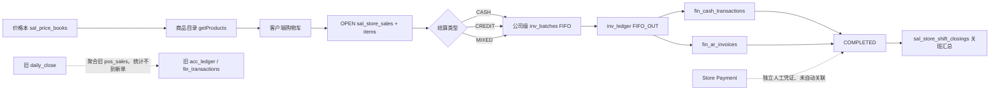
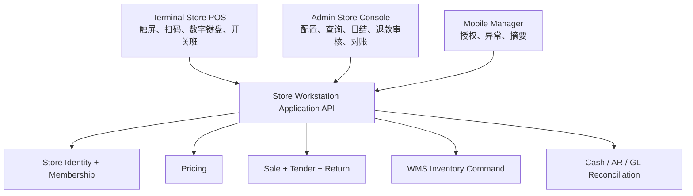
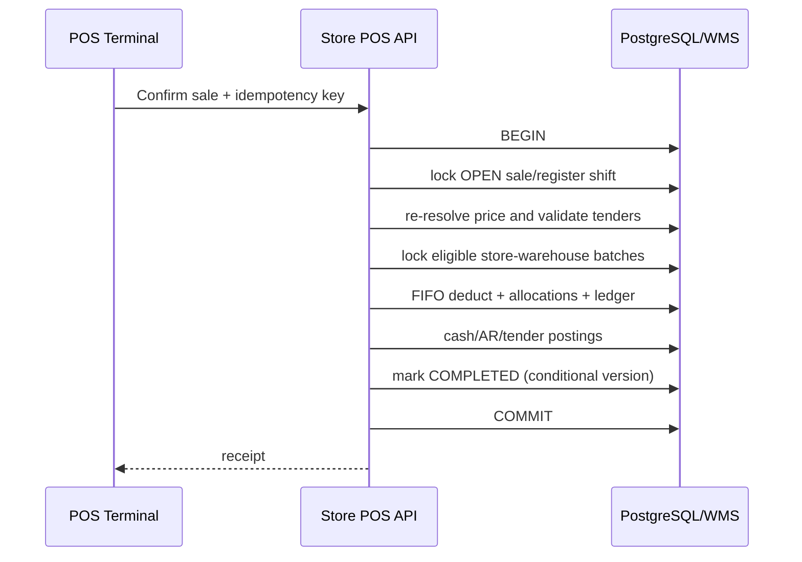
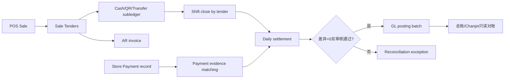

# 直营店收银 / 门店工作台历史设计考古、现状分析与 V1 提案

> 日期：2026-08-27
>
> 性质：纯调研、零实施
>
> 取证范围：前端三端路由、后端 Store / Store POS / Store Payment / WMS、迁移与 DDL、`docs/`、Git 历史
>
> 生产边界：本轮未连接生产、未执行生产命令、未写生产；生产运营量仅给出只读取证口径，不伪造实况

## 0. 结论先行

项目历史上可以区分出 **4 种设计方案/形态**，不是 4 个都完整上线的产品版本：

1. **旧门店管理工作台 + V2 POS/日结**（2026-05-15 起）：`/store/*` 是 Generic CRUD 工作台，旧 POS 写 `pos_sales`，旧日结聚合 `pos_sales` 并写 `daily_close / acc_ledger / fin_transactions`。当前门店 CRUD 壳仍在，旧 POS 已从模块注销，旧日结代码仍注册，是半废弃兼容链。
2. **Sales V2 直营店 POS**（2026-05-29 起）：`/store-pos` + `/api/v2/store-sales`，使用 `sal_store_sales` 表族，支持价格本、开关班、现金/赊销/混合支付、FIFO、AR、整单退货。它是**当前采用的主收银方案和唯一活跃 POS 入口**。
3. **统一公司收款码 / Store Payment MVP**（2026-06-21 起）：独立 `/store-payment` 域，解决个人收款码、付款截图、人工确认和审计；并非 POS 支付腿，也不自动入财务账。代码已落地，但裁定始终是受控试点 `GO WITH CONDITIONS`，生产 readiness 为 HOLD。
4. **门店分账库存设置**：`/settings/store-stock` 宣称 Retail/Wholesale 双库存池，但仅有前端设置壳，未发现正式 Boolean schema、库存路由或扣减实现；属于**提出/展示过但未形成运行方案**。

当前没有一个“更完善且已存在、可直接启用的 V1”。最接近的底座是 Sales V2 POS，但它还不是合格的多门店生产 V1：权限、门店仓、库存原子性、价格权威、多支付、日结与总账对账均未收口。因此本文提出的“门店工作台 V1”是基于既有资产的**增量目标方案**，不是伪称历史上已有的版本。

推荐形态：**独立 Terminal 触屏收银体验 + Admin 管理/审核后台 + Mobile 只做店长审批和异常提醒**；共用一套 Store POS Application API，不复制业务规则。

---

## 1. 取证方法与证据等级

- A 级：当前源码、当前迁移/DDL、当前路由与权限种子。
- B 级：专项架构/治理报告及已记录的生产只读证据。
- C 级：Git commit 的引入时间、diff 和提交说明。
- “当前采用”以 A 级为准；早期文档的 HOLD/未 wiring 若已被后续源码和 commit 覆盖，不作为当前状态。
- `docs/ops/runs/` 中大量 Store Payment Agent 编排产物属于同一 REQ 的过程记录，不按独立业务方案重复计数。

## 2. 前端入口与角色 / 菜单考古

### 2.1 Admin 端

| 路由 | 菜单 / 角色入口 | 当前功能 | 判断 |
|---|---|---|---|
| `/store-pos` | `MENU_STORE_POS`；登录后 `ROLE_CASHIER` 跳此；Cashier 通常 V/C/E，Store Manager 另有 D/A | 商品、购物车、建单、现金/赊销/混合收款、开关班、当日汇总、历史、作废、整单退货 | 当前主 POS，但页面仍固定试点公司/门店常量 |
| `/store` | `MENU_STORE_MGR`；`ROLE_STORE_MGR` 登录后跳此 | 今日销售/单量/待收货/近效期 KPI 与五个快捷入口 | 工作台导航壳，KPI/子页未形成统一应用层 |
| `/store/receiving` | `MENU_STORE_MGR` | `store_receiving` CRUD：补货收货验收 | Generic CRUD 单表操作，不是 WMS 收货流程 |
| `/store/replenish` | `MENU_STORE_MGR` | `store_replenish_req` CRUD | 状态字段存在，但无专用领域状态机证据 |
| `/store/losses` | `MENU_STORE_MGR` | `store_losses` CRUD | 原因硬编码，未走字典/统一 WMS 损耗动作 |
| `/store/inventory` | `MENU_STORE_MGR` | `store_inventory` 快照 CRUD | 可人工改库存快照，不是唯一库存台账 |
| `/store/daily` | `MENU_STORE_MGR` | `daily_close` CRUD | 与新 POS 的班次日结不是同一链 |
| `/store-payment` | `MENU_STORE_PAYMENT*` 五个细分菜单 | 收款账户、付款登记、凭证、确认/驳回/作废；导出禁用 | 独立人工收款确认域，不是 POS 支付编排 |
| `/settings/store-stock` | 设置菜单体系 | `mst_stores.split_stock_enabled` 开关，UI 宣称零售/批发分池 | UI 壳，未落地库存模型 |
| `/master-data/stores`、`/master/stores` | 主数据菜单体系 | 门店运行时/兼容 `mst_stores` 档案 | 门店身份目前仍双轨 |

关键证据：

- 路由与快捷入口：[store/page.tsx](<../../apps/web/src/app/(admin)/store/page.tsx>)、[store-pos/page.tsx](<../../apps/web/src/app/(admin)/store-pos/page.tsx>)、[store-payment/page.tsx](<../../apps/web/src/app/(admin)/store-payment/page.tsx>)。
- Sidebar 映射：[Sidebar.tsx](../../apps/web/src/components/layout/Sidebar.tsx) 154–172 行。
- 登录角色跳转：[login/page.tsx](../../apps/web/src/app/login/page.tsx) 188–201 行。
- Generic CRUD 对 `store_*` 的菜单映射与 `store_code` 注入：[generic-crud.controller.ts](../../apps/api/src/modules/generic-crud/generic-crud.controller.ts) 291–296、396–495 行。

### 2.2 Terminal 端

Terminal 已有适合触屏作业的基建：全屏 kiosk、无 Admin Sidebar、权限瓦片、数字键盘、班次/上下文、本地草稿；当前覆盖包装和 WMS，配送瓦片标为未就绪。**没有门店 POS / Cashier 路由或门店角色首页**。

现有可复用资产：

- 全屏与登录保护：[terminal/layout.tsx](<../../apps/web/src/app/(terminal)/layout.tsx>)。
- 权限瓦片：[terminal/home/page.tsx](<../../apps/web/src/app/(terminal)/terminal/home/page.tsx>)。
- 终端上下文与 localStorage：[useTerminalContext.ts](../../apps/web/src/hooks/useTerminalContext.ts)。
- 包装的开班→作业→异常→关班流程证明该端适合固定工位，而非证明门店 POS 已实现。

### 2.3 Mobile 端

Mobile 有登录、角色导航、审批、通知、农场销售、配送等能力，且有断网提示；**没有门店 POS、Cashier 收银、门店开关班或门店库存工作台**。`/mobile/sales` 是农场直销，不应误计为直营门店 POS。

建议 Mobile V1 只承担店长授权改价、退货/日结审批、异常提醒和只读摘要；不把连续扫码、购物车和收款主流程塞进手机页。

## 3. 后端域与数据模型考古

### 3.1 当前主 POS：StorePosModule

统一前缀 `/api/v2/store-sales`，Controller 挂 `MenuGuard + DataScopeGuard`：

| 能力 | API | 权限 |
|---|---|---|
| 商品目录 | `GET /products` | `MENU_STORE_POS:V` |
| 当日摘要 | `GET /daily-summary` | V |
| 当前班次/历史 | `GET /shift`, `GET /shift/history` | V |
| 开班/关班 | `POST /shift/open`, `POST /shift/close` | C |
| 销售列表/详情 | `GET /`, `GET /:id` | V |
| 建单 | `POST /` | C |
| 现金/赊销/混合 | `POST /:id/pay-*` | E |
| 作废/整单退货 | `POST /:id/void`, `POST /:id/return` | D |

证据：[store-pos.controller.ts](../../apps/api/src/modules/store-pos/controllers/store-pos.controller.ts) 36–210 行。

表族：

- `sal_store_sales`：销售主单、金额、币种、支付状态、现金账户/AR/班次引用、退货字段。
- `sal_store_sale_items`：商品/SKU、等级、规格、数量、单价、金额、首批次号。
- `sal_store_shift_closings`：开关班、系统现金、实盘现金、差异、销售汇总。
- 初始 DDL 在 [27_store_pos_tables.sql](../../apps/api/ddl/27_store_pos_tables.sql)，后续 SKU、币种、退货字段由其他迁移追加，因此该 DDL 不是最终 schema 单一真源。

### 3.2 旧 Store 域

旧 `/api/v3/pos` 已在 [store.module.ts](../../apps/api/src/modules/store/store.module.ts) 注销，注释明确唯一活跃 POS 是 StorePosModule。StoreService 仍保留三条日结形态：

1. ORM `biz_store_daily_close`；
2. V2 fidelity `daily_close`；
3. V2 日结聚合旧 `pos_sales / pos_sale_items`，写 `acc_ledger` 和旧 `fin_transactions`。

这条日结不会统计新 POS 的 `sal_store_sales`。证据：[store.service.ts](../../apps/api/src/modules/store/store.service.ts) 14–53、56–253 行。

### 3.3 Store Payment 域

数据模型：

- `store_payment_accounts`：公司、门店、账户码、支付方式、币种、QR 附件、可选 `fin_cash_account_id`、状态。
- `store_payment_records`：付款号、门店/公司、账户、金额、币种、方式、付款时间、凭证、可选订单/销售单号、PENDING/CONFIRMED/REJECTED/VOIDED、审计字段。

当前链路是“店员登记 → PENDING → 店长/财务确认/驳回 → 可作废 → 审计”。它没有调用 POS、现金流水、AR、总账或 Chanjet；`fin_cash_account_id` 只是弱映射线索。证据：[store-payment.service.ts](../../apps/api/src/modules/store-payment/store-payment.service.ts)、[CreateStorePaymentTables](../../apps/api/src/database/migrations/1782041418112-CreateStorePaymentTables.ts)。

### 3.4 门店库存 / Store Stock

现状有三种互不等价的“库存”表达：

1. POS/Sales V2 走 `inv_batches / inv_ledger`；POS FIFO 只按 `company_code + SKU/product/grade`，不按门店或仓库筛选。
2. WMS 原子库存走 `wms_stock_balance / wms_stock_ledger`，维度含仓、库位、规格、批次和 `store_code`，与 POS FIFO 不是同一服务。
3. `/store/inventory` 直接 CRUD `store_inventory` 快照，`/settings/store-stock` 只写一个未形成正式 schema/逻辑的开关。

因此当前门店不是“每店一个正式虚拟仓”，也不是独立 Store Stock 领域；实际 POS 消耗的是**公司级 `inv_batches` 池**。`store_code` 在销售单上表示归属门店，在 ledger 上是跟随写入的机构标签，但不决定取货批次。

## 4. 历史方案清单与 Git 时间线

| 方案 | 时期 / 关键提交 | 单据流 / 库存 / 收银 / 权限 | 当时裁定 | 当前状态与证据链 |
|---|---|---|---|---|
| A. 旧门店工作台 + V2 POS/日结 | 2026-05-15，`991035ae` initial | `/store/*` CRUD；旧 `pos_sales`；旧 POS 扣 `inv_batches`；`daily_close` 写旧财务表；legacy `store_code` 隔离 | 初始业务基线；后续审计称 POS 接近 Runtime | **半废弃**：CRUD 与 StoreService 仍在，旧 POS Controller 注销；新 POS 不被旧日结统计 |
| B. Sales V2 Store POS | 2026-05-29，`3a176558`；`2d342f30` 引擎解耦；6 月 27–28 日补币种、改价、退货、并发现金 | `sal_store_sales`；价格本；CASH/CREDIT/MIXED；公司级 FIFO；现金/AR；班次 | Pilot Run 1 核心范围；R6 代码层 ready、运营待跑 | **当前在用主方案**：唯一活跃 POS 模块；但固定试点门店及多项 P0 债务未收口 |
| C. Store Payment 统一公司收款码 | 2026-06-21 `69cb7fdb` schema；`13676d2c` API；6 月 23–24 Web/ACL | 独立付款凭证；人工确认；门店/本人范围；不扣库存、不自动财务入账 | REQ 明确 MVP-1 排除自动对账/财务/库存/POS 强绑定；后续 `GO WITH CONDITIONS` | **代码落地、试点未闭环**：生产 readiness HOLD；导出禁用；不是 POS 支付腿 |
| D. Retail/Wholesale 分账库存 | 页面随设置体系出现；未发现对应领域 commit | UI 开关宣称 POS 只扣 Retail、B2B 只扣 Wholesale | 未发现正式 schema gate / 领域裁定 | **展示壳/未落地**：无后端读取、无池维度、无迁移；Generic CRUD 甚至可能动态补 TEXT 列 |

### 4.1 重要历史文档逐项裁定

- [sales-v2-architecture-audit.md](../sales-v2-architecture-audit.md)（2026-05-26）：当时销售域碎片化，旧 `store/pos` 被判为最接近 Runtime；不是对当前新 StorePosModule 的最终验收。
- [sales-v2-architecture.md](../sales-v2-architecture.md)（2026-05-27）：规定 `sal_*`、库存和 Finance V2 边界，为新 POS 抽离提供架构基线。
- [pilot-run-1-execution-plan.md](../pilot-run-1-execution-plan.md)、[launch report](../pilot-run-1-launch-report.md)（2026-05-30）：将直营店 POS、FIFO 与日结列入试运行核心范围，状态 RUNNING；这是试运行裁定，不等同当前生产实况证明。
- [v3-final-readiness-audit.md](../v3-final-readiness-audit.md)：指出旧门店日结仍写 `fin_transactions`，Pilot 可启动但全量上线需清旁路。
- [R6 go-live preparation](../production-runtime-rebuild-phase-r6-go-live-preparation.md)：POS→库存场景代码 ready，但 HTTP 全链和真实运营未跑，不能据此声称生产成熟。
- [REQ_STORE_PAYMENT_UNIFIED_CODE_001_SPEC.md](REQ_STORE_PAYMENT_UNIFIED_CODE_001_SPEC.md)：冻结 MVP-1 为人工收款凭证，明确排除自动到账、自动对账、库存、Chanjet、POS 强绑定和生产部署。
- [Store Payment data model](REQ_STORE_PAYMENT_UNIFIED_CODE_001_DATA_MODEL_DRAFT.md)、[API draft](REQ_STORE_PAYMENT_UNIFIED_CODE_001_API_DRAFT.md)、[permission matrix](REQ_STORE_PAYMENT_UNIFIED_CODE_001_PERMISSION_MATRIX.md)、[state machine](REQ_STORE_PAYMENT_UNIFIED_CODE_001_STATE_MACHINE.md)：分别定义独立账户/记录、细粒度菜单、门店派生范围和四态；早期均为 draft，不应误写成当时已批准实施。
- [Store Payment controlled pilot decision](STORE_PAYMENT_CONTROLLED_PILOT_RELEASE_DECISION.md)、[A7 QA Gate](A7_STORE_PAYMENT_FINAL_QA_GATE_REPORT.md)：后续代码和本地/受控试点准备已推进，但 production 始终 HOLD。
- [warehouse type and permission research](warehouse-type-and-permission-research-20260825.md)：提出 `facility_class × usage_type × capabilities` 双维度，`STORE` 是设施类别草案；当前仍冻结，不能直接复用旧 `type` 硬塞门店。
- [procurement role / xiejiling research](procurement-role-and-xiejiling-conflict-research-20260826.md)：X-B 明确要求 POS 专用门店模型、双读和消费点清零后才退役 `sys_user.store_code`。
- [SKU status mismatch fix](sku-status-mismatch-fix-20260826.md)：明确将 POS `getProducts()` 漏 `sal_price_items.status='ACTIVE'` 留作销售定价专项债务。

## 5. 当前采用方案：完整链路剖析

### 5.1 收银链路



1. **选货/价格**：`getProducts(storeCode, companyCode)` 查询 ACTIVE 且生效中的价格本、正价明细，并返回 floor/ceiling；但 `storeCode` 未参与 SQL，`pi.status='ACTIVE'` 漏滤，且无确定排序便做内存去重，所以“最新价”不可靠。
2. **建单**：客户端提交商品名、商品码和单价；服务重算金额、只校验低于 floor 的店长授权，没有按权威价格结果复验 SKU/价格，客户端仍可伪造高价/商品描述。
3. **收款**：只有 CASH/CREDIT/MIXED 三种业务分支；`paymentMethod` 是单值标签，不是多支付 tender 明细。现金写 `fin_cash_transactions`，赊销写 `fin_ar_invoices`，混合仅是一条现金腿 + 一条 AR 腿。
4. **库存**：同一 DB 事务内调用 FIFO，但 FIFO 以公司为池，不选门店仓；库存不足只 warn，异常 catch 后也继续，随后仍可完成销售。因此“事务包裹”不等于“库存与成交原子成功”。
5. **日结**：新链关班按 `sal_store_sales` 从 `opened_at` 聚合并写 `sal_store_shift_closings`。`MIXED` 的 `paid_amount` 被全部计入 `cash_sales`，即使 payment method 是 QR/转账。
6. **财务**：单笔 POS 已分别写 Cash/AR；关班仅保存运营汇总，不生成可对账的日结凭证。Store Payment 也未自动匹配 POS 或总账。旧 V2 日结虽然写旧财务表，却读旧 `pos_sales`，不能充当新链闭环。

### 5.2 门店库存模型结论

- 门店当前是销售归属/组织兼容身份，不是已建模的正式 WMS 仓。
- 项目长期原则已经明确“仓库 ≠ SITE，FIFO/批次/库位用 `warehouse_code`”；因此不建议另建平行 `store_stock` 作为权威库存。
- `inv_batches` 虽存在 `warehouse_code/location_code/store_code`，当前 POS FIFO 没用仓库条件；`store_code` 也不应继续兼任组织 SITE、门店、数据隔离和库存池。
- `/store/inventory` 可编辑快照与“库存台账唯一性”铁律冲突，应在 V1 中降为只读视图或退役，而非继续扩展。

### 5.3 权限与多店

- `ROLE_CASHIER` 通常持 `MENU_STORE_POS:V/C/E`，`ROLE_STORE_MGR` 持 V/C/E/D/A；登录页只做目的地分流，真正门禁是菜单权限。
- `DataScopeGuard` 只把范围写 CLS，不自动过滤。StorePosService/ShiftService 信任 query/body 的 `storeCode/companyCode`，未读取 allowed store scope；具菜单权限的人可构造跨店请求。
- `sys_user.store_code` 注释允许逗号多店，但 POS 没有授权门店列表或 selector；Generic CRUD 又按整个字符串做等值查询。因此“一 cashier 多店”只是字段兼容设想，不是可用能力。
- Store Payment 已有逗号拆分、别名展开和部分门店范围逻辑，但不应复制到 POS；V1 应统一为显式授权模型。

### 5.4 与近期治理的耦合

1. **仓库分域后**：`wms_warehouses.domain` 已区分 OPERATIONAL / FINANCE_MAPPING / TEST；门店仓必须是 OPERATIONAL。`facility_class=STORE`、`usage_type`、capabilities 仍是草案，V1 需等该 schema 决策或以兼容映射过渡，不修改现有 `type` 语义。
2. **仓权限 A 阶段**：门店 POS 库存仓应采用“所属门店授权 ∩ 显式 WarehouseScope”，零授权 fail-closed，且 FINANCE_MAPPING/TEST 不可进入销售扣减。
3. **X-B store_code 退役**：先引入正式 Store 身份与 Store Membership，POS 双读影子比对；之后停止 JWT legacy 消费，最后才讨论删列。不能在 POS 仍依赖时直接 DROP。

## 6. 已知缺陷与债务清单

### P0：V1 上线前必须清偿

1. **跨店/跨公司范围绕过**：StorePosService 未应用 DataScope，所有门店/公司参数由客户端提供。
2. **支付并发竞态**：支付前事务外读 OPEN，事务内无销售单 `FOR UPDATE` 或条件状态更新，可能重复扣库存、重复写 Cash/AR。
3. **FIFO 失败仍成交**：库存不足仅 warning；任一 FIFO 异常被 catch 吞掉；退货却按整单数量入 QUARANTINE，可能凭空增加库存。
4. **公司级库存池**：POS 未指定门店运营仓，无法证明哪家店出了哪批货。
5. **价格权威缺口**：漏 `sal_price_items.status='ACTIVE'`；storeCode 未用；价格本优先级不确定；建单未复验商品和权威售价。
6. **日结双轨断裂**：新班次读 `sal_store_sales`，旧日结读 `pos_sales`；Admin `/store/daily` 还可直接 CRUD。
7. **支付明细缺失**：无 tender 行表，无法表达现金+QR、双币种、找零、二维码账户、退款分摊。
8. **门店显式授权缺失**：legacy 单值/逗号字符串不是授权模型。

### P1：首轮稳定后清偿

9. 多批次分配只把首批号写回 sale item，缺完整 `sale_item ↔ batch allocation` 追溯。
10. 开班 SELECT 后 INSERT，无“每店唯一 OPEN 班次”约束。
11. 现金超收只在 sale 记录 paidAmount，Cash transaction 仍写 total，找零/实收口径不一致。
12. CREDIT 的客户校验会被默认“散客”绕过；MIXED 也可形成无权威客户的 AR。
13. 关班把 CASH/MIXED 的 `paid_amount` 当现金，支付方式口径错误。
14. Store Payment 与 POS/总账无自动匹配，`fin_cash_account_id` 无强 FK，确认不等于入账。
15. Store Payment 固定单店试点，导出禁用，附件 ACL/metadata 条件下可能不可预览。
16. `/store/*` 多个 CRUD 表是旁路库存/损耗/日结模型，易制造第二真相。
17. 初始 DDL、后续迁移、schema snapshot 对币种/退货等字段末态不一致，需在实施阶段做约束三对齐。

## 7. 门店工作台 V1 目标方案

### 7.1 架构选择



**建议：Terminal 主收银，Admin 管理，Mobile 辅助。**

- Terminal 已有 kiosk、触屏、权限瓦片、数字键盘、班次和 localStorage 草稿基建，最适合连续扫描和高频结账。
- Admin 保留商品/价格、账户、班次历史、日结审核、退货审核、对账和门店库存只读视图。
- Mobile 不复制完整 POS，只做需要离开柜台的店长动作。
- 现有 `/store-pos` 可先作为兼容入口，逐步把页面逻辑抽到共享 Store POS UI/domain hooks；不要求首阶段改路由。

### 7.2 正式门店与门店仓模型

目标实体关系：

```text
Store (正式门店身份，canonical store_id/store_code)
  ├─ StoreMembership (user_id, store_id, role, effective period, status)
  ├─ StoreWarehouseBinding (store_id, warehouse_code, purpose, priority, status)
  ├─ StoreRegister (收银机/终端)
  └─ StoreShift (register_id + cashier + opened/closed)

wms_warehouses
  domain = OPERATIONAL
  facility_class = STORE          # 待双维度治理批准
  usage_type = EGG_SALES/GENERAL  # 按业务用途
  capability 可包含 RETAIL_FULFILLMENT / RETURNS_QUARANTINE
```

选择 **WMS 门店仓**，不建设平行权威 `store_stock`：

- 每家直营店至少绑定一个销售可用 OPERATIONAL 仓；退货可进同仓 QUARANTINE zone，必要时绑定独立退货仓。
- `store_code` 只表达门店业务归属；库存定位始终由 `warehouse_code + zone/location + batch` 表达。
- POS 不直接改余额表，调用统一 WMS inventory command，在同一数据库事务中锁销售单、锁批次、扣减、写 allocation 和 ledger。
- FIFO 顺序维持到期日优先、创建时间次之；库存不足或库存服务异常必须回滚成交，若业务要“先卖后补”必须另建明确 Backorder 单据，不能 warn 后静默完成。

### 7.3 单据与原子性

最小新增/演进模型：

- `store_sales`：沿用 `sal_store_sales`，补 `store_id / warehouse_code / register_id / shift_id / idempotency_key / version`。
- `store_sale_items`：沿用现表；价格来源留 `price_item_id / price_snapshot`。
- `store_sale_tenders`：一单多行，类型 CASH/QR/TRANSFER/CARD/CREDIT，金额、币种、汇率、账户、外部参考、状态。
- `store_sale_allocations`：每个 sale item 对应多个 batch/qty，替代只存首批号。
- `store_returns + items + tender_reversals`：V1 可先整单退货，但数据模型不锁死为整单；库存只按原 allocation 可退数量反向。
- `store_shift_closings`：沿用并补按 tender 的 expected/actual/difference；唯一 OPEN 班次约束需按 register 或 store 的业务裁定。
- `store_daily_settlements`：班次可多次，日结按门店+营业日汇总，生成 immutable settlement 和对账状态。

成交事务：



任何库存、tender 或财务子账失败都回滚；重试依赖 idempotency key 返回同一结果。

### 7.4 价格体系

- 继续使用 `sal_price_books / sal_price_items`，但建立确定的适用规则：company 必选，可选 store/channel/customer group；ACTIVE + 生效期 + currency + priority + version。
- 商品目录与提交结算均由服务端重新解析 price item；销售行保存 `price_item_id` 和不可变价格快照。
- 明确处理同一 SKU 多个有效价格：priority、scope specificity、effective_from、version/id 形成全序；冲突配置在发布价格本时阻断。
- 改价必须记录原价、改后价、原因和授权人；floor/ceiling 都由策略决定，不让客户端凭菜单码自报授权。
- 首个修复即补 `pi.status='ACTIVE'`，但应和完整价格解析一起验收，避免只补一行后仍随机取价。

### 7.5 多支付、挂单、退货与离线

- **多支付**：tender 行金额按结算币种校验合计；现金支持 tendered/change；QR/转账必须绑定 Store Payment Account 或财务现金账户映射；CREDIT 必须有 ACTIVE 客户和额度/账期检查。
- **挂单**：OPEN 单可保存/恢复，绑定 register/cashier/store，过期自动标记 ABANDONED；恢复时重新校验价格和库存，不预占或明确用 reservation。
- **退货**：按原单、原行、原 allocation 和原 tender 反向；退回 QUARANTINE，质检后才能转 AVAILABLE；退款分现金/QR/AR 红冲，不再用整单数量盲目回库。
- **离线评估**：V1 不建议真正离线成交。可离线缓存商品/价格只读和 OPEN 草稿，但支付确认、库存扣减、票号生成必须在线。若老挝网络实测要求离线销售，应单独立项：设备证书、签名事件、离线额度/库存配额、单调序列、冲突仲裁和补传审计，风险高于 V1。

### 7.6 权限模型与 store_code 退役

引入显式 `StoreMembership`，语义对齐仓权限 A 阶段：

- Cashier：按有效 membership 选择门店；可开班/建单/收款，只能操作自己的 register/shift。
- Store Manager：本店改价授权、退货、关班/日结审核；多店店长由多条 membership 表达。
- Finance：按公司/授权门店看 settlement 和 Store Payment 对账，不自动获得 POS 操作权。
- Admin：配置门店、仓、register、支付账户和授权；高权限仍留审计。
- 服务端从认证上下文解析 allowedStoreIds，body 的 `store_id` 必须是其子集；再取 StoreWarehouseBinding 与 allowedWarehouseCodes 交集，空集合 fail-closed。

X-B 路线：

1. 建 Store/StoreMembership/绑定映射并回填；legacy `store_code` 只读兼容。
2. POS 双读（membership 权威、legacy 影子比较）并记录差异，不改变结果。
3. 切换 POS、Store Payment、Generic CRUD 门店页到新范围；保留 feature flag 回旧读。
4. 停止用户 API 写 legacy，token 保留兼容版本；观察无消费者后移除 JWT 字段。
5. schema 删除最后单独决策，绝不与 V1 首发绑在一起。

### 7.7 财务闭环



- Store Payment 不再是孤岛：QR/转账 tender 可引用 account；付款凭证与 POS sale/tender 进行一对一/多对一匹配。
- CONFIRMED 仅表示业务凭证确认，不直接等于 GL posted；日结结算审核后生成幂等 posting batch。
- 对账至少三方：POS tender 合计、收款账户/Store Payment 证据、Cash/AR/GL；差异进入异常队列，不靠修改已确认记录抹平。
- 延续“好业财只读单向”铁律；不得把门店聚合或 Store Payment 塞进 `fin_ar_invoices`。赊销发票仍由 ERP 业务流生成，支付结算走现金/收款/总账链。

## 8. 增量迁移路径

| 阶段 | 目标与主要产物 | 前置条件 | 退出标准 |
|---|---|---|---|
| V1-0 证据与冻结 | 生产只读取证；两套 POS/日结数据量；门店/收银员/班次清单；冻结旁路新增 | 受控只读 workflow | 运营优先级、真实门店码、日结口径、活跃用户均有实值 |
| V1-1 身份与权限 | StoreMembership、StoreWarehouseBinding；POS 服务端 scope；固定门店常量移除 | 门店 canonical 身份、人事授权确认；仓 A 阶段规则 | 五象限权限测试；跨店构造请求 403；零授权 fail-closed |
| V1-2 价格与成交安全 | ACTIVE/确定性定价；服务端价格快照；销售锁/idempotency；库存失败回滚；allocation | 价格本冲突清理；门店仓绑定 | 并发双击只成交一次；不足不成交；每批可追溯 |
| V1-3 Terminal 工作台 | Terminal POS、扫码/键盘、挂单、班次；Admin 保留管理 | V1-1/2 API 稳定；终端硬件/网络基线 | 真实门店 UAT 完成开班→销售→退款→关班 |
| V1-4 Tender / 日结 / 财务 | tender 行、Store Payment 匹配、settlement、差异处理、GL posting | 财务科目/账户映射与审批职责确认 | POS/凭证/现金AR/总账可逐笔或按批勾稽 |
| V1-5 旁路收口 | 旧 `pos_sales`/旧 daily close 只读归档；`/store/*` 库存/日结 CRUD 退役；legacy 双读 | 历史数据映射与回滚演练 | 新写入口唯一；旧数据可查；无双写 |
| V1-6 store_code 退役准备 | 停写、告警观察、移除 JWT 消费；是否 DROP 另案 | X-B 消费矩阵清零 | 无 runtime 读取后再提独立 schema 决策 |

该顺序不推倒重来：保留 `sal_store_sales`、现有页面和 Store Payment 表，优先补权威身份、原子性和对账；旧表先只读，不删除。

## 9. V1 对既有债务的清偿关系

| 债务 | V1 处理 | 是否顺带清偿 |
|---|---|---|
| POS 漏 price item ACTIVE | V1-2 统一价格解析，目录与结算双校验 | 是，且不止补单一过滤 |
| `store_code` 双轨 | V1-1 引入 membership；V1-5/6 双读→停写→移除消费 | 是，但 DROP 不属于 V1 首发 |
| 门店库存不分仓 | StoreWarehouseBinding + OPERATIONAL STORE 仓 + WMS command | 是 |
| Store Stock UI 壳 | 不扩平行池；改为仓库存只读/配置视图 | 是 |
| 新旧日结双轨 | settlement 统一读新 sale/tender；旧链只读归档 | 是 |
| Store Payment 孤岛 | tender/account/settlement 匹配，确认与过账分层 | 是 |
| 多批次追溯缺失 | allocation 表 | 是 |
| 真实离线能力缺失 | V1 明确只离线草稿；全离线另立高风险项目 | 否，主动限界 |

## 10. 生产只读取证建议（本轮未执行）

项目已有安全模式：GitHub production environment → SSH → `PGOPTIONS='-c default_transaction_read_only=on'` → `BEGIN TRANSACTION READ ONLY`。本轮没有专门门店运营 workflow，也未获需要外发/触发生产动作的新增授权，因此未连接生产。

V1-0 建议只输出聚合，不输出个人敏感数据：

1. `sal_store_sales` 按门店、月、状态的单量/金额；旧 `pos_sales` 单独列示，禁止简单相加。
2. 配置活跃 Cashier（ACTIVE user + ROLE_CASHIER）、交易活跃操作者（新旧表分列）、班次活跃操作者三种口径。
3. `sal_store_shift_closings` 每店每日 CLOSED 数、关班时长、sale_count、差异金额；旧 `daily_close` 单列。
4. 每店近 90 天 SKU 销售与 `inv_ledger` FIFO_OUT 的可匹配率、无 allocation 的多批次风险规模。
5. 当前门店码分布：`STORE-* / ST-* / SITE-*-STORE / 其他`，以及用户 legacy 与 canonical 门店映射差异。

没有这些实值前，不能断言 V1 是“最高优先级”或给出门店推广数量；但静态 P0（范围绕过、重复支付、库存失败仍成交）与单据量无关，任何新增生产推广前都应先修。

## 11. 待用户拍板决策项

1. **终端形态**：是否同意“Terminal 主收银 + Admin 管理 + Mobile 审批/摘要”，并保留 `/store-pos` 作为过渡入口？（建议同意）
2. **门店身份权威**：新建正式 Store/StoreMembership，还是将组织 `SITE-*-STORE` 直接作为 store_id？建议 Store 为业务主档、SITE 为组织归属，建立明确映射，避免把组织码继续当业务码。
3. **门店仓**：每店一个 OPERATIONAL 销售仓 + QUARANTINE zone，还是区域共享仓但按 reservation/ownership 分店？建议真实有店存即一店一仓；无店存的展示店才共享配送仓。
4. **仓类型双维度**：是否批准 `facility_class=STORE` 及所需 capability 进入仓库治理下一阶段？未批准前只做绑定表，不篡改现有 `type`。
5. **库存不足策略**：强制阻断（建议）还是正式 Backorder？禁止维持 warn 后完成。
6. **V1 支付范围**：现金、QR/转账、赊销是否足够；是否首发银行卡、双币种与找零？建议首发 tender 多行，但渠道按真实账户配置逐个开放。
7. **日结粒度**：每 register 班次 + 每门店营业日日结（建议），还是只做门店班次？
8. **财务过账 Gate**：由店长关班、财务审核 settlement 后过账，还是差异为零自动过账？建议首期财务审核，稳定后再考虑自动。
9. **退货范围**：首发整单 + 数据模型支持部分退货，还是首发即做部分退货？建议先整单但必须按原 allocation/tender 反向。
10. **离线边界**：是否接受 V1 只支持离线草稿、不支持离线成交？若不接受，需单独预算和风险评审。
11. **旧链处置**：是否批准旧 `/store/daily`、`store_inventory` 等写入口在新链稳定后转只读，而不是继续双写？（建议批准）
12. **生产只读取证**：是否授权新增一次性只读 workflow 获取 V1-0 五类聚合，以确定试点店、真实频率和推广优先级？

## 12. 最终回答用户三个问题

- **历史上有几种设计？** 按业务设计/运行形态去重为 4 种：旧门店工作台/V2 POS，新 Sales V2 POS，独立 Store Payment，未落地的分账库存设置。若只数“可独立成交的 POS 引擎”，则是 2 代（旧 `pos_sales` 与新 `sal_store_sales`）。
- **当前采用哪种？** Sales V2 Store POS 是唯一活跃收银入口；旧 `/store/*` 与日结残留仍在；Store Payment 是并行人工收款凭证，不是当前 POS 支付引擎。
- **是否存在更完善 V1？** 仓库里不存在已完成的更完善 V1；存在足够基建可以增量形成。本文 V1 方案以现有 StorePosModule 为底座，正式引入门店身份/门店仓、多 tender、原子库存、统一 settlement 与三方对账，并给出不推倒重来的迁移路线。
